# bodyLLM internal scan

Archivo: `lib/handlers/messageHandler.ts`
Rango analizado: L6248-L12975
Tamaño estimado: 6728 líneas
Bucket size: 250

> Scan estático readonly. Sirve para mapear densidad interna de `bodyLLM`, no para modificar código.

---

## 1. Buckets internos de bodyLLM

| Rango | Top markers | returns | awaits | decisions | temporal/check markers |
| --- | --- | ---: | ---: | ---: | ---: |
| 6248-6497 | `date/temporal:72`, `structured analyze:52`, `create:27`, `graph/classifier/policy:26`, `state/result:20`, `reservationSlots:20`, `reply builders:16`, `faq/policies/amenities:13` | 7 | 3 | 13 | 25 |
| 6498-6747 | `date/temporal:76`, `create:51`, `reservationSlots:46`, `modify:44`, `availability:27`, `state/result:18`, `graph/classifier/policy:17`, `reply builders:16` | 10 | 9 | 16 | 25 |
| 6748-6997 | `date/temporal:120`, `create:76`, `reservationSlots:52`, `state/result:35`, `modify:22`, `structured analyze:11`, `availability:9`, `graph/classifier/policy:6` | 3 | 4 | 16 | 64 |
| 6998-7247 | `date/temporal:56`, `reservationSlots:43`, `create:42`, `state/result:40`, `modify:27`, `availability:25`, `reply builders:20`, `graph/classifier/policy:18` | 11 | 11 | 19 | 22 |
| 7248-7497 | `modify:89`, `date/temporal:72`, `reservationSlots:29`, `state/result:27`, `create:24`, `reply builders:16`, `email/whatsapp copy:13`, `early return:9` | 9 | 9 | 13 | 12 |
| 7498-7747 | `reservationSlots:84`, `modify:68`, `selected target:58`, `date/temporal:54`, `email/whatsapp copy:40`, `reply builders:26`, `state/result:22`, `snapshot/verify:13` | 7 | 11 | 15 | 20 |
| 7748-7997 | `email/whatsapp copy:105`, `reservationSlots:31`, `date/temporal:31`, `modify:28`, `structured analyze:21`, `state/result:20`, `selected target:17`, `snapshot/verify:15` | 10 | 14 | 16 | 5 |
| 7998-8247 | `cancel:50`, `date/temporal:46`, `modify:42`, `reservationSlots:37`, `reply builders:36`, `canonical state:32`, `snapshot/verify:28`, `selected target:26` | 10 | 11 | 12 | 7 |
| 8248-8497 | `date/temporal:126`, `reservationSlots:67`, `modify:59`, `create:35`, `state/result:27`, `snapshot/verify:20`, `reply builders:18`, `confirm:12` | 9 | 8 | 8 | 36 |
| 8498-8747 | `snapshot/verify:51`, `date/temporal:47`, `reservationSlots:35`, `reply builders:30`, `selected target:27`, `modify:24`, `confirm:17`, `structured analyze:11` | 7 | 10 | 14 | 15 |
| 8748-8997 | `modify:127`, `date/temporal:114`, `reservationSlots:108`, `reply builders:30`, `selected target:29`, `state/result:27`, `email/whatsapp copy:21`, `early return:11` | 11 | 10 | 13 | 32 |
| 8998-9247 | `date/temporal:173`, `modify:131`, `reservationSlots:84`, `state/result:25`, `reply builders:25`, `selected target:14`, `email/whatsapp copy:12`, `early return:9` | 9 | 6 | 12 | 50 |
| 9248-9497 | `modify:87`, `reservationSlots:79`, `date/temporal:71`, `reply builders:40`, `state/result:33`, `create:25`, `early return:18`, `availability:18` | 18 | 8 | 17 | 31 |
| 9498-9747 | `create:109`, `date/temporal:87`, `reservationSlots:39`, `availability:33`, `state/result:18`, `reply builders:18`, `snapshot/verify:16`, `graph/classifier/policy:15` | 9 | 9 | 12 | 25 |
| 9748-9997 | `create:195`, `date/temporal:182`, `reply builders:41`, `reservationSlots:29`, `state/result:19`, `confirm:16`, `early return:14`, `email/whatsapp copy:11` | 14 | 9 | 15 | 45 |
| 9998-10247 | `email/whatsapp copy:156`, `reservationSlots:76`, `date/temporal:40`, `state/result:31`, `early return:14`, `graph/classifier/policy:11`, `snapshot/verify:10`, `create:4` | 13 | 18 | 24 | 18 |
| 10248-10497 | `email/whatsapp copy:188`, `reservationSlots:108`, `state/result:43`, `date/temporal:38`, `snapshot/verify:14`, `early return:9`, `create:9`, `graph/classifier/policy:9` | 9 | 29 | 27 | 17 |
| 10498-10747 | `cancel:116`, `selected target:30`, `confirm:30`, `date/temporal:28`, `reservationSlots:27`, `reply builders:26`, `email/whatsapp copy:21`, `create:20` | 10 | 14 | 10 | 6 |
| 10748-10997 | `date/temporal:57`, `reservationSlots:49`, `modify:44`, `create:42`, `snapshot/verify:35`, `confirm:33`, `state/result:25`, `early return:19` | 19 | 13 | 21 | 14 |
| 10998-11247 | `reservationSlots:93`, `date/temporal:72`, `snapshot/verify:57`, `reply builders:52`, `create:45`, `modify:32`, `state/result:23`, `early return:16` | 16 | 10 | 18 | 24 |
| 11248-11497 | `date/temporal:66`, `reservationSlots:40`, `snapshot/verify:33`, `state/result:24`, `canonical state:21`, `reply builders:20`, `confirm:18`, `graph/classifier/policy:14` | 12 | 7 | 13 | 28 |
| 11498-11747 | `reply builders:38`, `billing:34`, `reservationSlots:25`, `graph/classifier/policy:23`, `state/result:15`, `email/whatsapp copy:14`, `create:13`, `fallback:9` | 6 | 9 | 14 | 6 |
| 11748-11997 | `graph/classifier/policy:53`, `reservationSlots:35`, `fallback:34`, `state/result:29`, `create:26`, `reply builders:24`, `email/whatsapp copy:15`, `date/temporal:12` | 1 | 7 | 13 | 3 |
| 11998-12247 | `date/temporal:137`, `modify:115`, `reservationSlots:54`, `reply builders:24`, `state/result:20`, `email/whatsapp copy:15`, `selected target:13`, `conversationFocus:9` | 5 | 7 | 11 | 22 |
| 12248-12497 | `date/temporal:200`, `create:71`, `reservationSlots:40`, `modify:32`, `confirm:15`, `state/result:14`, `reply builders:13`, `structured analyze:12` | 4 | 4 | 17 | 71 |
| 12498-12747 | `create:103`, `date/temporal:95`, `reservationSlots:64`, `availability:28`, `modify:24`, `state/result:22`, `reply builders:13`, `email/whatsapp copy:12` | 10 | 6 | 27 | 25 |
| 12748-12975 | `create:60`, `reservationSlots:37`, `date/temporal:27`, `snapshot/verify:22`, `reply builders:20`, `modify:19`, `state/result:16`, `graph/classifier/policy:12` | 2 | 9 | 17 | 14 |

---

## 2. Diagrama tentativo por buckets

```mermaid
flowchart TD
  B0["6248-6497<br/>date/temporal<br/>structured analyze<br/>create"]
  B1["6498-6747<br/>date/temporal<br/>create<br/>reservationSlots"]
  B2["6748-6997<br/>date/temporal<br/>create<br/>reservationSlots"]
  B3["6998-7247<br/>date/temporal<br/>reservationSlots<br/>create"]
  B4["7248-7497<br/>modify<br/>date/temporal<br/>reservationSlots"]
  B5["7498-7747<br/>reservationSlots<br/>modify<br/>selected target"]
  B6["7748-7997<br/>email/whatsapp copy<br/>reservationSlots<br/>date/temporal"]
  B7["7998-8247<br/>cancel<br/>date/temporal<br/>modify"]
  B8["8248-8497<br/>date/temporal<br/>reservationSlots<br/>modify"]
  B9["8498-8747<br/>snapshot/verify<br/>date/temporal<br/>reservationSlots"]
  B10["8748-8997<br/>modify<br/>date/temporal<br/>reservationSlots"]
  B11["8998-9247<br/>date/temporal<br/>modify<br/>reservationSlots"]
  B12["9248-9497<br/>modify<br/>reservationSlots<br/>date/temporal"]
  B13["9498-9747<br/>create<br/>date/temporal<br/>reservationSlots"]
  B14["9748-9997<br/>create<br/>date/temporal<br/>reply builders"]
  B15["9998-10247<br/>email/whatsapp copy<br/>reservationSlots<br/>date/temporal"]
  B16["10248-10497<br/>email/whatsapp copy<br/>reservationSlots<br/>state/result"]
  B17["10498-10747<br/>cancel<br/>selected target<br/>confirm"]
  B18["10748-10997<br/>date/temporal<br/>reservationSlots<br/>modify"]
  B19["10998-11247<br/>reservationSlots<br/>date/temporal<br/>snapshot/verify"]
  B20["11248-11497<br/>date/temporal<br/>reservationSlots<br/>snapshot/verify"]
  B21["11498-11747<br/>reply builders<br/>billing<br/>reservationSlots"]
  B22["11748-11997<br/>graph/classifier/policy<br/>reservationSlots<br/>fallback"]
  B23["11998-12247<br/>date/temporal<br/>modify<br/>reservationSlots"]
  B24["12248-12497<br/>date/temporal<br/>create<br/>reservationSlots"]
  B25["12498-12747<br/>create<br/>date/temporal<br/>reservationSlots"]
  B26["12748-12975<br/>create<br/>reservationSlots<br/>date/temporal"]

  B0 --> B1
  B1 --> B2
  B2 --> B3
  B3 --> B4
  B4 --> B5
  B5 --> B6
  B6 --> B7
  B7 --> B8
  B8 --> B9
  B9 --> B10
  B10 --> B11
  B11 --> B12
  B12 --> B13
  B13 --> B14
  B14 --> B15
  B15 --> B16
  B16 --> B17
  B17 --> B18
  B18 --> B19
  B19 --> B20
  B20 --> B21
  B21 --> B22
  B22 --> B23
  B23 --> B24
  B24 --> B25
  B25 --> B26

  classDef darkBox fill:#111111,stroke:#d1d5db,stroke-width:1px,color:#ffffff;
  class B0 darkBox;
  class B1 darkBox;
  class B2 darkBox;
  class B3 darkBox;
  class B4 darkBox;
  class B5 darkBox;
  class B6 darkBox;
  class B7 darkBox;
  class B8 darkBox;
  class B9 darkBox;
  class B10 darkBox;
  class B11 darkBox;
  class B12 darkBox;
  class B13 darkBox;
  class B14 darkBox;
  class B15 darkBox;
  class B16 darkBox;
  class B17 darkBox;
  class B18 darkBox;
  class B19 darkBox;
  class B20 darkBox;
  class B21 darkBox;
  class B22 darkBox;
  class B23 darkBox;
  class B24 darkBox;
  class B25 darkBox;
  class B26 darkBox;
```

---

## 3. Returns por bucket

### 6248-6497

- L6276: `return { finalText, nextCategory, nextSlots, needsSupervision, graphResult: null };`
- L6329: `return { finalText, nextCategory, nextSlots, needsSupervision, graphResult: null };`
- L6389: `return { finalText, nextCategory, nextSlots, needsSupervision, graphResult: null };`
- L6416: `return { finalText, nextCategory, nextSlots, needsSupervision, graphResult: null };`
- L6433: `return {`
- L6444: `return {`
- L6465: `return {`

### 6498-6747

- L6540: `return { finalText, nextCategory, nextSlots, needsSupervision, graphResult: null };`
- L6604: `return {`
- L6612: `return {`
- L6634: `return {`
- L6662: `return {`
- L6674: `return {`
- L6685: `return {`
- L6698: `return {`
- L6724: `return {`
- L6745: `return {`

### 6748-6997

- L6803: `return {`
- L6844: `return {`
- L6871: `return {`

### 6998-7247

- L7001: `return {`
- L7025: `return {`
- L7054: `return {`
- L7073: `return {`
- L7084: `return {`
- L7102: `return {`
- L7116: `return {`
- L7147: `return {`
- L7183: `return {`
- L7214: `return {`
- L7226: `return { finalText, nextCategory: modifyContextActiveFast ? "modify_reservation" : (pre.prevCategory ?? null), nextSlots, needsSupervision, graphResult: null };`

### 7248-7497

- L7259: `return {`
- L7270: `return {`
- L7288: `return {`
- L7301: `return {`
- L7327: `return {`
- L7362: `return { finalText, nextCategory: modifyContextActiveFast ? "modify_reservation" : (pre.prevCategory ?? null), nextSlots, needsSupervision, graphResult: null };`
- L7402: `return {`
- L7438: `return { finalText, nextCategory: "retrieval_based", nextSlots, needsSupervision, graphResult: null };`
- L7491: `return { finalText, nextCategory: "modify_reservation", nextSlots, needsSupervision, graphResult: null };`

### 7498-7747

- L7527: `return { finalText, nextCategory: "modify_reservation", nextSlots: holderGuardSlots, needsSupervision, graphResult: null };`
- L7553: `return { finalText, nextCategory: "reservation", nextSlots, needsSupervision, graphResult: null };`
- L7583: `return {`
- L7591: `return {`
- L7635: `return {`
- L7666: `return {`
- L7716: `return { finalText, nextCategory: "modify_reservation", nextSlots: knownSlots, needsSupervision, graphResult: null };`

### 7748-7997

- L7767: `return { finalText: finalTextWA, nextCategory: 'send_whatsapp_copy', nextSlots: pre.currSlots, needsSupervision: false, graphResult: null };`
- L7776: `return { finalText: failText, nextCategory: 'send_whatsapp_copy', nextSlots: pre.currSlots, needsSupervision: code && code !== 'WA_NOT_READY', graphResult: null };`
- L7786: `return { finalText: askNum, nextCategory: 'send_whatsapp_copy', nextSlots: pre.currSlots, needsSupervision: false, graphResult: null };`
- L7802: `return { finalText, nextCategory: 'send_email_copy', nextSlots, needsSupervision, graphResult };`
- L7811: `return { finalText, nextCategory: 'send_email_copy', nextSlots, needsSupervision, graphResult };`
- L7814: `const toDDMMYYYY = (iso?: string) => { if (!iso) return iso; const m = iso.match(/(\d{4})-(\d{2})-(\d{2})/); return m ? '${m[3]}/${m[2]}/${m[1]}' : iso; };`
- L7857: `return { finalText, nextCategory: 'send_email_copy', nextSlots, needsSupervision, graphResult };`
- L7874: `return { finalText, nextCategory: 'send_email_copy', nextSlots, needsSupervision, graphResult };`
- L7896: `return { finalText, nextCategory: 'send_email_copy', nextSlots, needsSupervision, graphResult };`
- L7905: `return { finalText, nextCategory: 'send_email_copy', nextSlots, needsSupervision, graphResult };`

### 7998-8247

- L8038: `return { finalText, nextCategory: "reservation", nextSlots: canonicalPreviewSlots \|\| {}, needsSupervision, graphResult };`
- L8047: `return { finalText, nextCategory: "modify_reservation", nextSlots, needsSupervision, graphResult };`
- L8082: `return { finalText, nextCategory: "reservation", nextSlots: canonicalPreviewSlots \|\| {}, needsSupervision, graphResult };`
- L8101: `return { finalText, nextCategory: "reservation", nextSlots: canonicalPreviewSlots \|\| {}, needsSupervision, graphResult };`
- L8161: `return { finalText, nextCategory: "cancel_reservation", nextSlots: canonicalCancellationSlots, needsSupervision, graphResult };`
- L8183: `return { finalText, nextCategory: "cancel_reservation", nextSlots: canonicalPreviewSlots \|\| {}, needsSupervision, graphResult };`
- L8220: `return { finalText, nextCategory: "reservation", nextSlots: canonicalPreviewSlots \|\| {}, needsSupervision, graphResult };`
- L8233: `return { finalText, nextCategory: "modify_reservation", nextSlots: updatedPreviewSnapshot, needsSupervision, graphResult };`
- L8236: `return { finalText, nextCategory: "modify_reservation", nextSlots: updatedPreviewSnapshot, needsSupervision, graphResult };`
- L8241: `return { finalText, nextCategory: "modify_reservation", nextSlots: currentPreviewSnapshot, needsSupervision, graphResult };`

### 8248-8497

- L8253: `return { finalText, nextCategory: "modify_reservation", nextSlots: currentPreviewSnapshot, needsSupervision, graphResult };`
- L8257: `return { finalText, nextCategory: "modify_reservation", nextSlots: currentPreviewSnapshot, needsSupervision, graphResult };`
- L8270: `return { finalText, nextCategory: "modify_reservation", nextSlots: currentPreviewSnapshot, needsSupervision, graphResult };`
- L8289: `return {`
- L8334: `return { finalText, nextCategory, nextSlots, needsSupervision, graphResult };`
- L8377: `return { finalText, nextCategory: "modify_reservation", nextSlots, needsSupervision, graphResult };`
- L8396: `return { finalText, nextCategory, nextSlots, needsSupervision, graphResult };`
- L8468: `return { finalText, nextCategory, nextSlots, needsSupervision, graphResult };`
- L8480: `return { finalText, nextCategory, nextSlots, needsSupervision, graphResult };`

### 8498-8747

- L8520: `return { finalText, nextCategory, nextSlots, needsSupervision, graphResult };`
- L8544: `return { finalText, nextCategory, nextSlots, needsSupervision, graphResult };`
- L8553: `return { finalText, nextCategory, nextSlots, needsSupervision, graphResult };`
- L8627: `return { finalText, nextCategory, nextSlots, needsSupervision, graphResult };`
- L8652: `return { finalText, nextCategory, nextSlots, needsSupervision, graphResult };`
- L8700: `return { finalText, nextCategory, nextSlots, needsSupervision, graphResult };`
- L8730: `return { finalText, nextCategory, nextSlots, needsSupervision, graphResult };`

### 8748-8997

- L8749: `return { finalText, nextCategory: "modify_reservation", nextSlots, needsSupervision, graphResult };`
- L8800: `return { finalText, nextCategory: "modify_reservation", nextSlots, needsSupervision, graphResult };`
- L8817: `return { finalText, nextCategory: "modify_reservation", nextSlots, needsSupervision, graphResult };`
- L8841: `return { finalText, nextCategory: "modify_reservation", nextSlots: holderGuardSlots, needsSupervision, graphResult };`
- L8889: `return { finalText, nextCategory: "modify_reservation", nextSlots, needsSupervision, graphResult };`
- L8904: `return { finalText, nextCategory: "modify_reservation", nextSlots, needsSupervision, graphResult };`
- L8922: `return { finalText, nextCategory: "modify_reservation", nextSlots: snapshot, needsSupervision, graphResult };`
- L8927: `return { finalText, nextCategory: "modify_reservation", nextSlots: snapshot, needsSupervision, graphResult };`
- L8940: `return { finalText, nextCategory: "modify_reservation", nextSlots, needsSupervision, graphResult };`
- L8965: `return { finalText, nextCategory: "modify_reservation", nextSlots, needsSupervision, graphResult };`
- L8977: `return { finalText, nextCategory: "modify_reservation", nextSlots, needsSupervision, graphResult };`

### 8998-9247

- L9019: `return { finalText, nextCategory: "modify_reservation", nextSlots, needsSupervision, graphResult };`
- L9150: `return { finalText, nextCategory: "modify_reservation", nextSlots, needsSupervision, graphResult };`
- L9156: `return { finalText, nextCategory: "modify_reservation", nextSlots, needsSupervision, graphResult };`
- L9176: `return { finalText, nextCategory: "modify_reservation", nextSlots, needsSupervision, graphResult };`
- L9207: `return { finalText, nextCategory: "modify_reservation", nextSlots, needsSupervision, graphResult };`
- L9213: `return { finalText, nextCategory: "modify_reservation", nextSlots, needsSupervision, graphResult };`
- L9219: `return { finalText, nextCategory: "modify_reservation", nextSlots, needsSupervision, graphResult };`
- L9225: `return { finalText, nextCategory: "modify_reservation", nextSlots, needsSupervision, graphResult };`
- L9247: `return { finalText, nextCategory: "modify_reservation", nextSlots, needsSupervision, graphResult };`

### 9248-9497

- L9268: `return { finalText, nextCategory: "modify_reservation", nextSlots, needsSupervision, graphResult };`
- L9282: `return { finalText, nextCategory: "modify_reservation", nextSlots, needsSupervision, graphResult };`
- L9286: `return { finalText, nextCategory: "modify_reservation", nextSlots, needsSupervision, graphResult };`
- L9292: `return { finalText, nextCategory: "modify_reservation", nextSlots, needsSupervision, graphResult };`
- L9312: `return { finalText, nextCategory: "modify_reservation", nextSlots, needsSupervision, graphResult };`
- L9326: `return { finalText, nextCategory: "modify_reservation", nextSlots, needsSupervision, graphResult };`
- L9330: `return { finalText, nextCategory: "modify_reservation", nextSlots, needsSupervision, graphResult };`
- L9336: `return { finalText, nextCategory: "modify_reservation", nextSlots, needsSupervision, graphResult };`
- L9341: `return { finalText, nextCategory: "modify_reservation", nextSlots, needsSupervision, graphResult };`
- L9362: `return { finalText, nextCategory: "modify_reservation", nextSlots, needsSupervision, graphResult };`
- L9376: `return { finalText, nextCategory: "modify_reservation", nextSlots, needsSupervision, graphResult };`
- L9382: `return { finalText, nextCategory: "modify_reservation", nextSlots, needsSupervision, graphResult };`
- L9390: `return { finalText, nextCategory: "modify_reservation", nextSlots, needsSupervision, graphResult };`
- L9439: `return { finalText, nextCategory: "reservation", nextSlots, needsSupervision, graphResult };`
- L9447: `return { finalText, nextCategory: "reservation", nextSlots, needsSupervision, graphResult };`
- L9457: `return { finalText, nextCategory: "reservation", nextSlots, needsSupervision, graphResult };`
- L9469: `return {`
- L9483: `return { finalText, nextCategory: "reservation", nextSlots, needsSupervision, graphResult };`

### 9498-9747

- L9518: `return {`
- L9533: `return { finalText, nextCategory: "availability_inquiry", nextSlots, needsSupervision, graphResult };`
- L9557: `return { finalText, nextCategory, nextSlots, needsSupervision, graphResult };`
- L9562: `return {`
- L9617: `return {`
- L9679: `return {`
- L9706: `return {`
- L9720: `return {`
- L9742: `return { finalText, nextCategory: "reservation", nextSlots, needsSupervision, graphResult };`

### 9748-9997

- L9753: `return { finalText, nextCategory: "reservation", nextSlots, needsSupervision: needsSupervision \|\| readyCreateResult.needsHandoff, graphResult };`
- L9769: `return { finalText, nextCategory: "reservation", nextSlots: pausedDraft, needsSupervision, graphResult };`
- L9774: `return { finalText, nextCategory: "reservation", nextSlots, needsSupervision, graphResult };`
- L9783: `return { finalText, nextCategory: "reservation", nextSlots, needsSupervision, graphResult };`
- L9809: `if (!quotedTurnDirectWeekdayMatch) return {} as { checkIn?: string; checkOut?: string };`
- L9812: `if (typeof startWeekday !== "number" \|\| typeof endWeekday !== "number") return {};`
- L9816: `return checkIn && checkOut ? { checkIn, checkOut } : {};`
- L9878: `return {`
- L9892: `return {`
- L9907: `return { finalText, nextCategory: "reservation", nextSlots, needsSupervision, graphResult };`
- L9918: `return {`
- L9945: `return {`
- L9975: `return {`
- L9993: `return {`

### 9998-10247

- L10030: `return { finalText: buildAskGuestName(pre.lang), nextCategory, nextSlots, needsSupervision, graphResult };`
- L10044: `return { finalText, nextCategory: "send_email_copy", nextSlots, needsSupervision, graphResult };`
- L10047: `if (!iso) return iso;`
- L10048: `const m = iso.match(/(\d{4})-(\d{2})-(\d{2})/); return m ? '${m[3]}/${m[2]}/${m[1]}' : iso;`
- L10077: `return { finalText, nextCategory: "send_email_copy", nextSlots, needsSupervision, graphResult };`
- L10094: `return { finalText, nextCategory: 'send_email_copy', nextSlots, needsSupervision, graphResult };`
- L10115: `return { finalText: ask, nextCategory: 'send_email_copy', nextSlots, needsSupervision, graphResult };`
- L10118: `if (!iso) return iso; const m = iso.match(/(\d{4})-(\d{2})-(\d{2})/); return m ? '${m[3]}/${m[2]}/${m[1]}' : iso;`
- L10145: `return { finalText: ok, nextCategory: 'send_email_copy', nextSlots, needsSupervision, graphResult };`
- L10161: `return { finalText: fail, nextCategory: 'send_email_copy', nextSlots, needsSupervision, graphResult };`
- L10220: `return { finalText, nextCategory: 'send_whatsapp_copy', nextSlots, needsSupervision, graphResult };`
- L10232: `return { finalText, nextCategory: 'send_whatsapp_copy', nextSlots, needsSupervision, graphResult };`
- L10241: `return { finalText, nextCategory: 'send_whatsapp_copy', nextSlots, needsSupervision, graphResult };`

### 10248-10497

- L10276: `return { finalText, nextCategory: 'send_whatsapp_copy', nextSlots, needsSupervision, graphResult };`
- L10288: `return { finalText, nextCategory: 'send_whatsapp_copy', nextSlots, needsSupervision, graphResult };`
- L10341: `return { finalText, nextCategory: "send_whatsapp_copy", nextSlots, needsSupervision, graphResult };`
- L10353: `return { finalText, nextCategory: "send_whatsapp_copy", nextSlots, needsSupervision, graphResult };`
- L10363: `return { finalText, nextCategory: "send_whatsapp_copy", nextSlots, needsSupervision, graphResult };`
- L10398: `return { finalText, nextCategory: "send_whatsapp_copy", nextSlots, needsSupervision, graphResult };`
- L10410: `return { finalText, nextCategory: "send_whatsapp_copy", nextSlots, needsSupervision, graphResult };`
- L10455: `return { finalText, nextCategory: "send_whatsapp_copy", nextSlots, needsSupervision, graphResult };`
- L10467: `return { finalText, nextCategory: "send_whatsapp_copy", nextSlots, needsSupervision, graphResult };`

### 10498-10747

- L10540: `return { finalText, nextCategory: "cancel_reservation", nextSlots, needsSupervision, graphResult };`
- L10555: `return { finalText, nextCategory: "cancel_reservation", nextSlots, needsSupervision, graphResult };`
- L10568: `return { finalText, nextCategory: "cancel_reservation", nextSlots, needsSupervision, graphResult };`
- L10613: `return { finalText, nextCategory: "cancel_reservation", nextSlots, needsSupervision, graphResult };`
- L10626: `return { finalText, nextCategory: "cancel_reservation", nextSlots, needsSupervision, graphResult };`
- L10661: `return { finalText, nextCategory: "cancel_reservation", nextSlots: {}, needsSupervision, graphResult };`
- L10666: `return { finalText, nextCategory: "cancel_reservation", nextSlots, needsSupervision, graphResult };`
- L10677: `return { finalText, nextCategory: "cancel_reservation", nextSlots, needsSupervision, graphResult };`
- L10689: `return { finalText, nextCategory: "cancel_reservation", nextSlots, needsSupervision, graphResult };`
- L10709: `return { finalText, nextCategory: "cancel_reservation", nextSlots, needsSupervision, graphResult };`

### 10748-10997

- L10754: `return { finalText, nextCategory: "cancel_reservation", nextSlots, needsSupervision, graphResult };`
- L10767: `return { finalText, nextCategory: "cancel_reservation", nextSlots, needsSupervision, graphResult };`
- L10794: `return { finalText, nextCategory, nextSlots, needsSupervision, graphResult };`
- L10802: `return { finalText, nextCategory, nextSlots, needsSupervision, graphResult };`
- L10814: `return {`
- L10832: `return { finalText, nextCategory: "reservation", nextSlots, needsSupervision, graphResult };`
- L10847: `return { finalText, nextCategory: "reservation", nextSlots, needsSupervision, graphResult };`
- L10859: `return { finalText, nextCategory: "reservation", nextSlots, needsSupervision, graphResult };`
- L10865: `return { finalText, nextCategory, nextSlots, needsSupervision, graphResult };`
- L10868: `return { finalText, nextCategory, nextSlots, needsSupervision, graphResult };`
- L10888: `return { finalText, nextCategory, nextSlots, needsSupervision, graphResult };`
- L10904: `return { finalText, nextCategory: "modify_reservation", nextSlots, needsSupervision, graphResult };`
- L10939: `return { finalText, nextCategory: "modify_reservation", nextSlots, needsSupervision, graphResult };`
- L10952: `return { finalText, nextCategory: "modify_reservation", nextSlots: updatedPreviewSnapshot, needsSupervision, graphResult };`
- L10955: `return { finalText, nextCategory: "modify_reservation", nextSlots: updatedPreviewSnapshot, needsSupervision, graphResult };`
- L10960: `return { finalText, nextCategory: "modify_reservation", nextSlots: currentPreviewSnapshot, needsSupervision, graphResult };`
- L10972: `return { finalText, nextCategory: "modify_reservation", nextSlots: currentPreviewSnapshot, needsSupervision, graphResult };`
- L10976: `return { finalText, nextCategory: "modify_reservation", nextSlots: currentPreviewSnapshot, needsSupervision, graphResult };`
- L10989: `return { finalText, nextCategory: "modify_reservation", nextSlots: currentPreviewSnapshot, needsSupervision, graphResult };`

### 10998-11247

- L11030: `return { finalText, nextCategory: "reservation", nextSlots, needsSupervision, graphResult };`
- L11037: `return { finalText, nextCategory: "reservation", nextSlots, needsSupervision, graphResult };`
- L11060: `return { finalText, nextCategory: "reservation", nextSlots, needsSupervision, graphResult };`
- L11065: `return { finalText, nextCategory: "modify_reservation", nextSlots, needsSupervision, graphResult };`
- L11068: `return { finalText, nextCategory: "modify_reservation", nextSlots, needsSupervision, graphResult };`
- L11074: `return { finalText, nextCategory: "modify_reservation", nextSlots, needsSupervision, graphResult };`
- L11079: `return { finalText, nextCategory: "modify_reservation", nextSlots, needsSupervision, graphResult };`
- L11084: `return { finalText, nextCategory: "modify_reservation", nextSlots, needsSupervision, graphResult };`
- L11108: `return { finalText, nextCategory: "modify_reservation", nextSlots: snapshot, needsSupervision, graphResult };`
- L11112: `return { finalText, nextCategory: "modify_reservation", nextSlots: snapshot, needsSupervision, graphResult };`
- L11125: `return { finalText, nextCategory: "modify_reservation", nextSlots, needsSupervision, graphResult };`
- L11137: `return {`
- L11150: `return { finalText, nextCategory: "reservation", nextSlots, needsSupervision, graphResult };`
- L11155: `return { finalText, nextCategory: "reservation", nextSlots, needsSupervision, graphResult };`
- L11160: `return { finalText, nextCategory: "reservation", nextSlots, needsSupervision, graphResult };`
- L11242: `return {`

### 11248-11497

- L11256: `return { finalText, nextCategory: "reservation", nextSlots, needsSupervision, graphResult };`
- L11267: `return toBodyLLMResult(state);`
- L11318: `return { finalText, nextCategory, nextSlots, needsSupervision, graphResult: null, rich: undefined };`
- L11343: `return { finalText, nextCategory, nextSlots, needsSupervision, graphResult: null, rich: undefined };`
- L11359: `return { finalText, nextCategory, nextSlots, needsSupervision, graphResult: null, rich: undefined };`
- L11369: `return { finalText, nextCategory, nextSlots, needsSupervision, graphResult: null, rich: undefined };`
- L11378: `return { finalText, nextCategory, nextSlots, needsSupervision, graphResult: null, rich: undefined };`
- L11436: `return { finalText, nextCategory, nextSlots, needsSupervision, graphResult: null, rich: undefined };`
- L11441: `return { finalText, nextCategory, nextSlots, needsSupervision, graphResult: null, rich: undefined };`
- L11451: `return { finalText, nextCategory, nextSlots, needsSupervision, graphResult: null, rich: undefined };`
- L11471: `return { finalText, nextCategory, nextSlots, needsSupervision, graphResult: null, rich: undefined };`
- L11479: `return { finalText, nextCategory, nextSlots, needsSupervision, graphResult: null, rich: undefined };`

### 11498-11747

- L11498: `return keys.some((k) => hay.includes(k));`
- L11597: `return { finalText, nextCategory, nextSlots, needsSupervision, graphResult };`
- L11622: `return { finalText, nextCategory, nextSlots, needsSupervision, graphResult };`
- L11658: `return { finalText, nextCategory, nextSlots, needsSupervision, graphResult, rich: explicitRich };`
- L11680: `debugLog("[KB] fastpath return", { ok: kb.ok, safeCat, hasText: Boolean(text) });`
- L11732: `return { finalText, nextCategory, nextSlots, needsSupervision, graphResult };`

### 11748-11997

- L11760: `return { finalText, nextCategory, nextSlots, needsSupervision, graphResult };`

### 11998-12247

- L12083: `return { finalText, nextCategory: "modify_reservation", nextSlots, needsSupervision, graphResult };`
- L12123: `return { finalText, nextCategory: "modify_reservation", nextSlots, needsSupervision, graphResult };`
- L12135: `return { finalText, nextCategory: "modify_reservation", nextSlots, needsSupervision, graphResult };`
- L12156: `return { finalText, nextCategory: "modify_reservation", nextSlots, needsSupervision, graphResult };`
- L12182: `return { finalText, nextCategory: "modify_reservation", nextSlots, needsSupervision, graphResult };`

### 12248-12497

- L12352: `return { finalText, nextCategory, nextSlots, needsSupervision, graphResult };`
- L12361: `return { finalText, nextCategory, nextSlots, needsSupervision, graphResult };`
- L12387: `return { finalText, nextCategory, nextSlots, needsSupervision, graphResult };`
- L12395: `return { finalText, nextCategory, nextSlots, needsSupervision, graphResult };`

### 12498-12747

- L12510: `if (!iso) return iso \|\| '';`
- L12512: `return m ? '${m[3]}/${m[2]}/${m[1]}' : iso;`
- L12551: `const [dd, mm, yyyy] = d.split(/[\/\-]/); return '${yyyy}-${mm}-${dd}';`
- L12602: `return {`
- L12616: `return { finalText, nextCategory: "reservation", nextSlots, needsSupervision, graphResult };`
- L12625: `return { finalText, nextCategory: "reservation", nextSlots, needsSupervision, graphResult };`
- L12636: `return { finalText, nextCategory: "modify_reservation", nextSlots, needsSupervision, graphResult };`
- L12693: `return {`
- L12728: `return {`
- L12742: `return { finalText, nextCategory: "reservation", nextSlots, needsSupervision, graphResult };`

### 12748-12975

- L12749: `return { finalText, nextCategory: "reservation", nextSlots, needsSupervision, graphResult };`
- L12974: `return { finalText, nextCategory, nextSlots, needsSupervision, graphResult, rich };`

---

## 4. Awaits por bucket

### 6248-6497

- L6280: `const stableIntent = await runStableIntentsGuard({`
- L6368: `await updateConversationState(pre.msg.hotelId, pre.conversationId, {`
- L6399: `const hotel = await getHotelConfigSafe(pre.msg.hotelId);`

### 6498-6747

- L6594: `await updateConversationState(pre.msg.hotelId, pre.conversationId, {`
- L6613: `finalText: await persistModifyPreviewContext(pre, resolvedModifyTarget0, snapshot),`
- L6622: `await persistAvailabilityInquiry(pre, fastPathSlots);`
- L6642: `const availabilityResult = await runAvailabilityCheck(availabilityPre, fastPathSlots, dr0.checkIn, dr0.checkOut, {`
- L6651: `await persistAvailabilityInquiry(pre, nextSlots);`
- L6673: `await persistCreateDraftSnapshot(pre, createDraftConsistency.sanitizedSlots);`
- L6684: `await persistCreateDraft(pre, fastPathSlots);`
- L6697: `const previewResult = await buildModifyDatesPreviewWithAvailability(pre, previewTarget, fastPathSlots);`
- L6715: `await updateConversationState(pre.msg.hotelId, pre.conversationId, {`

### 6748-6997

- L6753: `const supportedDrFastRaw = await extractSupportedTemporalDateRange(userTxtFast, pre.lang);`
- L6802: `await persistCreateDraftSnapshot(pre, createDraftConsistency.sanitizedSlots);`
- L6815: `draftInitialization = await initializeCreateDraftIfLatest(`
- L6852: `const readyCreateResult = await finalizeDeterministicCreateProposal({`

### 6998-7247

- L7000: `await persistCreateDraftSnapshot(pre, sanitizedCreateSlots);`
- L7013: `await persistAvailabilityInquiry(pre, normalizedFastPathSlots);`
- L7034: `const availabilityResult = await runAvailabilityCheck(availabilityPre, fastPathSlots, ciISO, coISO, {`
- L7043: `await persistAvailabilityInquiry(pre, nextSlots);`
- L7072: `await persistCreateDraftSnapshot(pre, createDraftConsistency.sanitizedSlots);`
- L7082: `await persistCreateDraft(pre, normalizedFastPathSlots);`
- L7093: `const readyCreateResult = await finalizeDeterministicCreateProposal({`
- L7115: `const previewResult = await buildModifyDatesPreviewWithAvailability(pre, previewTarget, fastPathSlots);`
- L7133: `await updateConversationState(pre.msg.hotelId, pre.conversationId, {`
- L7167: `await updateConversationState(pre.msg.hotelId, pre.conversationId, {`
- L7212: `await persistCreateDraftSnapshot(pre, sanitizedCreateSlots);`

### 7248-7497

- L7258: `await persistCreateDraftSnapshot(pre, createDraftConsistency.sanitizedSlots);`
- L7269: `await persistCreateDraft(pre, fastPathSlots);`
- L7279: `const readyCreateResult = await finalizeDeterministicCreateProposal({`
- L7300: `const previewResult = await buildModifyDatesPreviewWithAvailability(pre, previewTarget, fastPathSlots);`
- L7318: `await updateConversationState(pre.msg.hotelId, pre.conversationId, {`
- L7339: `await updateConversationState(pre.msg.hotelId, pre.conversationId, {`
- L7389: `await updateConversationState(pre.msg.hotelId, pre.conversationId, {`
- L7424: `await updateConversationState(pre.msg.hotelId, pre.conversationId, {`
- L7467: `const userDatesFast = await extractSupportedTemporalDateRange(userTxt, pre.lang);`

### 7498-7747

- L7515: `await updateConversationState(pre.msg.hotelId, pre.conversationId, {`
- L7536: `await updateConversationState(pre.msg.hotelId, pre.conversationId, {`
- L7573: `await updateConversationState(pre.msg.hotelId, pre.conversationId, {`
- L7592: `finalText: await persistModifyPreviewContext(pre, resolvedFastReservationTarget, snapshot),`
- L7612: `await updateConversationState(pre.msg.hotelId, pre.conversationId, {`
- L7661: `await persistModifyExecutionContext(pre, resolvedFastReservationTarget.reservationId, {`
- L7714: `await updateConversationState(pre.msg.hotelId, pre.conversationId, modifyMenuPatch as any);`
- L7734: `const { sendReservationCopyWA } = await import('@/lib/whatsapp/sendReservationCopyWA');`
- L7735: `const { isWhatsAppReady } = await import('@/lib/adapters/whatsappBaileysAdapter');`
- L7736: `const { publishSendReservationCopy } = await import('@/lib/whatsapp/dispatch');`
- L7747: `await sendReservationCopyWA({ hotelId: pre.msg.hotelId, toJid: jid, summary, conversationId: pre.conversationId, channel: pre.msg.channel });`

### 7748-7997

- L7749: `const { published, requestId } = await publishSendReservationCopy({ hotelId: pre.msg.hotelId, toJid: jid, conversationId: pre.conversationId, channel: pre.msg.channel, summary });`
- L7752: `const { redis } = await import('@/lib/services/redis');`
- L7755: `const ack = await redis.get('wa:ack:${requestId}');`
- L7757: `await new Promise(r => setTimeout(r, 120));`
- L7796: `await updateConversationState(pre.msg.hotelId, pre.conversationId, { supervised: true, desiredAction: 'notify_reception', updatedBy: 'ai' } as any);`
- L7816: `const { sendReservationCopy } = await import('@/lib/email/sendReservationCopy');`
- L7831: `await sendReservationCopy({ hotelId: pre.msg.hotelId, to: lastEmail, summary, conversationId: pre.conversationId, channel: pre.msg.channel });`
- L7839: `const { classifyEmailError } = await import('@/lib/email/classifyEmailError');`
- L7847: `if (attempt < 2 && !sent) await new Promise(r => setTimeout(r, 150));`
- L7851: `await updateConversationState(pre.msg.hotelId, pre.conversationId, { lastEmailCopyAttempt: { to: lastEmail, failures: 0, updatedAt: new Date().toISOString(), lastErrorType: undefined }, lastCategory: `
- L7860: `const { classifyEmailError } = await import('@/lib/email/classifyEmailError');`
- L7868: `await updateConversationState(pre.msg.hotelId, pre.conversationId, { supervised: true, desiredAction: 'notify_reception', lastEmailCopyAttempt: { to: lastEmail, failures: prevFailures, updatedAt: new `
- L7876: `await updateConversationState(pre.msg.hotelId, pre.conversationId, { lastEmailCopyAttempt: { to: lastEmail, failures: prevFailures, updatedAt: new Date().toISOString(), lastError: rawMsg, lastErrorTyp`
- L7965: `await updateConversationState(pre.msg.hotelId, pre.conversationId, {`

### 7998-8247

- L8021: `await updateConversationState(pre.msg.hotelId, pre.conversationId, {`
- L8041: `await persistModifyExecutionContext(pre, pendingModifyPatchEarly.reservationId, {`
- L8067: `await updateConversationState(pre.msg.hotelId, pre.conversationId, {`
- L8086: `await updateConversationState(pre.msg.hotelId, pre.conversationId, {`
- L8139: `await updateConversationState(pre.msg.hotelId, pre.conversationId, {`
- L8164: `await updateConversationState(pre.msg.hotelId, pre.conversationId, {`
- L8188: `const correctionDates = await extractSupportedTemporalDateRange(userTxtRaw, pre.lang);`
- L8205: `await updateConversationState(pre.msg.hotelId, pre.conversationId, {`
- L8226: `await persistModifyExecutionContext(pre, pendingTarget.reservationId, {`
- L8235: `finalText = await persistModifyPreviewContext(pre, pendingTarget, updatedPreviewSnapshot);`
- L8246: `await persistModifyExecutionContext(pre, pendingTarget.reservationId, {`

### 8248-8497

- L8256: `finalText = await executeModifyReservationWithSnapshot(pre, pendingTarget.reservationId, currentPreviewSnapshot);`
- L8260: `await updateConversationState(pre.msg.hotelId, pre.conversationId, {`
- L8313: `await updateConversationState(pre.msg.hotelId, pre.conversationId, {`
- L8342: `const earlyModifyDates = await extractSupportedTemporalDateRange(userTxtRaw, pre.lang);`
- L8360: `await updateConversationState(pre.msg.hotelId, pre.conversationId, {`
- L8381: `await updateConversationState(pre.msg.hotelId, pre.conversationId, {`
- L8410: `const createDraftTemporalDates = await extractSupportedTemporalDateRange(userTxtRaw, pre.lang);`
- L8495: `await updateConversationState(pre.msg.hotelId, pre.conversationId, {`

### 8498-8747

- L8524: `await updateConversationState(pre.msg.hotelId, pre.conversationId, {`
- L8621: `await updateConversationState(pre.msg.hotelId, pre.conversationId, {`
- L8631: `const reservationListSource = await resolveReservationListSource(pre);`
- L8641: `await updateConversationState(pre.msg.hotelId, pre.conversationId, {`
- L8657: `const reservationListSource = await resolveReservationListSource(pre);`
- L8676: `await updateConversationState(pre.msg.hotelId, pre.conversationId, {`
- L8688: `await updateConversationState(pre.msg.hotelId, pre.conversationId, {`
- L8695: `await updateConversationState(pre.msg.hotelId, pre.conversationId, {`
- L8715: `await updateConversationState(pre.msg.hotelId, pre.conversationId, {`
- L8741: `await updateConversationState(pre.msg.hotelId, pre.conversationId, {`

### 8748-8997

- L8775: `const directModifyUserDates = await extractSupportedTemporalDateRange(userTxtRaw, pre.lang);`
- L8804: `await updateConversationState(pre.msg.hotelId, pre.conversationId, {`
- L8829: `await updateConversationState(pre.msg.hotelId, pre.conversationId, {`
- L8849: `await updateConversationState(pre.msg.hotelId, pre.conversationId, {`
- L8880: `await updateConversationState(pre.msg.hotelId, pre.conversationId, {`
- L8912: `await updateConversationState(pre.msg.hotelId, pre.conversationId, {`
- L8926: `finalText = await persistModifyPreviewContext(pre, target, snapshot);`
- L8930: `await updateConversationState(pre.msg.hotelId, pre.conversationId, {`
- L8953: `await updateConversationState(pre.msg.hotelId, pre.conversationId, {`
- L8987: `await updateConversationState(pre.msg.hotelId, pre.conversationId, {`

### 8998-9247

- L9061: `? await extractSupportedTemporalDateRange(userTxtRaw, pre.lang)`
- L9134: `await updateConversationState(pre.msg.hotelId, pre.conversationId, {`
- L9152: `const previewResult = await buildModifyDatesPreviewWithAvailability(pre, previewTarget, ingestedSlots);`
- L9191: `await updateConversationState(pre.msg.hotelId, pre.conversationId, {`
- L9209: `const previewResult = await buildModifyDatesPreviewWithAvailability(pre, previewTarget, correctedSlots);`
- L9232: `await updateConversationState(pre.msg.hotelId, pre.conversationId, {`

### 9248-9497

- L9257: `await updateConversationState(pre.msg.hotelId, pre.conversationId, {`
- L9284: `finalText = await persistModifyPreviewContext(pre, previewTarget, snapshot);`
- L9301: `await updateConversationState(pre.msg.hotelId, pre.conversationId, {`
- L9328: `finalText = await persistModifyPreviewContext(pre, previewTarget, snapshot);`
- L9351: `await updateConversationState(pre.msg.hotelId, pre.conversationId, {`
- L9378: `const previewResult = await buildModifyDatesPreviewWithAvailability(pre, previewTarget, snapshot);`
- L9412: `await updateConversationState(pre.msg.hotelId, pre.conversationId, {`
- L9459: `const availabilityResult = await finalizeDeterministicCreateProposal({`

### 9498-9747

- L9506: `await persistAvailabilityInquiry(pre, availabilityInquirySlots);`
- L9535: `const availabilityResult = await runAvailabilityCheck(availabilityPre, availabilityInquirySlots, inquiryCheckIn, inquiryCheckOut, {`
- L9544: `await persistAvailabilityInquiry(pre, nextSlots);`
- L9561: `await persistAvailabilityInquiry(pre, availabilityInquirySlots);`
- L9615: `await persistCreateDraftSnapshot(pre, createDraftConsistency.sanitizedSlots);`
- L9665: `await updateConversationState(pre.msg.hotelId, pre.conversationId, {`
- L9698: `const holderQuoteResult = await finalizeDeterministicCreateProposal({`
- L9715: `await persistCreateDraft(pre, updatedHolderSnapshot);`
- L9744: `const readyCreateResult = await finalizeDeterministicCreateProposal({`

### 9748-9997

- L9767: `await persistCreateDraft(pre, pausedDraft);`
- L9818: `const quotedTurnSupportedDates = await extractSupportedTemporalDateRange(trimmedQuotedReply, pre.lang);`
- L9876: `await persistCreateDraftSnapshot(pre, quotedDraftConsistency.sanitizedSlots);`
- L9888: `await persistCreateDraft(pre, quotedDraftConsistency.sanitizedSlots);`
- L9909: `const requoteResult = await finalizeDeterministicCreateProposal({`
- L9927: `await persistCreateDraft(pre, quotedDraftConsistency.sanitizedSlots);`
- L9943: `await persistCreateDraft(pre, createDraftConsistency.sanitizedSlots);`
- L9973: `await persistCreateDraft(pre, createDraftConsistency.sanitizedSlots);`
- L9991: `await persistCreateDraft(pre, createDraftConsistency.sanitizedSlots);`

### 9998-10247

- L10012: `await updateConversationState(pre.msg.hotelId, pre.conversationId, {`
- L10050: `const { sendReservationCopy } = await import("@/lib/email/sendReservationCopy");`
- L10065: `await sendReservationCopy({ hotelId: pre.msg.hotelId, to: email, summary, conversationId: pre.conversationId, channel: pre.msg.channel });`
- L10068: `lastErr = err; attempt++; if (attempt < 2) await new Promise(r => setTimeout(r, 150));`
- L10120: `const { sendReservationCopy } = await import('@/lib/email/sendReservationCopy');`
- L10135: `await sendReservationCopy({ hotelId: pre.msg.hotelId, to: explicitEmail, summary, conversationId: pre.conversationId, channel: pre.msg.channel });`
- L10137: `} catch (err) { lastErr = err; attempt++; if (attempt < 2) await new Promise(r => setTimeout(r, 150)); }`
- L10186: `const { sendReservationCopyWA } = await import('@/lib/whatsapp/sendReservationCopyWA');`
- L10187: `const { isWhatsAppReady } = await import('@/lib/adapters/whatsappBaileysAdapter');`
- L10188: `const { publishSendReservationCopy } = await import('@/lib/whatsapp/dispatch');`
- L10199: `await sendReservationCopyWA({ hotelId: pre.msg.hotelId, toJid: jidInline, summary, conversationId: pre.conversationId, channel: pre.msg.channel });`
- L10201: `const { published, requestId } = await publishSendReservationCopy({ hotelId: pre.msg.hotelId, toJid: jidInline, conversationId: pre.conversationId, channel: pre.msg.channel, summary });`
- L10205: `const { redis } = await import('@/lib/services/redis');`
- L10208: `const ack = await redis.get('wa:ack:${requestId}');`
- L10210: `await new Promise(r => setTimeout(r, 120));`
- L10244: `const { sendReservationCopyWA } = await import('@/lib/whatsapp/sendReservationCopyWA');`
- L10245: `const { isWhatsAppReady } = await import('@/lib/adapters/whatsappBaileysAdapter');`
- L10246: `const { publishSendReservationCopy } = await import('@/lib/whatsapp/dispatch');`

### 10248-10497

- L10257: `await sendReservationCopyWA({ hotelId: pre.msg.hotelId, toJid: jid, summary, conversationId: pre.conversationId, channel: pre.msg.channel });`
- L10259: `const { published, requestId } = await publishSendReservationCopy({ hotelId: pre.msg.hotelId, toJid: jid, conversationId: pre.conversationId, channel: pre.msg.channel, summary });`
- L10262: `const { redis } = await import('@/lib/services/redis');`
- L10265: `const ack = await redis.get('wa:ack:${requestId}');`
- L10267: `await new Promise(r => setTimeout(r, 120));`
- L10308: `const { sendReservationCopyWA } = await import("@/lib/whatsapp/sendReservationCopyWA");`
- L10309: `const { isWhatsAppReady } = await import('@/lib/adapters/whatsappBaileysAdapter');`
- L10310: `const { publishSendReservationCopy } = await import('@/lib/whatsapp/dispatch');`
- L10321: `await sendReservationCopyWA({ hotelId: pre.msg.hotelId, toJid: jidInline, summary, conversationId: pre.conversationId, channel: pre.msg.channel });`
- L10323: `const { published, requestId } = await publishSendReservationCopy({ hotelId: pre.msg.hotelId, toJid: jidInline, conversationId: pre.conversationId, channel: pre.msg.channel, summary });`
- L10326: `const { redis } = await import('@/lib/services/redis');`
- L10329: `const ack = await redis.get('wa:ack:${requestId}');`
- L10331: `await new Promise(r => setTimeout(r, 120));`
- L10366: `const { sendReservationCopyWA } = await import("@/lib/whatsapp/sendReservationCopyWA");`
- L10367: `const { isWhatsAppReady } = await import('@/lib/adapters/whatsappBaileysAdapter');`
- L10368: `const { publishSendReservationCopy } = await import('@/lib/whatsapp/dispatch');`
- L10379: `await sendReservationCopyWA({ hotelId: pre.msg.hotelId, toJid: jid, summary, conversationId: pre.conversationId, channel: pre.msg.channel });`
- L10381: `const { published, requestId } = await publishSendReservationCopy({ hotelId: pre.msg.hotelId, toJid: jid, conversationId: pre.conversationId, channel: pre.msg.channel, summary });`
- L10384: `const { redis } = await import('@/lib/services/redis');`
- L10387: `const ack = await redis.get('wa:ack:${requestId}');`
- L10389: `await new Promise(r => setTimeout(r, 120));`
- L10422: `const { sendReservationCopyWA } = await import("@/lib/whatsapp/sendReservationCopyWA");`
- L10423: `const { isWhatsAppReady } = await import('@/lib/adapters/whatsappBaileysAdapter');`
- L10424: `const { publishSendReservationCopy } = await import('@/lib/whatsapp/dispatch');`
- L10435: `await sendReservationCopyWA({ hotelId: pre.msg.hotelId, toJid: jid, summary, conversationId: pre.conversationId, channel: pre.msg.channel });`

### 10498-10747

- L10532: `await updateConversationState(pre.msg.hotelId, pre.conversationId, {`
- L10542: `await updateConversationState(pre.msg.hotelId, pre.conversationId, {`
- L10560: `await updateConversationState(pre.msg.hotelId, pre.conversationId, {`
- L10571: `const { cancelReservation } = await import("@/lib/agents/reservations");`
- L10572: `const r = await cancelReservation(pre.msg.hotelId, pendingCancellation.reservationId);`
- L10579: `await updateConversationState(pre.msg.hotelId, pre.conversationId, {`
- L10616: `await updateConversationState(pre.msg.hotelId, pre.conversationId, {`
- L10644: `await updateConversationState(pre.msg.hotelId, pre.conversationId, {`
- L10668: `await updateConversationState(pre.msg.hotelId, pre.conversationId, {`
- L10681: `await updateConversationState(pre.msg.hotelId, pre.conversationId, {`
- L10692: `await updateConversationState(pre.msg.hotelId, pre.conversationId, {`
- L10712: `const { cancelReservation } = await import("@/lib/agents/reservations");`
- L10713: `const r = await cancelReservation(pre.msg.hotelId, resolvedCancelCode);`
- L10720: `await updateConversationState(pre.msg.hotelId, pre.conversationId, {`

### 10748-10997

- L10757: `await updateConversationState(pre.msg.hotelId, pre.conversationId, {`
- L10775: `const hotel = await getHotelConfigSafe(pre.msg.hotelId);`
- L10812: `await persistCreateDraft(pre, createDraftSlots);`
- L10850: `await persistCreateDraft(pre, createDraftSlots);`
- L10863: `await persistCreateDraft(pre, createDraftSlots);`
- L10872: `await updateConversationState(pre.msg.hotelId, pre.conversationId, {`
- L10898: `await persistModifyExecutionContext(pre, pendingModifyPatch.reservationId, {`
- L10932: `await persistModifyExecutionContext(pre, pendingTarget.reservationId, {`
- L10945: `await persistModifyExecutionContext(pre, pendingTarget.reservationId, {`
- L10954: `finalText = await persistModifyPreviewContext(pre, pendingTarget, updatedPreviewSnapshot);`
- L10965: `await persistModifyExecutionContext(pre, pendingTarget.reservationId, {`
- L10975: `finalText = await executeModifyReservationWithSnapshot(pre, pendingTarget.reservationId, currentPreviewSnapshot);`
- L10979: `await updateConversationState(pre.msg.hotelId, pre.conversationId, {`

### 10998-11247

- L11021: `await updateConversationState(pre.msg.hotelId, pre.conversationId, {`
- L11039: `await updateConversationState(pre.msg.hotelId, pre.conversationId, {`
- L11097: `await updateConversationState(pre.msg.hotelId, pre.conversationId, {`
- L11111: `finalText = await persistModifyPreviewContext(pre, genericModifyTarget, snapshot);`
- L11115: `await updateConversationState(pre.msg.hotelId, pre.conversationId, {`
- L11135: `await persistCreateDraftSnapshot(pre, createDraftConsistency.sanitizedSlots);`
- L11148: `await persistCreateDraft(pre, snapshot as ReservationSlotsStrict);`
- L11163: `const { confirmAndCreate } = await import("@/lib/agents/reservations");`
- L11164: `const result = await confirmAndCreate(pre.msg.hotelId, snapshot as any, pre.msg.channel);`
- L11197: `await updateConversationState(pre.msg.hotelId, pre.conversationId, {`

### 11248-11497

- L11266: `if (await tryConversationalGuestNameCapture(pre, state)) {`
- L11300: `const reservationListSource = await resolveReservationListSource(pre);`
- L11311: `await updateConversationState(pre.msg.hotelId, pre.conversationId, {`
- L11336: `await updateConversationState(pre.msg.hotelId, pre.conversationId, {`
- L11352: `await updateConversationState(pre.msg.hotelId, pre.conversationId, {`
- L11444: `const hotel = await getHotelConfigSafe(pre.msg.hotelId);`
- L11455: `const hotel = await getHotelConfigSafe(pre.msg.hotelId);`

### 11498-11747

- L11558: `const kbForced = await answerWithKnowledge({`
- L11567: `finalText = await harmonizeBillingCurrencyAnswer(finalText, kbUserText, pre.msg.hotelId, pre.lang);`
- L11573: `finalText = await buildDeterministicBillingReply(pre.msg.hotelId, pre.lang, kbUserText);`
- L11603: `finalText = await buildDeterministicBillingReply(pre.msg.hotelId, pre.lang, kbUserText);`
- L11636: `hasRoomImages: await hotelHasRenderableRoomInventoryVisuals(pre),`
- L11641: `const richResolved = await runKbPrecedenceRichPath(pre, kbPrecedence.promptKey);`
- L11661: `const kb = await answerWithKnowledge({`
- L11709: `await persistCreateLateralCategoryIfNeeded(pre, kbUserText, dominantTurnDomain, nextCategory);`
- L11744: `await persistCreateLateralCategoryIfNeeded(pre, kbUserText, dominantTurnDomain, nextCategory);`

### 11748-11997

- L11777: `graphResult = await withTimeout(`
- L11856: `const rbState = await retrievalBased({`
- L11887: `await tryBodyLLMStructuredEnrichment(pre, state);`
- L11903: `await tryBodyLLMStructuredFallback(pre, state);`
- L11938: `await persistCreateDraft(pre, createGatingSlots);`
- L11950: `await updateConversationState(pre.msg.hotelId, pre.conversationId, {`
- L11982: `await persistCreateLateralCategoryIfNeeded(pre, rawTurnText, dominantTurnDomain, nextCategory);`

### 11998-12247

- L12038: `const temporalUserDates = await extractSupportedTemporalDateRange(userTxt, pre.lang);`
- L12067: `await updateConversationState(pre.msg.hotelId, pre.conversationId, {`
- L12107: `await updateConversationState(pre.msg.hotelId, pre.conversationId, {`
- L12131: `const previewResult = await buildModifyDatesPreviewWithAvailability(pre, previewTarget, ingestedSlots);`
- L12158: `await updateConversationState(pre.msg.hotelId, pre.conversationId, {`
- L12220: `await updateConversationState(pre.msg.hotelId, pre.conversationId, {`
- L12236: `const userDates = await extractSupportedTemporalDateRange(String(pre.msg.content \|\| ""), pre.lang);`

### 12248-12497

- L12354: `const hotel = await getHotelConfigSafe(pre.msg.hotelId);`
- L12369: `const hotel = await getHotelConfigSafe(pre.msg.hotelId);`
- L12426: `await updateConversationState(pre.msg.hotelId, pre.conversationId, {`
- L12459: `const cons = (await import('./pipeline/dateConsolidation')).consolidateDates({`

### 12498-12747

- L12600: `await persistCreateDraftSnapshot(pre, createDraftConsistency.sanitizedSlots);`
- L12614: `await persistCreateDraft(pre, createQuoteSlots);`
- L12646: `const previewResult = await buildModifyDatesPreviewWithAvailability(pre, modifyTarget, modifySnapshot);`
- L12659: `const res = await finalizeDeterministicCreateProposal({`
- L12726: `await persistCreateDraftSnapshot(pre, createDraftConsistency.sanitizedSlots);`
- L12740: `await persistCreateDraft(pre, createQuoteSlots);`

### 12748-12975

- L12752: `const res = await runAvailabilityCheck(availabilityPre, { ...nextSlots }, ciISO, coISO);`
- L12756: `await persistModifyExecutionContext(pre, modifyReservationId, {`
- L12774: `const res = await finalizeDeterministicCreateProposal({`
- L12820: `finalText = await harmonizeBillingCurrencyAnswer(`
- L12865: `await updateConversationState(pre.msg.hotelId, pre.conversationId, {`
- L12887: `await persistCreateDraftSnapshot(pre, createDraftConsistency.sanitizedSlots);`
- L12893: `await persistCreateDraft(pre, quotedReservationSnapshot as ReservationSlotsStrict);`
- L12920: `await updateConversationState(pre.msg.hotelId, pre.conversationId, {`
- L12939: `await tryUpdateAttributedCreateProposalText({`

---

## 5. Decisiones por bucket

### 6248-6497

- L6262: `if (correctedGuestName) {`
- L6304: `if (stableIntent.matched && stableIntent.response && !shouldSuppressStableIntent) {`
- L6314: `if (stableIntent.intentKey === "farewell") {`
- L6346: `if (`
- L6354: `if (continuation) finalText = '${String(finalText \|\| "").trim()} ${continuation}'.trim();`
- L6356: `if (shouldClearSelectedReservationTargetForCategory(nextCategory, null)) {`
- L6367: `if (!shouldPreserveModifyTarget) {`
- L6392: `if (`
- L6419: `if (rawCreateDateIssue) {`
- L6432: `if (!isNonReservationFollowup && rawCreateSubFlow === "create" && rawCreateIntent.kind !== "modify" && rawCreateIntent.kind !== "cancel" && hasExplicitCreateContext) {`
- L6442: `if (dominantTurnDomain.dominant === "pricing" && !dominantTurnDomain.hasReservation) {`
- L6463: `if (vagueWeekendReservationIntent) {`
- L6473: `// Fast-path 0: if the user provides an explicit full date range in the same message, confirm immediately`

### 6498-6747

- L6531: `if (dr0.checkIn && dr0.checkOut && !isEventLikeMessage && !hasCompleteRichCreatePayloadInTurn0) {`
- L6537: `if (dr0Coherence && !dr0Coherence.ok) {`
- L6573: `if (shouldBypassRichCreateFastPath \|\| shouldBypassRichModifyFastPath) {`
- L6577: `if (`
- L6592: `if (!fastModifyValidation.ok) {`
- L6593: `if (fastModifyValidation.nextField) {`
- L6620: `if (availabilityInquiryPolicy0) {`
- L6623: `if (inquiryMissingField) {`
- L6647: `if (!availabilityResult.needsHandoff) {`
- L6670: `if (fastPathSubFlow === "create") {`
- L6672: `if (!createDraftConsistency.valid) {`
- L6683: `if (missingField) {`
- L6694: `if (fastPathSubFlow === "modify") {`
- L6696: `if (previewTarget?.reservationId) {`
- L6714: `if (fastPathSubFlow === "modify") {`
- L6744: `if (ambiguousQuotedProposalConfirmationFast) {`

### 6748-6997

- L6778: `if (fastPathSubFlow === "create" && !explicitTurnSlotsFast.guestName) {`
- L6780: `if (safeLeadGuestName) explicitTurnSlotsFast.guestName = safeLeadGuestName;`
- L6796: `if (currentTurnReadyCreateFast) {`
- L6801: `if (!createDraftConsistency.valid) {`
- L6843: `if (!draftInitialization?.accepted) {`
- L6938: `if (hasOneDateOnly && hasContext && !shouldDeferSingleDateFastPath) {`
- L6939: `if (singleFastISO && reservationContextualMissingSideFast) {`
- L6949: `if (`
- L6957: `if (!normalizedFastPathSlots.numGuests) {`
- L6959: `if (explicitGuestCount) normalizedFastPathSlots.numGuests = explicitGuestCount;`
- L6962: `if (`
- L6974: `if (inheritedCheckOutCoherence && !inheritedCheckOutCoherence.ok) {`
- L6980: `if (`
- L6988: `if (isPastReservationDateISO(coISO) \|\| (checkOutCoherence && !checkOutCoherence.ok)) {`
- L6994: `if (!sanitizedCreateSlots.numGuests) {`
- L6996: `if (explicitGuestCount) sanitizedCreateSlots.numGuests = explicitGuestCount;`

### 6998-7247

- L7011: `if (availabilityInquiryPolicyFast) {`
- L7014: `if (inquiryMissingField) {`
- L7033: `if (ciISO && coISO) {`
- L7039: `if (!availabilityResult.needsHandoff) {`
- L7063: `if (fastPathSubFlow === "create") {`
- L7071: `if (!createDraftConsistency.valid) {`
- L7083: `if (missingField) {`
- L7092: `if (canAutoQuoteCreateFast && isCreateStateReadyForQuote(normalizedFastPathSlots) && ciISO && coISO) {`
- L7111: `if (ciISO && coISO) {`
- L7112: `if (fastPathSubFlow === "modify") {`
- L7114: `if (previewTarget?.reservationId) {`
- L7132: `if (fastPathSubFlow === "modify") {`
- L7156: `if (singleFastISO && fastPathSubFlow === "modify" && fastTemporalSideIntent) {`
- L7192: `if (`
- L7205: `if (`
- L7222: `if (drFast.checkIn && !explicitCheckOutFast && !isConfirmedBooking && isPastReservationCheckInISO(drFast.checkIn)) {`
- L7231: `if (last instanceof HumanMessage) {`
- L7233: `if (lastTxt.trim() === userTxtFast.trim()) hist.pop();`
- L7238: `if (prevISO && currISO) {`

### 7248-7497

- L7249: `if (fastPathSubFlow === "create") {`
- L7257: `if (!createDraftConsistency.valid) {`
- L7268: `if (missingField) {`
- L7278: `if (canAutoQuoteCreateFast) {`
- L7297: `if (fastPathSubFlow === "modify") {`
- L7299: `if (previewTarget?.reservationId) {`
- L7317: `if (fastPathSubFlow === "modify") {`
- L7338: `if (modifyContextActiveFast) {`
- L7368: `if (`
- L7385: `if (hasValueForQueuedField) {`
- L7388: `if (nextQueuedModifyState) {`
- L7423: `if (explicitModifyExitFast) {`
- L7489: `if (genericModify && (resolutionFast.status === "ambiguous" \|\| resolutionFast.status === "out_of_range")) {`

### 7498-7747

- L7501: `if (`
- L7529: `if (`
- L7555: `if (`
- L7571: `if (!fastInlineValidation.ok) {`
- L7572: `if (fastInlineValidation.nextField) {`
- L7599: `if (`
- L7611: `if (activeFieldFast) {`
- L7644: `if (`
- L7683: `if (canOpenModifyMenu) {`
- L7706: `if (resolvedFastReservationTarget?.reservationId) {`
- L7720: `if (pre.prevCategory === 'send_email_copy') {`
- L7724: `if (wantsWhatsApp) {`
- L7727: `if (phoneMatchWA) {`
- L7730: `if (norm.normalized) {`
- L7746: `if (isWhatsAppReady()) {`

### 7748-7997

- L7750: `if (!published) throw Object.assign(new Error('Remote dispatch publish failed'), { code: 'WA_REMOTE_DISPATCH_FAILED' });`
- L7751: `if (requestId) {`
- L7756: `if (ack) break;`
- L7794: `if (wantsEscalate) {`
- L7804: `if (emailInMsg \|\| wantsRetry) {`
- L7805: `if (!lastEmail) {`
- L7814: `const toDDMMYYYY = (iso?: string) => { if (!iso) return iso; const m = iso.match(/(\d{4})-(\d{2})-(\d{2})/); return m ? '${m[3]}/${m[2]}/${m[1]}' : iso; };`
- L7826: `if (summary.checkIn) summary.displayCheckIn = toDDMMYYYY(summary.checkIn);`
- L7827: `if (summary.checkOut) summary.displayCheckOut = toDDMMYYYY(summary.checkOut);`
- L7842: `if (cLoop.isNotConfigured \|\| cLoop.isQuota) {`
- L7847: `if (attempt < 2 && !sent) await new Promise(r => setTimeout(r, 150));`
- L7850: `if (sent) {`
- L7866: `if (prevFailures >= escalationThreshold) {`
- L7877: `if (isNotConfigured) {`
- L7883: `} else if (isQuota) {`
- L7964: `if (looksNonReservationDomainTurn && pre.st?.selectedReservationTarget && !shouldPreserveReservationSelectionForOverride) {`

### 7998-8247

- L8012: `if (awaitingModifyPreviewConfirmationEarly && pendingModifyPatchEarly?.reservationId) {`
- L8020: `if (competingPendingCancellation?.reservationId && competingPendingCancellation.awaitingConfirmation) {`
- L8040: `if (!pendingTarget?.reservationId \|\| pendingTarget.reservationStatus === "cancelled" \|\| pendingTarget.reservationStatus === "error") {`
- L8066: `if (explicitPreviewRejection) {`
- L8085: `if (barePreviewCancellation) {`
- L8104: `if (wantsReservationCancellationFromPreview) {`
- L8127: `if (`
- L8204: `if (previewReject) {`
- L8223: `if (hasPreviewCorrections && !previewConfirm) {`
- L8225: `if (!previewValidation.ok) {`
- L8239: `if (!previewConfirm) {`
- L8245: `if (!previewValidation.ok) {`

### 8248-8497

- L8282: `if (`
- L8297: `if (`
- L8336: `if (`
- L8344: `if (`
- L8380: `if (explicitModifyExit) {`
- L8459: `if (`
- L8470: `if (`
- L8483: `if (`

### 8498-8747

- L8514: `if (`
- L8522: `if (ambiguousReservationAction) {`
- L8523: `if (ambiguousReservationAction === "modify") {`
- L8546: `if (`
- L8590: `if (`
- L8605: `if (targetId && target) {`
- L8630: `if (effectiveSnapshotQueryKind === "list") {`
- L8654: `if (effectiveSnapshotQueryKind && !resolvedSnapshotTarget) {`
- L8656: `if (localConfirmed.length === 0) {`
- L8660: `if (candidates.length === 1) {`
- L8681: `} else if (candidates.length > 1) {`
- L8694: `if (finalText) {`
- L8704: `if (effectiveSnapshotQueryKind && resolvedSnapshotTarget) {`
- L8739: `if (modifyFocusActiveEarly && explicitReservationCode && !explicitIdReservationTarget && !explicitOrdinalReservationTarget) {`

### 8748-8997

- L8793: `if (`
- L8798: `if (!target?.reservationId) {`
- L8802: `if (target.reservationStatus === "cancelled" \|\| target.reservationStatus === "error") {`
- L8819: `if (wantsConfirmedHolderChange) {`
- L8872: `if (!hasImmediateModifyValue && hasExplicitModifyFieldRequest && hasExplicitModifyTarget) {`
- L8879: `if (activeField) {`
- L8892: `if (hasImmediateModifyValue && hasExplicitModifyTarget && target.reservationId && directImmediateModifyFields.length > 0) {`
- L8902: `if (modifyDateCoherence && !modifyDateCoherence.ok) {`
- L8909: `if (nextRoomTypeForCapacity && hasValidGuestCount) {`
- L8911: `if (capacity > 0 && nextGuestCountNumber > capacity) {`
- L8943: `if (!hasImmediateModifyValue && hasTemporalModifySignal) {`
- L8967: `if (!hasImmediateModifyValue) {`
- L8980: `if (`

### 8998-9247

- L9021: `if (`
- L9112: `if (`
- L9148: `if (!previewTarget?.reservationId) {`
- L9159: `if (activeModifyField === "dates" && hasModifyDateCorrection) {`
- L9169: `if (correctedTemporalISO) {`
- L9174: `if (modifyDateCoherence && !modifyDateCoherence.ok) {`
- L9205: `if (!previewTarget?.reservationId) {`
- L9217: `if (!hasTurnLevelModifyValue && !awaitingModifyExecutionContinuation) {`
- L9222: `if (activeModifyField === "guests" && nextGuestCount) {`
- L9223: `if (!codeFromModifySubstate) {`
- L9229: `if (baseRoomType && hasValidGuestCount) {`
- L9231: `if (capacity > 0 && nextGuestCountNumber > capacity) {`

### 9248-9497

- L9251: `if (queuedModifyState) {`
- L9280: `if (!previewTarget?.reservationId) {`
- L9289: `if (activeModifyField === "roomType" && nextRoomType && String(nextRoomType) !== String(pre.st?.reservationSlots?.roomType \|\| "")) {`
- L9290: `if (!codeFromModifySubstate) {`
- L9295: `if (queuedModifyState) {`
- L9324: `if (!previewTarget?.reservationId) {`
- L9333: `if (activeModifyField === "dates" && hasExplicitDateRange && nextCheckIn && nextCheckOut) {`
- L9334: `if (!codeFromModifySubstate) {`
- L9339: `if (modifyDateCoherence && !modifyDateCoherence.ok) {`
- L9344: `if (queuedModifyState) {`
- L9374: `if (!previewTarget?.reservationId) {`
- L9385: `if (awaitingModifyExecutionContinuation) {`
- L9404: `if (additionalReservationIntent && hasConfirmedBookingContext) {`
- L9433: `if (hasCheckIn && !hasCheckOut) {`
- L9441: `if (!hasCheckIn && hasCheckOut) {`
- L9449: `if (hasCheckIn && hasCheckOut) {`
- L9451: `if (missingField) {`

### 9498-9747

- L9503: `if (shouldHandleAvailabilityInquiry) {`
- L9505: `if (inquiryMissingField) {`
- L9529: `if (inquiryCheckIn && inquiryCheckOut) {`
- L9531: `if (inquiryDateCoherence && !inquiryDateCoherence.ok) {`
- L9540: `if (!availabilityResult.needsHandoff) {`
- L9560: `if (availabilityInquiryAmbiguousAdvance) {`
- L9614: `if (!createDraftConsistency.valid) {`
- L9660: `if (draftHolderCorrectionActive) {`
- L9664: `if (!holderCandidate) {`
- L9697: `if (shouldQuoteUpdatedHolder) {`
- L9728: `if (`
- L9740: `if (readyCreateDateCoherence && !readyCreateDateCoherence.ok) {`

### 9748-9997

- L9755: `if (pendingCreateProposal && !modifyExecutionActive) {`
- L9765: `if (quotedReplyIsNegative) {`
- L9772: `if (!strictQuotedConfirmation && quotedReplyHasConfirmWord) {`
- L9777: `if (!strictQuotedConfirmation && quotedReplyIsBareAffirmative) {`
- L9786: `if (!strictQuotedConfirmation) {`
- L9809: `if (!quotedTurnDirectWeekdayMatch) return {} as { checkIn?: string; checkOut?: string };`
- L9812: `if (typeof startWeekday !== "number" \|\| typeof endWeekday !== "number") return {};`
- L9873: `if (hasQuotedProposalCorrection) {`
- L9875: `if (!quotedDraftConsistency.valid) {`
- L9886: `if (!isCreateStateReadyForQuote(quotedDraftConsistency.sanitizedSlots)) {`
- L9903: `if (hasQuotedProposalDateCorrection && requoteCheckIn && requoteCheckOut) {`
- L9905: `if (requoteCoherence && !requoteCoherence.ok) {`
- L9932: `if (`
- L9967: `if (`
- L9983: `if (`

### 9998-10247

- L10001: `if (`
- L10035: `if (emailAskRE.test(userTxtRaw)) {`
- L10038: `if (!email) {`
- L10047: `if (!iso) return iso;`
- L10060: `if (summary.checkIn) summary.displayCheckIn = toDDMMYYYY(summary.checkIn);`
- L10061: `if (summary.checkOut) summary.displayCheckOut = toDDMMYYYY(summary.checkOut);`
- L10068: `lastErr = err; attempt++; if (attempt < 2) await new Promise(r => setTimeout(r, 150));`
- L10071: `if (sentOK) {`
- L10107: `if (!emailAskRE.test(userTxtRaw) && recentReservationMention && lightVerb && (hasEmailAddr \|\| mentionsEmailWord)) {`
- L10109: `if (!explicitEmail) {`
- L10118: `if (!iso) return iso; const m = iso.match(/(\d{4})-(\d{2})-(\d{2})/); return m ? '${m[3]}/${m[2]}/${m[1]}' : iso;`
- L10130: `if (summary.checkIn) summary.displayCheckIn = toDDMMYYYY(summary.checkIn);`
- L10131: `if (summary.checkOut) summary.displayCheckOut = toDDMMYYYY(summary.checkOut);`
- L10137: `} catch (err) { lastErr = err; attempt++; if (attempt < 2) await new Promise(r => setTimeout(r, 150)); }`
- L10139: `if (sentOK) {`
- L10173: `if (!waAskRE.test(userTxtRaw) && waLightAskRE.test(userTxtRaw) && (pre.st?.lastReservation \|\| recentReservationMention)) {`
- L10178: `if (!jid) {`
- L10180: `if (phoneInline) {`
- L10182: `if (attempt.normalized) {`
- L10198: `if (isWhatsAppReady()) {`
- L10202: `if (!published) throw Object.assign(new Error('Remote dispatch publish failed'), { code: 'WA_REMOTE_DISPATCH_FAILED' });`
- L10204: `if (requestId) {`
- L10209: `if (ack) break;`
- L10224: `if (code !== 'WA_NOT_READY') {`

### 10248-10497

- L10256: `if (isWhatsAppReady()) {`
- L10260: `if (!published) throw Object.assign(new Error('Remote dispatch publish failed'), { code: 'WA_REMOTE_DISPATCH_FAILED' });`
- L10261: `if (requestId) {`
- L10266: `if (ack) break;`
- L10280: `if (code !== 'WA_NOT_READY') {`
- L10293: `if (waAskRE.test(userTxtRaw)) {`
- L10299: `if (!jid) {`
- L10302: `if (phoneInline) {`
- L10304: `if (attempt.normalized) {`
- L10320: `if (isWhatsAppReady()) {`
- L10324: `if (!published) throw Object.assign(new Error('Remote dispatch publish failed'), { code: 'WA_REMOTE_DISPATCH_FAILED' });`
- L10325: `if (requestId) {`
- L10330: `if (ack) break;`
- L10345: `if (code !== 'WA_NOT_READY') {`
- L10378: `if (isWhatsAppReady()) {`
- L10382: `if (!published) throw Object.assign(new Error('Remote dispatch publish failed'), { code: 'WA_REMOTE_DISPATCH_FAILED' });`
- L10383: `if (requestId) {`
- L10388: `if (ack) break;`
- L10402: `if (code !== 'WA_NOT_READY') {`
- L10415: `if (pre.prevCategory === "send_whatsapp_copy") {`
- L10417: `if (phoneMatch) {`
- L10419: `if (digits.length >= 6) {`
- L10434: `if (isWhatsAppReady()) {`
- L10438: `if (!published) throw Object.assign(new Error('Remote dispatch publish failed'), { code: 'WA_REMOTE_DISPATCH_FAILED' });`
- L10439: `if (requestId) {`
- L10444: `if (ack) break;`
- L10459: `if (code !== 'WA_NOT_READY') {`

### 10498-10747

- L10529: `if (inCancelFlow && cancelCodeFromUser && !isPureConfirm(userTxtRaw)) {`
- L10531: `if (canonicalCancelTarget && canonicalCancelTarget.canonicalStatus !== "active") {`
- L10557: `if (pendingCancellation?.reservationId && pendingCancellation.awaitingConfirmation && isPureConfirm(userTxtRaw)) {`
- L10559: `if (canonicalCancelTarget && canonicalCancelTarget.canonicalStatus !== "active") {`
- L10629: `if (wantsCancel) {`
- L10630: `if (`
- L10663: `if (!resolvedCancelCode) {`
- L10664: `if (reservationReference.status === "ambiguous" \|\| reservationReference.status === "out_of_range") {`
- L10680: `if (canonicalCancelTarget && canonicalCancelTarget.canonicalStatus !== "active") {`
- L10691: `if (!(isPureConfirm(userTxtRaw) \|\| hasInlineCancelConfirmation)) {`

### 10748-10997

- L10772: `if (offeredTimeSide && isPureAffirmative(userTxtRaw, pre.lang)) {`
- L10778: `if (time && typeof time === "string") {`
- L10805: `if (`
- L10822: `if (`
- L10834: `if (`
- L10840: `if (!isReservationConfirmable && !modifyExecutionActive && !hasCreateQuoteConfirmationContext) {`
- L10841: `if (reservationFlow === "confirmed") {`
- L10846: `: "There is already a confirmed booking on this conversation. Tell me if you want to modify or cancel it.";`
- L10849: `if (activeCreateFlow && nextCreateMissingField) {`
- L10861: `if (!hasGuests) {`
- L10862: `if (activeCreateFlow && pre.msg.channel === "email" && nextCreateMissingField) {`
- L10870: `if (!hasGuestName) {`
- L10871: `if (!modifyExecutionActive) {`
- L10891: `if (modifyExecutionActive) {`
- L10895: `if (awaitingModifyPreviewConfirmation && pendingModifyPatch?.reservationId) {`
- L10897: `if (!pendingTarget?.reservationId \|\| pendingTarget.reservationStatus === "cancelled" \|\| pendingTarget.reservationStatus === "error") {`
- L10931: `if (previewReject) {`
- L10942: `if (hasPreviewCorrections && !previewConfirm) {`
- L10944: `if (!previewValidation.ok) {`
- L10958: `if (!previewConfirm) {`
- L10964: `if (!previewValidation.ok) {`

### 10998-11247

- L11011: `if (`
- L11019: `if (!hasChanges) {`
- L11020: `if (hasDraftHolderCorrectionIntent(userTxtRaw)) {`
- L11062: `if (!codeFromUser) {`
- L11063: `if (reservationReference.status === "ambiguous" \|\| reservationReference.status === "out_of_range") {`
- L11070: `if (!hasChanges) {`
- L11077: `if (modifyDateCoherence && !modifyDateCoherence.ok) {`
- L11082: `if (!genericModifyTarget?.reservationId \|\| genericModifyTarget.reservationStatus === "cancelled" \|\| genericModifyTarget.reservationStatus === "error") {`
- L11095: `if (!genericModifyValidation.ok) {`
- L11096: `if (genericModifyValidation.nextField) {`
- L11128: `if (hasCreateQuoteConfirmationContext) {`
- L11134: `if (!createDraftConsistency.valid) {`
- L11145: `if (!isCreateStateReadyForQuote(snapshot as ReservationSlotsStrict)) {`
- L11147: `if (missingField) {`
- L11153: `if (!snapshot.roomType \|\| !snapshot.checkIn \|\| !snapshot.checkOut) {`
- L11158: `if (createDateCoherence && !createDateCoherence.ok) {`
- L11168: `if (result.ok && hasReservationId && providerReservation) {`
- L11218: `if (canonicalRecordForReply) {`

### 11248-11497

- L11266: `if (await tryConversationalGuestNameCapture(pre, state)) {`
- L11270: `if (!tryBodyLLMTestGreetingFastpath(pre, state)) {`
- L11294: `if (`
- L11303: `if (postBookingSnapshotQ === "list") {`
- L11320: `if (candidates.length === 1) {`
- L11345: `if (candidates.length > 1) {`
- L11362: `if (postBookingSnapshotQ && !hasConfirmedBookingContext) {`
- L11371: `if (`
- L11380: `if (`
- L11386: `if (postBookingSnapshotQ === "list") {`
- L11438: `if (postBookingLateCheckoutQ && hasConfirmedBookingContext) {`
- L11443: `if (postBookingEarlyCheckinQ && hasConfirmedBookingContext) {`
- L11453: `if (postBookingTimeQ && hasConfirmedBookingContext) {`

### 11498-11747

- L11551: `if (wantsNearby) {`
- L11554: `if (looksBillingByRule) {`
- L11565: `if (kbForced.ok && forcedText) {`
- L11572: `if (/(actividad\|actividades\|zona\|lugares para visitar\|restaurants? cercanos\|atracciones)/i.test(finalText)) {`
- L11602: `if (!forcedBillingResolved) {`
- L11625: `if (!hasReservationContext && !wantsNearby && !looksEventIntent && !looksTransactionalPricing) {`
- L11627: `if (skipKbFastpath) {`
- L11640: `if (kbPrecedence?.promptKey === "room_info_img" && !kbPrecedence.defersToRuntimeAction) {`
- L11642: `if (richResolved) {`
- L11678: `if (kb.ok && safeCat && text) {`
- L11693: `if (`
- L11705: `if (continuation) {`
- L11738: `if (pureCreateLateralTurn && !pureCreateLateralKbResolved) {`
- L11740: `if (failsafeReply) {`

### 11748-11997

- L11801: `if (nextCategory === "reservation" && finalText) {`
- L11835: `if (typeof merged.numGuests !== "undefined" && typeof merged.numGuests !== "string") {`
- L11853: `if (noContent && isNearby) {`
- L11869: `if (rbRich) explicitRich = rbRich;`
- L11870: `if (rbText) {`
- L11913: `if (!finalText) {`
- L11915: `if (!(pre as any).__orchestratorActive) {`
- L11937: `if (createFlowActive && createMissingField === "guestName" && nextCategory === "reservation") {`
- L11944: `if (reservationLocalFallbackNeeded) {`
- L11949: `if (Object.keys(fallbackSlots).length > 0) {`
- L11984: `if (pre.inModifyMode) {`
- L11986: `if (isContactHotelText(finalText, pre.lang)) {`
- L11997: `if (!ackedVerifyInThisReply && noNewChangeData && isQuoteOrConfirmText(finalText, pre.lang)) {`

### 11998-12247

- L12058: `if (`
- L12085: `if (!activeModifyField && (requestedChangeDates \|\| requestedChangeRoom \|\| requestedChangeGuests \|\| hasImplicitModifyValueFollowup)) {`
- L12086: `if ((pre.inModifyMode \|\| pre.prevCategory === "modify_reservation") && (hasBoundReservationTarget \|\| pre.prevCategory === "modify_reservation")) {`
- L12102: `if (hasImmediateFieldValue) {`
- L12120: `if (pendingRequestedFields.length > 0) {`
- L12125: `if (activeField === "dates" && ingestedSlots.checkIn && ingestedSlots.checkOut) {`
- L12130: `if (previewTarget?.reservationId) {`
- L12166: `if (activeField === "dates") {`
- L12168: `} else if (activeField === "guests") {`
- L12204: `if (pre.inModifyMode && wantsGenericModify(String(pre.msg.content \|\| ""), pre.lang) && (nextSlots.checkIn \|\| pre.st?.reservationSlots?.checkIn) && (nextSlots.checkOut \|\| pre.st?.reservationSlots?.chec`
- L12219: `if (resolvedModifyTarget?.reservationId) {`

### 12248-12497

- L12349: `if (lateCheckoutQ) {`
- L12353: `} else if (earlyCheckinQ) {`
- L12362: `} else if (timeQ) {`
- L12367: `if (hasConfirmedBookingContext) {`
- L12373: `if (time && typeof time === "string") {`
- L12400: `if (!nextCategory) nextCategory = "retrieval_based";`
- L12402: `} else if (triggerDateFlow) {`
- L12416: `if (shouldPersistPartialModifyDate && modifyTemporalSideIntent) {`
- L12443: `if (!hasDateTokenInMsg) {`
- L12445: `if (modifyTemporalSideIntent && (userDates.checkIn \|\| userDates.checkOut)) {`
- L12450: `} else if (sideIntent) {`
- L12452: `if (sideIntent === 'checkIn') preserveAskCheckIn = finalText; // preservar si luego se genera confirmación accidental`
- L12453: `} else if (mentionsNewDates \|\| mentionsDates) {`
- L12471: `if (cons.changed) {`
- L12475: `if (!userModifiesCheckInWithoutDate && (isEmpty \|\| cons.finalText)) {`
- L12477: `if (cons.finalText) finalText = cons.finalText;`
- L12479: `if (cons.preservedPrompt && /anot[eé] nuevas fechas\|anotei as novas datas\|noted the new dates/i.test(finalText \|\| '')) {`

### 12498-12747

- L12503: `if (newCI && newCO && (newCI !== prevCI \|\| newCO !== prevCO)) {`
- L12508: `if ((!txt \|\| genericAck \|\| !hasDatesMentioned)) {`
- L12510: `if (!iso) return iso \|\| '';`
- L12517: `if (!modifyExecutionActive && !createQuoteReady && !/¿cu[aá]l es la fecha de check\-?out\|what is the check\-?out date\|qual é a data de check\-?out/i.test(txt)) {`
- L12535: `if (hasDuplicateRange) {`
- L12542: `if (m instanceof HumanMessage) {`
- L12545: `if (dates.length === 1 && dates[0] !== currentDate) { previousSingle = dates[0]; break; }`
- L12548: `if (previousSingle && currentDate) {`
- L12562: `if (!modifyExecutionActive) {`
- L12580: `if (isVerifyAvailabilityAffirmative) {`
- L12597: `if (quoteGatedCreateFlow) {`
- L12599: `if (!createDraftConsistency.valid) {`
- L12611: `if (quoteGatedCreateFlow && !isCreateStateReadyForQuote(createQuoteSlots)) {`
- L12613: `if (missingField && (pre.msg.channel === "email" \|\| missingField === "checkIn" \|\| missingField === "checkOut" \|\| missingField === "roomType")) {`
- L12621: `if (ci && co) {`
- L12623: `if (availabilityDateCoherence && !availabilityDateCoherence.ok) {`
- L12629: `if (modifyExecutionActive) {`
- L12634: `if (!modifyTarget?.reservationId) {`
- L12677: `if (availabilityNeedsHandoff) {`
- L12691: `if (missing) finalText = buildAskMissingDate(pre.lang, missing as any, modifyExecutionActive ? "modify" : "create");`
- L12705: `if (isAskAvailabilityStatusQuery(String(pre.msg.content \|\| ""), pre.lang)) {`
- L12723: `if (quoteGatedCreateFlow) {`
- L12725: `if (!createDraftConsistency.valid) {`
- L12737: `if (quoteGatedCreateFlow && !isCreateStateReadyForQuote(createQuoteSlots)) {`
- L12739: `if (missingField && (pre.msg.channel === "email" \|\| missingField === "checkIn" \|\| missingField === "checkOut" \|\| missingField === "roomType")) {`
- L12745: `if (ciISO && coISO) {`
- L12747: `if (availabilityStatusDateCoherence && !availabilityStatusDateCoherence.ok) {`

### 12748-12975

- L12751: `if (modifyExecutionActive) {`
- L12770: `if (res.needsHandoff) {`
- L12786: `if (res.needsHandoff) {`
- L12815: `if (isAmenitiesTurn) {`
- L12819: `if (isBillingTurn) {`
- L12829: `if (isSupportTurn) {`
- L12842: `if (`
- L12849: `if (continuation) {`
- L12853: `if (shouldClearSelectedReservationTargetForCategory(nextCategory, promptKeyUsed)) {`
- L12864: `if (!shouldPreserveModifyTarget) {`
- L12879: `if (`
- L12886: `if (!createDraftConsistency.valid) {`
- L12890: `} else if (!isCreateStateReadyForQuote(quotedReservationSnapshot as ReservationSlotsStrict)) {`
- L12892: `if (missingField) {`
- L12899: `if (`
- L12911: `if (`
- L12958: `if (!(graphResult as any)?.meta?.debug?.route_source && finalText) {`

---

## 6. Líneas relevantes para temporal/checkIn/checkOut/numGuests

### 6248-6497

- L6310: `? "checkout_info"`
- L6312: `? "checkin_info"`
- L6334: `stableTurnSlots.checkIn \|\|`
- L6335: `stableTurnSlots.checkOut \|\|`
- L6337: `stableTurnSlots.numGuests \|\|`
- L6339: `extractRawOrderedDateRange(rawTurnText)?.checkIn`
- L6349: `isLateralTurn: nextCategory === "amenities_info" \|\| nextCategory === "checkin_info" \|\| nextCategory === "checkout_info",`
- L6391: `const earlyCheckinShortcutQ = detectEarlyCheckinQuestion(rawTurnText, pre.lang);`
- L6393: `earlyCheckinShortcutQ &&`
- L6400: `const { checkIn: confCheckIn } = getConfiguredCheckTimes(hotel);`
- L6401: `finalText = buildEarlyCheckinResponse(pre.lang, guestState, {`
- L6402: `checkInTime: confCheckIn,`
- L6405: `nextCategory = "checkin_info";`
- L6407: `decision_layer: "early_checkin_heuristic",`
- L6408: `route_source: "early_checkin_heuristic",`
- L6409: `route_match: "early_checkin",`
- L6459: `!extractSlotsFromText(rawTurnText, pre.lang).checkIn &&`
- L6460: `!extractSlotsFromText(rawTurnText, pre.lang).checkOut &&`
- L6488: `Boolean(explicitDr0.checkIn && explicitDr0.checkOut) &&`
- L6489: `assessReservationDateCoherence(explicitDr0.checkIn, explicitDr0.checkOut)?.ok === true;`
- L6491: `Boolean(rawDr0?.checkIn && rawDr0?.checkOut) &&`
- L6492: `assessReservationDateCoherence(rawDr0?.checkIn, rawDr0?.checkOut)?.ok === true;`
- L6494: `Boolean(lightDr0.checkIn && lightDr0.checkOut) &&`
- L6495: `assessReservationDateCoherence(lightDr0.checkIn, lightDr0.checkOut)?.ok === true;`
- L6497: `Boolean(relativeWeekendDr0.checkIn && relativeWeekendDr0.checkOut) &&`

### 6498-6747

- L6498: `assessReservationDateCoherence(relativeWeekendDr0.checkIn, relativeWeekendDr0.checkOut)?.ok === true;`
- L6500: `Boolean(relativeWeekdayRangeDr0.checkIn && relativeWeekdayRangeDr0.checkOut) &&`
- L6501: `assessReservationDateCoherence(relativeWeekdayRangeDr0.checkIn, relativeWeekdayRangeDr0.checkOut)?.ok === true;`
- L6503: `Boolean(anchoredCreateDr0.checkIn && anchoredCreateDr0.checkOut) &&`
- L6504: `assessReservationDateCoherence(anchoredCreateDr0.checkIn, anchoredCreateDr0.checkOut)?.ok === true;`
- L6518: `: explicitDr0.checkIn \|\| explicitDr0.checkOut`
- L6525: `turnCreateSlots0.checkIn &&`
- L6526: `turnCreateSlots0.checkOut &&`
- L6528: `turnCreateSlots0.numGuests &&`
- L6531: `if (dr0.checkIn && dr0.checkOut && !isEventLikeMessage && !hasCompleteRichCreatePayloadInTurn0) {`
- L6535: `assessReservationDateCoherence(rawDr0?.checkIn, rawDr0?.checkOut) \|\|`
- L6536: `assessReservationDateCoherence(dr0.checkIn, dr0.checkOut);`
- L6545: `checkIn: dr0.checkIn,`
- L6546: `checkOut: dr0.checkOut,`
- L6560: `fastPathSlots.checkIn &&`
- L6561: `fastPathSlots.checkOut &&`
- L6563: `fastPathSlots.numGuests &&`
- L6571: `Boolean(fastPathTurnSlots.roomType \|\| fastPathTurnSlots.numGuests);`
- L6581: `(fastPathTurnSlots.roomType \|\| fastPathTurnSlots.numGuests)`
- L6586: `numGuests: (fastPathTurnSlots.numGuests \|\| resolveAuthoritativeNumGuests(resolvedModifyTarget0, fastPathSlots.numGuests)) as string \| number \| undefined,`
- L6587: `checkIn: fastPathSlots.checkIn \|\| resolvedModifyTarget0.checkIn,`
- L6588: `checkOut: fastPathSlots.checkOut \|\| resolvedModifyTarget0.checkOut,`
- L6642: `const availabilityResult = await runAvailabilityCheck(availabilityPre, fastPathSlots, dr0.checkIn, dr0.checkOut, {`
- L6707: `const ciTxt = isoToDDMMYYYY(dr0.checkIn) \|\| dr0.checkIn;`
- L6708: `const coTxt = isoToDDMMYYYY(dr0.checkOut) \|\| dr0.checkOut;`

### 6748-6997

- L6753: `const supportedDrFastRaw = await extractSupportedTemporalDateRange(userTxtFast, pre.lang);`
- L6757: `supportedDrFastRaw.checkIn && supportedDrFastRaw.checkOut`
- L6759: `: relativeWeekdayRangeFast.checkIn && relativeWeekdayRangeFast.checkOut`
- L6761: `: supportedDrFastRaw.checkIn \|\| supportedDrFastRaw.checkOut`
- L6779: `const safeLeadGuestName = extractSafeCreateTemporalLeadGuestName(userTxtFast);`
- L6811: `const ciISO = createDraftConsistency.sanitizedSlots.checkIn;`
- L6812: `const coISO = createDraftConsistency.sanitizedSlots.checkOut;`
- L6857: `checkIn: ciISO!,`
- L6858: `checkOut: coISO!,`
- L6879: `const fastTemporalSideIntent = detectModifyTemporalSideIntent(userTxtFast, drFast);`
- L6880: `const explicitCheckOutFast =`
- L6881: `fastTemporalSideIntent === "checkOut" \|\|`
- L6882: `Boolean(explicitTurnSlotsFast.checkOut && !explicitTurnSlotsFast.checkIn);`
- L6890: `? !inquiryKnownFastSlots.checkIn`
- L6891: `? "checkIn"`
- L6892: `: !inquiryKnownFastSlots.checkOut`
- L6893: `? "checkOut"`
- L6900: `const createCheckOutRepairContextFast =`
- L6902: `explicitCheckOutFast &&`
- L6903: `Boolean(pre.st?.reservationSlots?.checkIn \|\| nextSlots.checkIn) &&`
- L6904: `!Boolean(pre.st?.reservationSlots?.checkOut);`
- L6907: `(createCheckOutRepairContextFast ? "checkOut" : undefined) \|\|`
- L6909: `(inquiryMissingSideFast === "checkIn" \|\| inquiryMissingSideFast === "checkOut" ? inquiryMissingSideFast : undefined);`
- L6910: `const createCheckInRepairContextFast =`
- L6912: `!explicitCheckOutFast &&`
- L6913: `drFast.checkIn &&`
- L6914: `!drFast.checkOut &&`
- L6915: `!pre.st?.reservationSlots?.checkIn;`
- L6917: `createCheckInRepairContextFast`
- L6918: `? "checkIn"`
- L6920: `const singleFastISO = drFast.checkIn \|\| drFast.checkOut;`
- L6921: `const hasOneDateOnly = Boolean(singleFastISO) && !(drFast.checkIn && drFast.checkOut);`
- L6932: `Boolean((pre.st?.reservationSlots?.checkIn \|\| nextSlots.checkIn) && (pre.st?.reservationSlots?.checkOut \|\| nextSlots.checkOut));`
- L6937: `!fastTemporalSideIntent;`
- L6941: `fastPathSubFlow === "create" && explicitCheckOutFast`
- L6942: `? "checkOut"`
- L6944: `const contextualFastDates = createSingleDateSideFast === "checkIn"`
- L6945: `? { checkIn: singleFastISO }`
- L6946: `: { checkOut: singleFastISO };`
- L6951: `createSingleDateSideFast === "checkOut" &&`

### 6998-7247

- L6998: `delete sanitizedCreateSlots.checkOut;`
- L7002: `finalText: buildInvalidCreateCheckOutReply(pre.lang),`
- L7097: `checkIn: ciISO,`
- L7098: `checkOut: coISO,`
- L7156: `if (singleFastISO && fastPathSubFlow === "modify" && fastTemporalSideIntent) {`
- L7164: `fastTemporalSideIntent`
- L7181: `fastTemporalSideIntent === "checkIn" ? "checkOut" : "checkIn"`
- L7194: `drFast.checkIn &&`
- L7195: `!explicitCheckOutFast &&`
- L7197: `isPastReservationCheckInISO(drFast.checkIn)`
- L7204: `delete sanitizedCreateSlots.checkOut;`
- L7206: `sanitizedCreateSlots.checkIn &&`
- L7207: `isPastReservationCheckInISO(sanitizedCreateSlots.checkIn)`
- L7209: `delete sanitizedCreateSlots.checkIn;`
- L7213: `finalText = buildPastReservationCheckInPrompt(pre.lang, drFast.checkIn);`
- L7222: `if (drFast.checkIn && !explicitCheckOutFast && !isConfirmedBooking && isPastReservationCheckInISO(drFast.checkIn)) {`
- L7223: `finalText = buildPastReservationCheckInPrompt(pre.lang, drFast.checkIn);`
- L7224: `const { checkIn: _dropInvalidCheckIn, ...restNextSlots } = nextSlots;`
- L7236: `const prevISO = prevSingle.checkIn \|\| prevSingle.checkOut;`
- L7237: `const currISO = drFast.checkIn \|\| drFast.checkOut;`
- L7245: `checkIn: ciISO,`
- L7246: `checkOut: coISO,`

### 7248-7497

- L7283: `checkIn: ciISO,`
- L7284: `checkOut: coISO,`
- L7336: `const missingSide = drFast.checkIn ? "checkOut" : "checkIn";`
- L7350: `fastTemporalSideIntent`
- L7383: `(activeQueuedModifyField === "guests" && Boolean(queuedTurnSlots.numGuests)) \|\|`
- L7384: `(activeQueuedModifyField === "dates" && Boolean(queuedDateRange?.checkIn && queuedDateRange?.checkOut));`
- L7467: `const userDatesFast = await extractSupportedTemporalDateRange(userTxt, pre.lang);`
- L7468: `const sideIntentFast = detectModifyTemporalSideIntent(userTxt, userDatesFast);`
- L7471: `const isDateTopicFast = Boolean(sideIntentFast \|\| userDatesFast.checkIn \|\| userDatesFast.checkOut \|\| hasAnyDateTokenFast \|\| mentionsDatesFast);`
- L7475: `const mentionsGuestsFieldFast = /\b(cantidad de huespedes\|cantidad de huéspedes\|huespedes\|huéspedes\|personas\|guests\|pessoas)\b/i.test(normalizedUserTxtFast);`
- L7478: `inlineModifyTurnSlotsFast.numGuests \|\|`
- L7479: `(inlineModifyDateRangeFast?.checkIn && inlineModifyDateRangeFast?.checkOut)`

### 7498-7747

- L7510: `numGuests: resolvedFastReservationTarget.numGuests,`
- L7511: `checkIn: resolvedFastReservationTarget.checkIn,`
- L7512: `checkOut: resolvedFastReservationTarget.checkOut,`
- L7565: `numGuests: (inlineModifyTurnSlotsFast.numGuests \|\| resolveAuthoritativeNumGuests(resolvedFastReservationTarget, pre.st?.reservationSlots?.numGuests)) as string \| number \| undefined,`
- L7566: `checkIn: inlineModifyDateRangeFast?.checkIn \|\| resolvedFastReservationTarget.checkIn,`
- L7567: `checkOut: inlineModifyDateRangeFast?.checkOut \|\| resolvedFastReservationTarget.checkOut,`
- L7617: `numGuests: resolvedFastReservationTarget.numGuests,`
- L7618: `checkIn: resolvedFastReservationTarget.checkIn,`
- L7619: `checkOut: resolvedFastReservationTarget.checkOut,`
- L7650: `!inlineModifyTurnSlotsFast.numGuests &&`
- L7651: `!(inlineModifyDateRangeFast?.checkIn && inlineModifyDateRangeFast?.checkOut)`
- L7656: `numGuests: resolveAuthoritativeNumGuests(resolvedFastReservationTarget, pre.st?.reservationSlots?.numGuests) as string \| number \| undefined,`
- L7657: `checkIn: resolvedFastReservationTarget.checkIn \|\| pre.st?.reservationSlots?.checkIn,`
- L7658: `checkOut: resolvedFastReservationTarget.checkOut \|\| pre.st?.reservationSlots?.checkOut,`
- L7691: `numGuests: resolvedFastReservationTarget.numGuests,`
- L7692: `checkIn: resolvedFastReservationTarget.checkIn,`
- L7693: `checkOut: resolvedFastReservationTarget.checkOut,`
- L7740: `checkIn: pre.st?.reservationSlots?.checkIn \|\| pre.currSlots.checkIn,`
- L7741: `checkOut: pre.st?.reservationSlots?.checkOut \|\| pre.currSlots.checkOut,`
- L7742: `numGuests: pre.st?.reservationSlots?.numGuests \|\| pre.currSlots.numGuests,`

### 7748-7997

- L7820: `checkIn: pre.st?.reservationSlots?.checkIn \|\| nextSlots.checkIn,`
- L7821: `checkOut: pre.st?.reservationSlots?.checkOut \|\| nextSlots.checkOut,`
- L7822: `numGuests: pre.st?.reservationSlots?.numGuests \|\| nextSlots.numGuests,`
- L7826: `if (summary.checkIn) summary.displayCheckIn = toDDMMYYYY(summary.checkIn);`
- L7827: `if (summary.checkOut) summary.displayCheckOut = toDDMMYYYY(summary.checkOut);`

### 7998-8247

- L8188: `const correctionDates = await extractSupportedTemporalDateRange(userTxtRaw, pre.lang);`
- L8192: `numGuests: correctionTurnSlots.numGuests \|\| correctionGuestCount \|\| currentPreviewSnapshot.numGuests,`
- L8193: `checkIn: correctionDates.checkIn \|\| currentPreviewSnapshot.checkIn,`
- L8194: `checkOut: correctionDates.checkOut \|\| currentPreviewSnapshot.checkOut,`
- L8200: `String(updatedPreviewSnapshot.numGuests \|\| "") !== String(currentPreviewSnapshot.numGuests \|\| "") \|\|`
- L8201: `String(updatedPreviewSnapshot.checkIn \|\| "") !== String(currentPreviewSnapshot.checkIn \|\| "") \|\|`
- L8202: `String(updatedPreviewSnapshot.checkOut \|\| "") !== String(currentPreviewSnapshot.checkOut \|\| "");`

### 8248-8497

- L8342: `const earlyModifyDates = await extractSupportedTemporalDateRange(userTxtRaw, pre.lang);`
- L8343: `const earlyModifySideIntent = detectModifyTemporalSideIntent(userTxtRaw, earlyModifyDates);`
- L8346: `(earlyModifyDates.checkIn \|\| earlyModifyDates.checkOut) &&`
- L8374: `earlyModifySideIntent === "checkIn" ? "checkOut" : "checkIn"`
- L8401: `const reservationCheckIn = nextSlots.checkIn \|\| pre.currSlots.checkIn \|\| pre.st?.reservationSlots?.checkIn;`
- L8402: `const reservationCheckOut = nextSlots.checkOut \|\| pre.currSlots.checkOut \|\| pre.st?.reservationSlots?.checkOut;`
- L8403: `const reservationGuests = nextSlots.numGuests \|\| pre.currSlots.numGuests \|\| pre.st?.reservationSlots?.numGuests;`
- L8410: `const createDraftTemporalDates = await extractSupportedTemporalDateRange(userTxtRaw, pre.lang);`
- L8415: `turnCreateSlots.checkIn \|\|`
- L8416: `turnCreateSlots.checkOut \|\|`
- L8418: `turnCreateSlots.numGuests \|\|`
- L8420: `createDraftTemporalDates.checkIn \|\|`
- L8421: `createDraftTemporalDates.checkOut \|\|`
- L8422: `createDraftRawOrderedDates?.checkIn \|\|`
- L8423: `createDraftRawOrderedDates?.checkOut \|\|`
- L8424: `createDraftRelativeWeekendRange.checkIn \|\|`
- L8425: `createDraftRelativeWeekendRange.checkOut`
- L8427: `const createDraftCheckIn =`
- L8428: `reservationCheckIn \|\|`
- L8429: `createDraftTemporalDates.checkIn \|\|`
- L8430: `createDraftRawOrderedDates?.checkIn \|\|`
- L8431: `createDraftRelativeWeekendRange.checkIn;`
- L8432: `const createDraftCheckOut =`
- L8433: `reservationCheckOut \|\|`
- L8434: `createDraftTemporalDates.checkOut \|\|`
- L8435: `createDraftRawOrderedDates?.checkOut \|\|`
- L8436: `createDraftRelativeWeekendRange.checkOut;`
- L8440: `Boolean(turnCreateSlots.checkIn && turnCreateSlots.checkOut) &&`
- L8441: `Boolean(turnCreateSlots.roomType \|\| turnCreateSlots.numGuests \|\| isSafeGuestName(turnCreateSlots.guestName \|\| ""));`
- L8444: `const explicitTurnDateCoherence = assessReservationDateCoherence(rawOrderedDateRange?.checkIn, rawOrderedDateRange?.checkOut);`
- L8445: `const reservationDateCoherence = assessReservationDateCoherence(reservationCheckIn, reservationCheckOut);`
- L8447: `pre.currSlots.checkIn !== pre.prevSlotsStrict?.checkIn \|\|`
- L8448: `pre.currSlots.checkOut !== pre.prevSlotsStrict?.checkOut \|\|`
- L8449: `Boolean(extractDateRangeFromText(userTxtRaw).checkIn \|\| extractDateRangeFromText(userTxtRaw).checkOut);`
- L8489: `reservationCheckIn &&`
- L8490: `reservationCheckOut &&`

### 8498-8747

- L8499: `checkIn: reservationCheckIn,`
- L8500: `checkOut: reservationCheckOut,`
- L8501: `numGuests: String(reservationGuests),`
- L8574: `numGuests: confirmedSnapshotFallback.slots.numGuests,`
- L8575: `checkIn: confirmedSnapshotFallback.slots.checkIn,`
- L8576: `checkOut: confirmedSnapshotFallback.slots.checkOut,`
- L8614: `numGuests: target.numGuests,`
- L8615: `checkIn: target.checkIn,`
- L8616: `checkOut: target.checkOut,`
- L8669: `numGuests: target.numGuests,`
- L8670: `checkIn: target.checkIn,`
- L8671: `checkOut: target.checkOut,`
- L8711: `numGuests: target.numGuests,`
- L8712: `checkIn: target.checkIn,`
- L8713: `checkOut: target.checkOut,`

### 8748-8997

- L8752: `const mentionsModifyDatesField = /\b(fechas\|fecha\|dates\|date\|datas\|data\|check-in\|check out\|check-out\|entrada\|salida\|ingreso)\b/i.test(normalizedUserTxtForModify);`
- L8754: `const mentionsModifyGuestsField = /\b(cantidad de huespedes\|cantidad de huéspedes\|huespedes\|huéspedes\|personas\|guests\|pessoas)\b/i.test(normalizedUserTxtForModify);`
- L8771: `Boolean(rawOrderedDateRange?.checkIn && rawOrderedDateRange?.checkOut) \|\|`
- L8772: `Boolean(directModifyTurnSlots.numGuests) \|\|`
- L8775: `const directModifyUserDates = await extractSupportedTemporalDateRange(userTxtRaw, pre.lang);`
- L8776: `const directModifySideIntent = detectModifyTemporalSideIntent(userTxtRaw, directModifyUserDates);`
- L8777: `const hasTemporalModifySignal = hasModifyDatesEntrySignal(`
- L8790: `(hasExplicitModifyFieldRequest \|\| hasImmediateModifyValue \|\| hasTemporalModifySignal \|\| Boolean(explicitReservationCode))`
- L8824: `numGuests: resolveAuthoritativeNumGuests(target, pre.currSlots.numGuests \|\| nextSlots.numGuests),`
- L8825: `checkIn: pre.currSlots.checkIn \|\| nextSlots.checkIn \|\| target.checkIn,`
- L8826: `checkOut: pre.currSlots.checkOut \|\| nextSlots.checkOut \|\| target.checkOut,`
- L8845: `rawOrderedDateRange?.checkIn && rawOrderedDateRange?.checkOut ? "dates" : null,`
- L8846: `directModifyTurnSlots.numGuests ? "guests" : null,`
- L8854: `numGuests: resolveAuthoritativeNumGuests(target, pre.currSlots.numGuests \|\| nextSlots.numGuests),`
- L8855: `checkIn: pre.currSlots.checkIn \|\| nextSlots.checkIn \|\| target.checkIn,`
- L8856: `checkOut: pre.currSlots.checkOut \|\| nextSlots.checkOut \|\| target.checkOut,`
- L8896: `numGuests: (directModifyTurnSlots.numGuests \|\| resolveAuthoritativeNumGuests(target, reservationGuests ? String(reservationGuests) : undefined)) as string \| number \| undefined,`
- L8897: `checkIn: rawOrderedDateRange?.checkIn \|\| reservationCheckIn \|\| target.checkIn,`
- L8898: `checkOut: rawOrderedDateRange?.checkOut \|\| reservationCheckOut \|\| target.checkOut,`
- L8901: `const modifyDateCoherence = assessReservationDateCoherence(snapshot.checkIn, snapshot.checkOut);`
- L8906: `const nextGuestCountNumber = Number.parseInt(String(snapshot.numGuests \|\| ""), 10);`
- L8943: `if (!hasImmediateModifyValue && hasTemporalModifySignal) {`
- L8948: `numGuests: resolveAuthoritativeNumGuests(target, reservationGuests),`
- L8949: `checkIn: reservationCheckIn \|\| target.checkIn,`
- L8950: `checkOut: reservationCheckOut \|\| target.checkOut,`
- L8963: `? buildAskMissingDate(pre.lang, directModifySideIntent === "checkIn" ? "checkOut" : "checkIn")`
- L8972: `numGuests: resolveAuthoritativeNumGuests(target, reservationGuests),`
- L8973: `checkIn: reservationCheckIn \|\| target.checkIn,`
- L8974: `checkOut: reservationCheckOut \|\| target.checkOut,`
- L8992: `numGuests: target?.numGuests,`
- L8993: `checkIn: target?.checkIn,`
- L8994: `checkOut: target?.checkOut,`

### 8998-9247

- L9014: `numGuests: target?.numGuests,`
- L9015: `checkIn: target?.checkIn,`
- L9016: `checkOut: target?.checkOut,`
- L9039: `const rawGuestCount = extractSlotsFromText(userTxtRaw, pre.lang).numGuests \|\| extractGuests(userTxtRaw);`
- L9048: `const hasExplicitDateRange = Boolean(rawOrderedDateRange?.checkIn && rawOrderedDateRange?.checkOut);`
- L9052: `const baseGuests = resolveAuthoritativeNumGuests(baseModifyTarget, reservationGuests);`
- L9053: `const baseCheckIn = baseModifyTarget?.checkIn \|\| reservationCheckIn;`
- L9054: `const baseCheckOut = baseModifyTarget?.checkOut \|\| reservationCheckOut;`
- L9055: `const currentModifyCheckIn = nextSlots.checkIn \|\| pre.st?.reservationSlots?.checkIn \|\| baseCheckIn;`
- L9056: `const currentModifyCheckOut = nextSlots.checkOut \|\| pre.st?.reservationSlots?.checkOut \|\| baseCheckOut;`
- L9057: `const nextCheckIn = hasExplicitDateRange ? rawOrderedDateRange?.checkIn : baseCheckIn;`
- L9058: `const nextCheckOut = hasExplicitDateRange ? rawOrderedDateRange?.checkOut : baseCheckOut;`
- L9059: `const modifyTemporalDatesRaw =`
- L9061: `? await extractSupportedTemporalDateRange(userTxtRaw, pre.lang)`
- L9063: `const modifyTemporalDates =`
- L9065: `? anchorModifyRelativeDateToContext(pre, userTxtRaw, modifyTemporalDatesRaw, nextSlots)`
- L9066: `: modifyTemporalDatesRaw;`
- L9072: `checkIn: nextCheckIn,`
- L9073: `checkOut: nextCheckOut,`
- L9076: `const modifySingleTemporalISO =`
- L9077: `modifyTemporalDates.checkIn \|\| modifyTemporalDates.checkOut;`
- L9080: `Boolean(currentModifyCheckIn && currentModifyCheckOut) &&`
- L9082: `Boolean(modifySingleTemporalISO) &&`
- L9087: `Boolean(modifySingleTemporalISO) &&`
- L9088: `!(modifyTemporalDates.checkIn && modifyTemporalDates.checkOut);`
- L9115: `modifySingleTemporalISO &&`
- L9118: `const contextualDateSlots = contextualMissingModifySide === "checkIn"`
- L9119: `? { checkIn: modifySingleTemporalISO }`
- L9120: `: { checkOut: modifySingleTemporalISO };`
- L9126: `numGuests: baseGuests,`
- L9127: `checkIn: baseCheckIn,`
- L9128: `checkOut: baseCheckOut,`
- L9160: `const correctionSideIntent = detectModifyTemporalSideIntent(userTxtRaw, modifyTemporalDates) \|\| "checkOut";`
- L9161: `const correctionTemporalDates =`
- L9162: `correctionSideIntent === "checkOut"`
- L9163: `? anchorRelativeWeekdayToCheckOutAfterCheckIn(userTxtRaw, modifyTemporalDates, currentModifyCheckIn)`
- L9164: `: modifyTemporalDates;`
- L9165: `const correctedTemporalISO =`
- L9166: `correctionSideIntent === "checkIn"`
- L9167: `? (correctionTemporalDates.checkIn \|\| correctionTemporalDates.checkOut)`

### 9248-9497

- L9254: `numGuests: nextGuestCount,`
- L9273: `numGuests: nextGuestCount,`
- L9274: `checkIn: nextCheckIn,`
- L9275: `checkOut: nextCheckOut,`
- L9285: `nextSlots = { ...nextSlots, numGuests: nextGuestCount } as ReservationSlotsStrict;`
- L9317: `numGuests: baseGuests,`
- L9318: `checkIn: baseCheckIn,`
- L9319: `checkOut: baseCheckOut,`
- L9333: `if (activeModifyField === "dates" && hasExplicitDateRange && nextCheckIn && nextCheckOut) {`
- L9338: `const modifyDateCoherence = assessReservationDateCoherence(nextCheckIn, nextCheckOut);`
- L9347: `checkIn: nextCheckIn,`
- L9348: `checkOut: nextCheckOut,`
- L9367: `numGuests: baseGuests,`
- L9368: `checkIn: nextCheckIn,`
- L9369: `checkOut: nextCheckOut,`
- L9399: `checkIn: createDraftCheckIn,`
- L9400: `checkOut: createDraftCheckOut,`
- L9401: `numGuests: reservationGuests ? String(reservationGuests) : undefined,`
- L9431: `const hasCheckIn = Boolean(additionalReservationDraft.checkIn);`
- L9432: `const hasCheckOut = Boolean(additionalReservationDraft.checkOut);`
- L9433: `if (hasCheckIn && !hasCheckOut) {`
- L9435: `? 'Perfecto, mantenemos la reserva anterior y abrimos una nueva. ${buildAskMissingDate(pre.lang, "checkOut", "create")}'`
- L9437: `? 'Perfeito, mantemos a reserva anterior e abrimos uma nova. ${buildAskMissingDate(pre.lang, "checkOut", "create")}'`
- L9438: `: 'Perfect, we will keep the previous booking and open a new one. ${buildAskMissingDate(pre.lang, "checkOut", "create")}';`
- L9441: `if (!hasCheckIn && hasCheckOut) {`
- L9443: `? 'Perfecto, mantenemos la reserva anterior y abrimos una nueva. ${buildAskMissingDate(pre.lang, "checkIn", "create")}'`
- L9445: `? 'Perfeito, mantemos a reserva anterior e abrimos uma nova. ${buildAskMissingDate(pre.lang, "checkIn", "create")}'`
- L9446: `: 'Perfect, we will keep the previous booking and open a new one. ${buildAskMissingDate(pre.lang, "checkIn", "create")}';`
- L9449: `if (hasCheckIn && hasCheckOut) {`
- L9463: `checkIn: additionalReservationDraft.checkIn!,`
- L9464: `checkOut: additionalReservationDraft.checkOut!,`

### 9498-9747

- L9499: `checkIn: reservationCheckIn,`
- L9500: `checkOut: reservationCheckOut,`
- L9501: `numGuests: reservationGuests ? String(reservationGuests) : undefined,`
- L9527: `const inquiryCheckIn = availabilityInquirySlots.checkIn;`
- L9528: `const inquiryCheckOut = availabilityInquirySlots.checkOut;`
- L9529: `if (inquiryCheckIn && inquiryCheckOut) {`
- L9530: `const inquiryDateCoherence = assessReservationDateCoherence(inquiryCheckIn, inquiryCheckOut);`
- L9535: `const availabilityResult = await runAvailabilityCheck(availabilityPre, availabilityInquirySlots, inquiryCheckIn, inquiryCheckOut, {`
- L9630: `createDraftTemporalDates.checkIn \|\|`
- L9631: `createDraftTemporalDates.checkOut \|\|`
- L9632: `createDraftRawOrderedDates?.checkIn \|\|`
- L9633: `createDraftRawOrderedDates?.checkOut \|\|`
- L9634: `createDraftRelativeWeekendRange.checkIn \|\|`
- L9635: `createDraftRelativeWeekendRange.checkOut \|\|`
- L9636: `(pre.currSlots.checkIn && pre.currSlots.checkIn !== pre.prevSlotsStrict?.checkIn) \|\|`
- L9637: `(pre.currSlots.checkOut && pre.currSlots.checkOut !== pre.prevSlotsStrict?.checkOut)`
- L9640: `createDraftConsistency.sanitizedSlots.checkIn &&`
- L9641: `createDraftConsistency.sanitizedSlots.checkOut &&`
- L9643: `createDraftConsistency.sanitizedSlots.numGuests &&`
- L9694: `Boolean(updatedHolderSnapshot.checkIn && updatedHolderSnapshot.checkOut && updatedHolderSnapshot.roomType && updatedHolderSnapshot.numGuests) &&`
- L9702: `checkIn: updatedHolderSnapshot.checkIn!,`
- L9703: `checkOut: updatedHolderSnapshot.checkOut!,`
- L9737: `const readyCreateCheckIn = createDraftConsistency.sanitizedSlots.checkIn;`
- L9738: `const readyCreateCheckOut = createDraftConsistency.sanitizedSlots.checkOut;`
- L9739: `const readyCreateDateCoherence = assessReservationDateCoherence(readyCreateCheckIn, readyCreateCheckOut);`

### 9748-9997

- L9748: `checkIn: readyCreateCheckIn!,`
- L9749: `checkOut: readyCreateCheckOut!,`
- L9809: `if (!quotedTurnDirectWeekdayMatch) return {} as { checkIn?: string; checkOut?: string };`
- L9814: `const checkIn = firstWeekdayOnOrAfter(baseIso, startWeekday);`
- L9815: `const checkOut = checkIn ? firstWeekdayStrictlyAfter(checkIn, endWeekday) : undefined;`
- L9816: `return checkIn && checkOut ? { checkIn, checkOut } : {};`
- L9818: `const quotedTurnSupportedDates = await extractSupportedTemporalDateRange(trimmedQuotedReply, pre.lang);`
- L9823: `quotedTurnSupportedDates.checkIn && quotedTurnSupportedDates.checkOut`
- L9825: `: quotedTurnRelativeWeekendRange.checkIn && quotedTurnRelativeWeekendRange.checkOut`
- L9827: `: quotedTurnDirectWeekdayRange.checkIn && quotedTurnDirectWeekdayRange.checkOut`
- L9829: `: quotedTurnRelativeWeekdayRange.checkIn && quotedTurnRelativeWeekdayRange.checkOut`
- L9831: `: quotedTurnSupportedDates.checkIn \|\| quotedTurnSupportedDates.checkOut`
- L9848: `quotedTurnSlots.numGuests \|\|`
- L9849: `quotedTurnSupportedDates.checkIn \|\|`
- L9850: `quotedTurnSupportedDates.checkOut \|\|`
- L9851: `quotedTurnRelativeWeekendRange.checkIn \|\|`
- L9852: `quotedTurnRelativeWeekendRange.checkOut \|\|`
- L9853: `quotedTurnDirectWeekdayRange.checkIn \|\|`
- L9854: `quotedTurnDirectWeekdayRange.checkOut \|\|`
- L9855: `quotedTurnRelativeWeekdayRange.checkIn \|\|`
- L9856: `quotedTurnRelativeWeekdayRange.checkOut \|\|`
- L9857: `quotedTurnSingleRelativeDate.checkIn \|\|`
- L9858: `quotedTurnSingleRelativeDate.checkOut`
- L9861: `quotedTurnSupportedDates.checkIn \|\|`
- L9862: `quotedTurnSupportedDates.checkOut \|\|`
- L9863: `quotedTurnRelativeWeekendRange.checkIn \|\|`
- L9864: `quotedTurnRelativeWeekendRange.checkOut \|\|`
- L9865: `quotedTurnDirectWeekdayRange.checkIn \|\|`
- L9866: `quotedTurnDirectWeekdayRange.checkOut \|\|`
- L9867: `quotedTurnRelativeWeekdayRange.checkIn \|\|`
- L9868: `quotedTurnRelativeWeekdayRange.checkOut \|\|`
- L9869: `quotedTurnSingleRelativeDate.checkIn \|\|`
- L9870: `quotedTurnSingleRelativeDate.checkOut`
- L9901: `const requoteCheckIn = quotedDraftConsistency.sanitizedSlots.checkIn;`
- L9902: `const requoteCheckOut = quotedDraftConsistency.sanitizedSlots.checkOut;`
- L9903: `if (hasQuotedProposalDateCorrection && requoteCheckIn && requoteCheckOut) {`
- L9904: `const requoteCoherence = assessReservationDateCoherence(requoteCheckIn, requoteCheckOut);`
- L9913: `checkIn: requoteCheckIn,`
- L9914: `checkOut: requoteCheckOut,`
- L9937: `createDraftConsistency.sanitizedSlots.checkIn \|\|`

### 9998-10247

- L10007: `reservationCheckIn &&`
- L10008: `reservationCheckOut &&`
- L10016: `checkIn: reservationCheckIn,`
- L10017: `checkOut: reservationCheckOut,`
- L10018: `numGuests: String(reservationGuests),`
- L10054: `checkIn: pre.st?.reservationSlots?.checkIn \|\| nextSlots.checkIn,`
- L10055: `checkOut: pre.st?.reservationSlots?.checkOut \|\| nextSlots.checkOut,`
- L10056: `numGuests: pre.st?.reservationSlots?.numGuests \|\| nextSlots.numGuests,`
- L10060: `if (summary.checkIn) summary.displayCheckIn = toDDMMYYYY(summary.checkIn);`
- L10061: `if (summary.checkOut) summary.displayCheckOut = toDDMMYYYY(summary.checkOut);`
- L10124: `checkIn: pre.st?.reservationSlots?.checkIn \|\| nextSlots.checkIn,`
- L10125: `checkOut: pre.st?.reservationSlots?.checkOut \|\| nextSlots.checkOut,`
- L10126: `numGuests: pre.st?.reservationSlots?.numGuests \|\| nextSlots.numGuests,`
- L10130: `if (summary.checkIn) summary.displayCheckIn = toDDMMYYYY(summary.checkIn);`
- L10131: `if (summary.checkOut) summary.displayCheckOut = toDDMMYYYY(summary.checkOut);`
- L10192: `checkIn: pre.st?.reservationSlots?.checkIn \|\| nextSlots.checkIn,`
- L10193: `checkOut: pre.st?.reservationSlots?.checkOut \|\| nextSlots.checkOut,`
- L10194: `numGuests: pre.st?.reservationSlots?.numGuests \|\| nextSlots.numGuests,`

### 10248-10497

- L10250: `checkIn: pre.st?.reservationSlots?.checkIn \|\| nextSlots.checkIn,`
- L10251: `checkOut: pre.st?.reservationSlots?.checkOut \|\| nextSlots.checkOut,`
- L10252: `numGuests: pre.st?.reservationSlots?.numGuests \|\| nextSlots.numGuests,`
- L10314: `checkIn: pre.st?.reservationSlots?.checkIn \|\| nextSlots.checkIn,`
- L10315: `checkOut: pre.st?.reservationSlots?.checkOut \|\| nextSlots.checkOut,`
- L10316: `numGuests: pre.st?.reservationSlots?.numGuests \|\| nextSlots.numGuests,`
- L10372: `checkIn: pre.st?.reservationSlots?.checkIn \|\| nextSlots.checkIn,`
- L10373: `checkOut: pre.st?.reservationSlots?.checkOut \|\| nextSlots.checkOut,`
- L10374: `numGuests: pre.st?.reservationSlots?.numGuests \|\| nextSlots.numGuests,`
- L10428: `checkIn: pre.st?.reservationSlots?.checkIn \|\| nextSlots.checkIn,`
- L10429: `checkOut: pre.st?.reservationSlots?.checkOut \|\| nextSlots.checkOut,`
- L10430: `numGuests: pre.st?.reservationSlots?.numGuests \|\| nextSlots.numGuests,`
- L10474: `const hasGuests = Boolean(pre.currSlots?.numGuests \|\| pre.st?.reservationSlots?.numGuests);`
- L10480: `(pre.currSlots?.checkIn \|\| pre.st?.reservationSlots?.checkIn) &&`
- L10481: `(pre.currSlots?.checkOut \|\| pre.st?.reservationSlots?.checkOut) &&`
- L10482: `(pre.currSlots?.numGuests \|\| pre.st?.reservationSlots?.numGuests) &&`
- L10485: `const pendingAvailabilityVerification = (pre.st as any)?.pendingAvailabilityVerification as { checkIn?: string; checkOut?: string } \| undefined;`

### 10498-10747

- L10584: `checkIn: cancelledReservation.checkIn,`
- L10585: `checkOut: cancelledReservation.checkOut,`
- L10586: `numGuests: cancelledReservation.numGuests,`
- L10725: `checkIn: cancelledReservation.checkIn,`
- L10726: `checkOut: cancelledReservation.checkOut,`
- L10727: `numGuests: cancelledReservation.numGuests,`

### 10748-10997

- L10776: `const { checkIn: confCheckIn, checkOut: confCheckOut } = getConfiguredCheckTimes(hotel);`
- L10777: `const time = offeredTimeSide === "checkin" ? confCheckIn : confCheckOut;`
- L10780: `? (offeredTimeSide === "checkin" ? 'El check-in comienza a las ${time}.' : 'El check-out es hasta las ${time}.')`
- L10782: `? (offeredTimeSide === "checkin" ? 'O check-in começa às ${time}.' : 'O check-out vai até ${time}.')`
- L10783: `: (offeredTimeSide === "checkin" ? 'Check-in starts at ${time}.' : 'Check-out is until ${time}.');`
- L10784: `nextCategory = offeredTimeSide === "checkin" ? "checkin_info" : "checkout_info";`
- L10792: `nextCategory = offeredTimeSide === "checkin" ? "checkin_info" : "checkout_info";`
- L10801: `nextCategory = offeredTimeSide === "checkin" ? "checkin_info" : "checkout_info";`
- L10919: `numGuests: nextSlots.numGuests \|\| currentPreviewSnapshot.numGuests,`
- L10920: `checkIn: nextSlots.checkIn \|\| currentPreviewSnapshot.checkIn,`
- L10921: `checkOut: nextSlots.checkOut \|\| currentPreviewSnapshot.checkOut,`
- L10927: `String(updatedPreviewSnapshot.numGuests \|\| "") !== String(currentPreviewSnapshot.numGuests \|\| "") \|\|`
- L10928: `String(updatedPreviewSnapshot.checkIn \|\| "") !== String(currentPreviewSnapshot.checkIn \|\| "") \|\|`
- L10929: `String(updatedPreviewSnapshot.checkOut \|\| "") !== String(currentPreviewSnapshot.checkOut \|\| "");`

### 10998-11247

- L11006: `const ci = nextSlots.checkIn \|\| pre.st?.reservationSlots?.checkIn;`
- L11007: `const co = nextSlots.checkOut \|\| pre.st?.reservationSlots?.checkOut;`
- L11009: `const ng = nextSlots.numGuests \|\| pre.st?.reservationSlots?.numGuests;`
- L11043: `numGuests: ng,`
- L11044: `checkIn: ci,`
- L11045: `checkOut: co,`
- L11089: `numGuests: ng,`
- L11090: `checkIn: ci,`
- L11091: `checkOut: co,`
- L11153: `if (!snapshot.roomType \|\| !snapshot.checkIn \|\| !snapshot.checkOut) {`
- L11154: `finalText = buildAskMissingDate(pre.lang, !snapshot.checkIn ? "checkIn" : "checkOut");`
- L11157: `const createDateCoherence = assessReservationDateCoherence(snapshot.checkIn, snapshot.checkOut);`
- L11176: `checkIn: normalizeReservationCalendarDate(providerReservation.checkInDate) \|\| providerReservation.checkInDate,`
- L11177: `checkOut: normalizeReservationCalendarDate(providerReservation.checkOutDate) \|\| providerReservation.checkOutDate,`
- L11178: `numGuests: providerReservation.numGuests,`
- L11201: `checkIn: createdReservation.checkIn,`
- L11202: `checkOut: createdReservation.checkOut,`
- L11203: `numGuests: createdReservation.numGuests,`
- L11222: `checkIn: canonicalRecordForReply.checkIn,`
- L11223: `checkOut: canonicalRecordForReply.checkOut,`
- L11224: `numGuests: canonicalRecordForReply.numGuests,`
- L11231: `? '✅ ¡Reserva confirmada! Código **${result.reservationId ?? "pendiente"}**.\nHabitación **${localizeRoomType(replySnapshot.roomType, pre.lang)}**, Fechas **${replySnapshot.checkIn} → ${replySnapshot.checkOut}**${replySn`
- L11233: `? '✅ Reserva confirmada! Código **${result.reservationId ?? "pendente"}**.\nQuarto **${localizeRoomType(replySnapshot.roomType, pre.lang)}**, Datas **${replySnapshot.checkIn} → ${replySnapshot.checkOut}**${replySnapshot.`
- L11234: `: '✅ Booking confirmed! Code **${result.reservationId ?? "pending"}**.\nRoom **${localizeRoomType(replySnapshot.roomType, pre.lang)}**, Dates **${replySnapshot.checkIn} → ${replySnapshot.checkOut}**${replySnapshot.numGue`

### 11248-11497

- L11284: `const postBookingLateCheckoutQ = detectLateCheckoutQuestion(kbUserText, pre.lang);`
- L11285: `const postBookingEarlyCheckinQ = detectEarlyCheckinQuestion(kbUserText, pre.lang);`
- L11286: `const postBookingTimeQ = detectCheckinOrCheckoutTimeQuestion(kbUserText, pre.lang);`
- L11329: `numGuests: target.numGuests,`
- L11330: `checkIn: target.checkIn,`
- L11331: `checkOut: target.checkOut,`
- L11405: `checkIn: canonicalRecord.checkIn,`
- L11406: `checkOut: canonicalRecord.checkOut,`
- L11407: `numGuests: canonicalRecord.numGuests,`
- L11419: `checkIn: persistedSlots.checkIn \|\| supplementalSlots.checkIn \|\| canonicalSlots.checkIn,`
- L11420: `checkOut: persistedSlots.checkOut \|\| supplementalSlots.checkOut \|\| canonicalSlots.checkOut,`
- L11421: `numGuests: canonicalSlots.numGuests,`
- L11438: `if (postBookingLateCheckoutQ && hasConfirmedBookingContext) {`
- L11439: `finalText = buildLateCheckoutResponse(pre.lang, kbGuestState);`
- L11440: `nextCategory = "checkout_info";`
- L11443: `if (postBookingEarlyCheckinQ && hasConfirmedBookingContext) {`
- L11445: `const { checkIn: confCheckIn } = getConfiguredCheckTimes(hotel);`
- L11446: `finalText = buildEarlyCheckinResponse(pre.lang, kbGuestState, {`
- L11447: `checkInTime: confCheckIn,`
- L11450: `nextCategory = "checkin_info";`
- L11456: `const { checkIn: confCheckIn, checkOut: confCheckOut } = getConfiguredCheckTimes(hotel);`
- L11457: `const asksCheckOut = detectDateSideFromText(kbUserText) === "checkOut" \|\| /check\s*-?out\|salida\|egreso\|retirada\|partida\|sa[ií]da/i.test(kbUserText);`
- L11458: `const time = asksCheckOut ? confCheckOut : confCheckIn;`
- L11461: `? (asksCheckOut ? 'El check-out es hasta las ${time}.' : 'El check-in comienza a las ${time}.')`
- L11463: `? (asksCheckOut ? 'O check-out vai até ${time}.' : 'O check-in começa às ${time}.')`
- L11464: `: (asksCheckOut ? 'Check-out is until ${time}.' : 'Check-in starts at ${time}.'))`
- L11470: `nextCategory = asksCheckOut ? "checkout_info" : "checkin_info";`
- L11478: `nextCategory = /check\s*-?out\|salida\|egreso\|retirada\|partida\|sa[ií]da/i.test(kbUserText) ? "checkout_info" : "checkin_info";`

### 11498-11747

- L11686: `extractSlotsFromText(kbUserText, pre.lang).checkIn \|\|`
- L11687: `extractSlotsFromText(kbUserText, pre.lang).checkOut \|\|`
- L11689: `extractSlotsFromText(kbUserText, pre.lang).numGuests \|\|`
- L11691: `extractRawOrderedDateRange(kbUserText)?.checkIn`
- L11697: `nextCategory === "checkin_info" \|\|`
- L11698: `nextCategory === "checkout_info" \|\|`

### 11748-11997

- L11835: `if (typeof merged.numGuests !== "undefined" && typeof merged.numGuests !== "string") {`
- L11836: `merged.numGuests = String((merged as any).numGuests);`
- L11996: `const noNewChangeData = !userDatesNow.checkIn && !userDatesNow.checkOut && !userMentionedSide && !userAffirmAfterVerify;`

### 11998-12247

- L12006: `const mentionsChangeDates = /\b(fechas\|fecha\|dates\|date\|datas\|data\|check-in\|check out\|check-out\|entrada\|salida\|ingreso)\b/i.test(normalizedUserTxt);`
- L12008: `const mentionsChangeGuests = /\b(cantidad de huespedes\|cantidad de huéspedes\|huespedes\|huéspedes\|personas\|guests\|pessoas)\b/i.test(normalizedUserTxt);`
- L12035: `const hasImmediateDateValue = Boolean(immediateDateRange?.checkIn && immediateDateRange?.checkOut);`
- L12036: `const hasImmediateGuestValue = Boolean(immediateTurnSlots.numGuests);`
- L12038: `const temporalUserDates = await extractSupportedTemporalDateRange(userTxt, pre.lang);`
- L12039: `const temporalSideIntent = detectModifyTemporalSideIntent(userTxt, temporalUserDates);`
- L12040: `const hasTemporalModifySignal = hasModifyDatesEntrySignal(`
- L12041: `temporalSideIntent,`
- L12042: `temporalUserDates,`
- L12062: `hasTemporalModifySignal &&`
- L12066: `const partialModifySlots = buildModifyPartialDateSlots(knownSlots, temporalUserDates, temporalSideIntent);`
- L12079: `finalText = temporalSideIntent`
- L12080: `? buildAskMissingDate(pre.lang, temporalSideIntent === "checkIn" ? "checkOut" : "checkIn")`
- L12125: `if (activeField === "dates" && ingestedSlots.checkIn && ingestedSlots.checkOut) {`
- L12193: `const guestsFromText = extractSlotsFromText(String(pre.msg.content \|\| ""), pre.lang).numGuests;`
- L12197: `const prevGuestsVal = pre.prevSlotsStrict?.numGuests \|\| pre.st?.reservationSlots?.numGuests \|\| "";`
- L12199: `const haveDatesNow = Boolean((nextSlots.checkIn \|\| pre.st?.reservationSlots?.checkIn) && (nextSlots.checkOut \|\| pre.st?.reservationSlots?.checkOut));`
- L12204: `if (pre.inModifyMode && wantsGenericModify(String(pre.msg.content \|\| ""), pre.lang) && (nextSlots.checkIn \|\| pre.st?.reservationSlots?.checkIn) && (nextSlots.checkOut \|\| pre.st?.reservationSlots?.checkOut)) {`
- L12213: `numGuests: resolvedModifyTarget.numGuests,`
- L12214: `checkIn: resolvedModifyTarget.checkIn,`
- L12215: `checkOut: resolvedModifyTarget.checkOut,`
- L12236: `const userDates = await extractSupportedTemporalDateRange(String(pre.msg.content \|\| ""), pre.lang);`

### 12248-12497

- L12248: `const lateCheckoutQ = detectLateCheckoutQuestion(String(pre.msg.content \|\| ""), pre.lang);`
- L12249: `const earlyCheckinQ = detectEarlyCheckinQuestion(String(pre.msg.content \|\| ""), pre.lang);`
- L12251: `const timeQ = detectCheckinOrCheckoutTimeQuestion(String(pre.msg.content \|\| ""), pre.lang);`
- L12265: `const currentTurnCreateSlots = attributeSingleWordDateToPendingCreateCheckout(`
- L12272: `const shouldMergeCreateTemporalDates =`
- L12277: `const currentTurnCreateTemporalSlots = shouldMergeCreateTemporalDates`
- L12281: `checkIn: currentTurnCreateTemporalSlots.checkIn,`
- L12282: `checkOut: currentTurnCreateTemporalSlots.checkOut,`
- L12283: `roomType: currentTurnCreateTemporalSlots.roomType,`
- L12284: `numGuests: currentTurnCreateTemporalSlots.numGuests,`
- L12285: `guestName: currentTurnCreateTemporalSlots.guestName,`
- L12290: `currentTurnCreateTemporalSlots.checkIn &&`
- L12291: `currentTurnCreateTemporalSlots.checkOut &&`
- L12292: `currentTurnCreateTemporalSlots.roomType &&`
- L12293: `currentTurnCreateTemporalSlots.numGuests &&`
- L12294: `isSafeGuestName(currentTurnCreateTemporalSlots.guestName \|\| "")`
- L12298: `userDates.checkIn \|\|`
- L12299: `userDates.checkOut \|\|`
- L12300: `currentTurnCreateTemporalSlots.checkIn \|\|`
- L12301: `currentTurnCreateTemporalSlots.checkOut \|\|`
- L12302: `currentTurnRelativeWeekendRange.checkIn \|\|`
- L12303: `currentTurnRelativeWeekendRange.checkOut`
- L12317: `Boolean(currentTurnRelativeWeekendRange.checkIn && currentTurnRelativeWeekendRange.checkOut) \|\|`
- L12324: `currentTurnCreateTemporalSlots.checkIn &&`
- L12325: `currentTurnCreateTemporalSlots.checkOut &&`
- L12326: `currentTurnCreateTemporalSlots.roomType &&`
- L12327: `currentTurnCreateTemporalSlots.numGuests &&`
- L12328: `isSafeGuestName(currentTurnCreateTemporalSlots.guestName \|\| "")`
- L12333: `checkIn: currentTurnCreateTemporalSlots.checkIn,`
- L12334: `checkOut: currentTurnCreateTemporalSlots.checkOut,`
- L12335: `roomType: currentTurnCreateTemporalSlots.roomType,`
- L12336: `numGuests: currentTurnCreateTemporalSlots.numGuests,`
- L12337: `guestName: currentTurnCreateTemporalSlots.guestName,`
- L12345: `!lateCheckoutQ &&`
- L12346: `!earlyCheckinQ &&`
- L12347: `(pre.inModifyMode \|\| mentionsDates \|\| hasAnyDateToken \|\| Boolean(userDates.checkIn \|\| userDates.checkOut));`
- L12349: `if (lateCheckoutQ) {`
- L12350: `finalText = buildLateCheckoutResponse(pre.lang, guestState);`
- L12351: `nextCategory = "checkout_info";`
- L12353: `} else if (earlyCheckinQ) {`

### 12498-12747

- L12561: `nextSlots.checkIn = ciISO; nextSlots.checkOut = coISO;`
- L12582: `const ciISO = pendingAvailabilityVerification?.checkIn \|\| proposed.checkIn \|\| nextSlots.checkIn \|\| pre.st?.reservationSlots?.checkIn;`
- L12583: `const coISO = pendingAvailabilityVerification?.checkOut \|\| proposed.checkOut \|\| nextSlots.checkOut \|\| pre.st?.reservationSlots?.checkOut;`
- L12585: `checkIn: ciISO,`
- L12586: `checkOut: coISO,`
- L12591: `checkIn: createQuoteSlots.checkIn,`
- L12592: `checkOut: createQuoteSlots.checkOut,`
- L12594: `numGuests: createQuoteSlots.numGuests,`
- L12613: `if (missingField && (pre.msg.channel === "email" \|\| missingField === "checkIn" \|\| missingField === "checkOut" \|\| missingField === "roomType")) {`
- L12641: `numGuests: resolveAuthoritativeNumGuests(modifyTarget, nextSlots.numGuests \|\| pre.st?.reservationSlots?.numGuests),`
- L12642: `checkIn: ciISO,`
- L12643: `checkOut: coISO,`
- L12664: `checkIn: ciISO,`
- L12665: `checkOut: coISO,`
- L12669: `checkIn: ciISO!,`
- L12670: `checkOut: coISO!,`
- L12690: `const missing = !ciISO ? "checkIn" : !coISO ? "checkOut" : undefined;`
- L12708: `const ciISO = proposed.checkIn \|\| nextSlots.checkIn \|\| pre.st?.reservationSlots?.checkIn;`
- L12709: `const coISO = proposed.checkOut \|\| nextSlots.checkOut \|\| pre.st?.reservationSlots?.checkOut;`
- L12711: `checkIn: ciISO,`
- L12712: `checkOut: coISO,`
- L12717: `checkIn: createQuoteSlots.checkIn,`
- L12718: `checkOut: createQuoteSlots.checkOut,`
- L12720: `numGuests: createQuoteSlots.numGuests,`
- L12739: `if (missingField && (pre.msg.channel === "email" \|\| missingField === "checkIn" \|\| missingField === "checkOut" \|\| missingField === "roomType")) {`

### 12748-12975

- L12781: `checkIn: ciISO,`
- L12782: `checkOut: coISO,`
- L12792: `const missing = !ciISO ? "checkIn" : "checkOut";`
- L12801: `: "I had an issue checking availability. Could you try again?";`
- L12835: `focusTurnExtractedSlots.checkIn \|\|`
- L12836: `focusTurnExtractedSlots.checkOut \|\|`
- L12838: `focusTurnExtractedSlots.numGuests \|\|`
- L12840: `extractRawOrderedDateRange(String(pre.msg.content \|\| ""))?.checkIn`
- L12903: `quotedReservationSnapshot.checkIn &&`
- L12904: `quotedReservationSnapshot.checkOut &&`
- L12905: `quotedReservationSnapshot.numGuests &&`
- L12915: `quotedReservationSnapshot.checkIn &&`
- L12916: `quotedReservationSnapshot.checkOut &&`
- L12917: `quotedReservationSnapshot.numGuests &&`
