# bodyLLM internal scan

Archivo: `lib/handlers/messageHandler.ts`
Rango analizado: L6283-L13045
Tamaño estimado: 6763 líneas
Bucket size: 250

> Scan estático readonly. Sirve para mapear densidad interna de `bodyLLM`, no para modificar código.

---

## 1. Buckets internos de bodyLLM

| Rango | Top markers | returns | awaits | decisions | temporal/check markers |
| --- | --- | ---: | ---: | ---: | ---: |
| 6283-6532 | `date/temporal:72`, `structured analyze:52`, `create:27`, `graph/classifier/policy:26`, `state/result:20`, `reservationSlots:20`, `reply builders:16`, `faq/policies/amenities:13` | 7 | 3 | 13 | 25 |
| 6533-6782 | `date/temporal:76`, `create:51`, `reservationSlots:46`, `modify:44`, `availability:27`, `state/result:18`, `graph/classifier/policy:17`, `reply builders:16` | 10 | 9 | 16 | 25 |
| 6783-7032 | `date/temporal:120`, `create:76`, `reservationSlots:52`, `state/result:35`, `modify:22`, `structured analyze:11`, `availability:9`, `graph/classifier/policy:6` | 3 | 4 | 16 | 64 |
| 7033-7282 | `date/temporal:56`, `reservationSlots:43`, `create:42`, `state/result:40`, `modify:27`, `availability:25`, `reply builders:20`, `graph/classifier/policy:18` | 11 | 11 | 19 | 22 |
| 7283-7532 | `modify:79`, `date/temporal:43`, `reservationSlots:32`, `create:24`, `state/result:21`, `reply builders:19`, `snapshot/verify:16`, `email/whatsapp copy:13` | 12 | 11 | 16 | 6 |
| 7533-7782 | `modify:83`, `date/temporal:81`, `reservationSlots:67`, `selected target:51`, `state/result:25`, `reply builders:21`, `snapshot/verify:10`, `email/whatsapp copy:10` | 7 | 7 | 10 | 23 |
| 7783-8032 | `email/whatsapp copy:137`, `reservationSlots:51`, `date/temporal:37`, `state/result:27`, `modify:22`, `structured analyze:18`, `graph/classifier/policy:16`, `selected target:15` | 11 | 18 | 21 | 8 |
| 8033-8282 | `cancel:50`, `modify:42`, `selected target:34`, `date/temporal:32`, `canonical state:30`, `reservationSlots:30`, `reply builders:30`, `confirm:20` | 6 | 8 | 8 | 5 |
| 8283-8532 | `date/temporal:130`, `modify:60`, `reservationSlots:58`, `create:34`, `snapshot/verify:33`, `state/result:25`, `reply builders:20`, `confirm:13` | 11 | 11 | 10 | 36 |
| 8533-8782 | `date/temporal:51`, `reservationSlots:44`, `snapshot/verify:42`, `modify:28`, `reply builders:27`, `confirm:18`, `state/result:15`, `selected target:12` | 8 | 9 | 15 | 14 |
| 8783-9032 | `modify:117`, `date/temporal:102`, `reservationSlots:94`, `selected target:37`, `reply builders:30`, `state/result:26`, `email/whatsapp copy:21`, `snapshot/verify:19` | 10 | 10 | 13 | 28 |
| 9033-9282 | `date/temporal:188`, `modify:129`, `reservationSlots:88`, `selected target:20`, `reply builders:19`, `state/result:17`, `email/whatsapp copy:11`, `structured analyze:10` | 6 | 6 | 9 | 58 |
| 9283-9532 | `modify:119`, `date/temporal:65`, `reservationSlots:60`, `reply builders:56`, `state/result:36`, `snapshot/verify:30`, `create:24`, `early return:22` | 22 | 11 | 23 | 21 |
| 9533-9782 | `create:81`, `date/temporal:77`, `availability:45`, `reservationSlots:41`, `state/result:20`, `graph/classifier/policy:15`, `snapshot/verify:12`, `reply builders:12` | 9 | 7 | 10 | 24 |
| 9783-10032 | `create:206`, `date/temporal:198`, `reply builders:43`, `reservationSlots:31`, `state/result:19`, `confirm:18`, `early return:14`, `graph/classifier/policy:11` | 14 | 9 | 15 | 48 |
| 10033-10282 | `email/whatsapp copy:123`, `reservationSlots:75`, `date/temporal:40`, `state/result:30`, `create:22`, `early return:13`, `snapshot/verify:12`, `graph/classifier/policy:9` | 12 | 17 | 25 | 18 |
| 10283-10532 | `email/whatsapp copy:214`, `reservationSlots:87`, `state/result:39`, `date/temporal:32`, `snapshot/verify:12`, `early return:11`, `graph/classifier/policy:11` | 11 | 32 | 28 | 12 |
| 10533-10782 | `cancel:100`, `reservationSlots:44`, `confirm:35`, `email/whatsapp copy:30`, `create:29`, `date/temporal:29`, `reply builders:24`, `selected target:23` | 11 | 12 | 10 | 8 |
| 10783-11032 | `date/temporal:58`, `reservationSlots:52`, `create:42`, `modify:35`, `confirm:34`, `snapshot/verify:32`, `cancel:28`, `state/result:22` | 16 | 12 | 20 | 17 |
| 11033-11282 | `reservationSlots:69`, `date/temporal:63`, `create:43`, `snapshot/verify:42`, `modify:41`, `reply builders:24`, `state/result:23`, `early return:18` | 18 | 13 | 18 | 18 |
| 11283-11532 | `date/temporal:70`, `reservationSlots:66`, `snapshot/verify:56`, `reply builders:48`, `canonical state:27`, `state/result:25`, `confirm:18`, `graph/classifier/policy:13` | 11 | 7 | 14 | 30 |
| 11533-11782 | `billing:34`, `reply builders:28`, `reservationSlots:24`, `graph/classifier/policy:18`, `date/temporal:16`, `state/result:14`, `email/whatsapp copy:13`, `create:12` | 7 | 8 | 12 | 10 |
| 11783-12032 | `graph/classifier/policy:60`, `reservationSlots:37`, `fallback:34`, `state/result:31`, `reply builders:30`, `create:25`, `email/whatsapp copy:16`, `structured analyze:7` | 2 | 7 | 12 | 2 |
| 12033-12282 | `date/temporal:105`, `modify:104`, `reservationSlots:51`, `reply builders:24`, `state/result:21`, `email/whatsapp copy:14`, `selected target:13`, `structured analyze:8` | 5 | 6 | 13 | 19 |
| 12283-12532 | `date/temporal:209`, `create:66`, `modify:48`, `reservationSlots:34`, `reply builders:14`, `confirm:13`, `structured analyze:12`, `availability:8` | 4 | 6 | 14 | 64 |
| 12533-12782 | `date/temporal:115`, `create:67`, `reservationSlots:64`, `state/result:28`, `modify:24`, `availability:23`, `reply builders:14`, `confirm:10` | 8 | 4 | 25 | 32 |
| 12783-13032 | `create:101`, `reservationSlots:45`, `date/temporal:39`, `snapshot/verify:24`, `reply builders:20`, `modify:19`, `state/result:16`, `availability:16` | 3 | 11 | 23 | 18 |
| 13033-13045 | `graph/classifier/policy:6`, `reply builders:3`, `state/result:2`, `reservationSlots:2`, `early return:1`, `fallback:1` | 1 | 0 | 0 | 0 |

---

## 2. Diagrama tentativo por buckets

```mermaid
flowchart TD
  B0["6283-6532<br/>date/temporal<br/>structured analyze<br/>create"]
  B1["6533-6782<br/>date/temporal<br/>create<br/>reservationSlots"]
  B2["6783-7032<br/>date/temporal<br/>create<br/>reservationSlots"]
  B3["7033-7282<br/>date/temporal<br/>reservationSlots<br/>create"]
  B4["7283-7532<br/>modify<br/>date/temporal<br/>reservationSlots"]
  B5["7533-7782<br/>modify<br/>date/temporal<br/>reservationSlots"]
  B6["7783-8032<br/>email/whatsapp copy<br/>reservationSlots<br/>date/temporal"]
  B7["8033-8282<br/>cancel<br/>modify<br/>selected target"]
  B8["8283-8532<br/>date/temporal<br/>modify<br/>reservationSlots"]
  B9["8533-8782<br/>date/temporal<br/>reservationSlots<br/>snapshot/verify"]
  B10["8783-9032<br/>modify<br/>date/temporal<br/>reservationSlots"]
  B11["9033-9282<br/>date/temporal<br/>modify<br/>reservationSlots"]
  B12["9283-9532<br/>modify<br/>date/temporal<br/>reservationSlots"]
  B13["9533-9782<br/>create<br/>date/temporal<br/>availability"]
  B14["9783-10032<br/>create<br/>date/temporal<br/>reply builders"]
  B15["10033-10282<br/>email/whatsapp copy<br/>reservationSlots<br/>date/temporal"]
  B16["10283-10532<br/>email/whatsapp copy<br/>reservationSlots<br/>state/result"]
  B17["10533-10782<br/>cancel<br/>reservationSlots<br/>confirm"]
  B18["10783-11032<br/>date/temporal<br/>reservationSlots<br/>create"]
  B19["11033-11282<br/>reservationSlots<br/>date/temporal<br/>create"]
  B20["11283-11532<br/>date/temporal<br/>reservationSlots<br/>snapshot/verify"]
  B21["11533-11782<br/>billing<br/>reply builders<br/>reservationSlots"]
  B22["11783-12032<br/>graph/classifier/policy<br/>reservationSlots<br/>fallback"]
  B23["12033-12282<br/>date/temporal<br/>modify<br/>reservationSlots"]
  B24["12283-12532<br/>date/temporal<br/>create<br/>modify"]
  B25["12533-12782<br/>date/temporal<br/>create<br/>reservationSlots"]
  B26["12783-13032<br/>create<br/>reservationSlots<br/>date/temporal"]
  B27["13033-13045<br/>graph/classifier/policy<br/>reply builders<br/>state/result"]

  B0 --> B1
  B1 --> B2
  B2 --> B3
  B3 --> B4
  B4 --> B5
  B5 --> B6
  B6 --> B7
  B7 --> B8
  B8 --> B9
  B9 --> B10
  B10 --> B11
  B11 --> B12
  B12 --> B13
  B13 --> B14
  B14 --> B15
  B15 --> B16
  B16 --> B17
  B17 --> B18
  B18 --> B19
  B19 --> B20
  B20 --> B21
  B21 --> B22
  B22 --> B23
  B23 --> B24
  B24 --> B25
  B25 --> B26
  B26 --> B27

  classDef darkBox fill:#111111,stroke:#d1d5db,stroke-width:1px,color:#ffffff;
  class B0 darkBox;
  class B1 darkBox;
  class B2 darkBox;
  class B3 darkBox;
  class B4 darkBox;
  class B5 darkBox;
  class B6 darkBox;
  class B7 darkBox;
  class B8 darkBox;
  class B9 darkBox;
  class B10 darkBox;
  class B11 darkBox;
  class B12 darkBox;
  class B13 darkBox;
  class B14 darkBox;
  class B15 darkBox;
  class B16 darkBox;
  class B17 darkBox;
  class B18 darkBox;
  class B19 darkBox;
  class B20 darkBox;
  class B21 darkBox;
  class B22 darkBox;
  class B23 darkBox;
  class B24 darkBox;
  class B25 darkBox;
  class B26 darkBox;
  class B27 darkBox;
```

---

## 3. Returns por bucket

### 6283-6532

- L6311: `return { finalText, nextCategory, nextSlots, needsSupervision, graphResult: null };`
- L6364: `return { finalText, nextCategory, nextSlots, needsSupervision, graphResult: null };`
- L6424: `return { finalText, nextCategory, nextSlots, needsSupervision, graphResult: null };`
- L6451: `return { finalText, nextCategory, nextSlots, needsSupervision, graphResult: null };`
- L6468: `return {`
- L6479: `return {`
- L6500: `return {`

### 6533-6782

- L6575: `return { finalText, nextCategory, nextSlots, needsSupervision, graphResult: null };`
- L6639: `return {`
- L6647: `return {`
- L6669: `return {`
- L6697: `return {`
- L6709: `return {`
- L6720: `return {`
- L6733: `return {`
- L6759: `return {`
- L6780: `return {`

### 6783-7032

- L6838: `return {`
- L6879: `return {`
- L6906: `return {`

### 7033-7282

- L7036: `return {`
- L7060: `return {`
- L7089: `return {`
- L7108: `return {`
- L7119: `return {`
- L7137: `return {`
- L7151: `return {`
- L7182: `return {`
- L7218: `return {`
- L7249: `return {`
- L7261: `return { finalText, nextCategory: modifyContextActiveFast ? "modify_reservation" : (pre.prevCategory ?? null), nextSlots, needsSupervision, graphResult: null };`

### 7283-7532

- L7294: `return {`
- L7305: `return {`
- L7323: `return {`
- L7336: `return {`
- L7362: `return {`
- L7397: `return { finalText, nextCategory: modifyContextActiveFast ? "modify_reservation" : (pre.prevCategory ?? null), nextSlots, needsSupervision, graphResult: null };`
- L7440: `return {`
- L7450: `return {`
- L7467: `return {`
- L7477: `return {`
- L7485: `return {`
- L7520: `return { finalText, nextCategory: "retrieval_based", nextSlots, needsSupervision, graphResult: null };`

### 7533-7782

- L7573: `return { finalText, nextCategory: "modify_reservation", nextSlots, needsSupervision, graphResult: null };`
- L7609: `return { finalText, nextCategory: "modify_reservation", nextSlots: holderGuardSlots, needsSupervision, graphResult: null };`
- L7635: `return { finalText, nextCategory: "reservation", nextSlots, needsSupervision, graphResult: null };`
- L7665: `return {`
- L7673: `return {`
- L7717: `return {`
- L7748: `return {`

### 7783-8032

- L7798: `return { finalText, nextCategory: "modify_reservation", nextSlots: knownSlots, needsSupervision, graphResult: null };`
- L7849: `return { finalText: finalTextWA, nextCategory: 'send_whatsapp_copy', nextSlots: pre.currSlots, needsSupervision: false, graphResult: null };`
- L7858: `return { finalText: failText, nextCategory: 'send_whatsapp_copy', nextSlots: pre.currSlots, needsSupervision: code && code !== 'WA_NOT_READY', graphResult: null };`
- L7868: `return { finalText: askNum, nextCategory: 'send_whatsapp_copy', nextSlots: pre.currSlots, needsSupervision: false, graphResult: null };`
- L7884: `return { finalText, nextCategory: 'send_email_copy', nextSlots, needsSupervision, graphResult };`
- L7893: `return { finalText, nextCategory: 'send_email_copy', nextSlots, needsSupervision, graphResult };`
- L7896: `const toDDMMYYYY = (iso?: string) => { if (!iso) return iso; const m = iso.match(/(\d{4})-(\d{2})-(\d{2})/); return m ? '${m[3]}/${m[2]}/${m[1]}' : iso; };`
- L7939: `return { finalText, nextCategory: 'send_email_copy', nextSlots, needsSupervision, graphResult };`
- L7956: `return { finalText, nextCategory: 'send_email_copy', nextSlots, needsSupervision, graphResult };`
- L7978: `return { finalText, nextCategory: 'send_email_copy', nextSlots, needsSupervision, graphResult };`
- L7987: `return { finalText, nextCategory: 'send_email_copy', nextSlots, needsSupervision, graphResult };`

### 8033-8282

- L8120: `return { finalText, nextCategory: "reservation", nextSlots: canonicalPreviewSlots \|\| {}, needsSupervision, graphResult };`
- L8129: `return { finalText, nextCategory: "modify_reservation", nextSlots, needsSupervision, graphResult };`
- L8164: `return { finalText, nextCategory: "reservation", nextSlots: canonicalPreviewSlots \|\| {}, needsSupervision, graphResult };`
- L8183: `return { finalText, nextCategory: "reservation", nextSlots: canonicalPreviewSlots \|\| {}, needsSupervision, graphResult };`
- L8243: `return { finalText, nextCategory: "cancel_reservation", nextSlots: canonicalCancellationSlots, needsSupervision, graphResult };`
- L8265: `return { finalText, nextCategory: "cancel_reservation", nextSlots: canonicalPreviewSlots \|\| {}, needsSupervision, graphResult };`

### 8283-8532

- L8302: `return { finalText, nextCategory: "reservation", nextSlots: canonicalPreviewSlots \|\| {}, needsSupervision, graphResult };`
- L8315: `return { finalText, nextCategory: "modify_reservation", nextSlots: updatedPreviewSnapshot, needsSupervision, graphResult };`
- L8318: `return { finalText, nextCategory: "modify_reservation", nextSlots: updatedPreviewSnapshot, needsSupervision, graphResult };`
- L8323: `return { finalText, nextCategory: "modify_reservation", nextSlots: currentPreviewSnapshot, needsSupervision, graphResult };`
- L8335: `return { finalText, nextCategory: "modify_reservation", nextSlots: currentPreviewSnapshot, needsSupervision, graphResult };`
- L8339: `return { finalText, nextCategory: "modify_reservation", nextSlots: currentPreviewSnapshot, needsSupervision, graphResult };`
- L8352: `return { finalText, nextCategory: "modify_reservation", nextSlots: currentPreviewSnapshot, needsSupervision, graphResult };`
- L8371: `return {`
- L8416: `return { finalText, nextCategory, nextSlots, needsSupervision, graphResult };`
- L8459: `return { finalText, nextCategory: "modify_reservation", nextSlots, needsSupervision, graphResult };`
- L8478: `return { finalText, nextCategory, nextSlots, needsSupervision, graphResult };`

### 8533-8782

- L8550: `return { finalText, nextCategory, nextSlots, needsSupervision, graphResult };`
- L8562: `return { finalText, nextCategory, nextSlots, needsSupervision, graphResult };`
- L8602: `return { finalText, nextCategory, nextSlots, needsSupervision, graphResult };`
- L8626: `return { finalText, nextCategory, nextSlots, needsSupervision, graphResult };`
- L8635: `return { finalText, nextCategory, nextSlots, needsSupervision, graphResult };`
- L8709: `return { finalText, nextCategory, nextSlots, needsSupervision, graphResult };`
- L8734: `return { finalText, nextCategory, nextSlots, needsSupervision, graphResult };`
- L8782: `return { finalText, nextCategory, nextSlots, needsSupervision, graphResult };`

### 8783-9032

- L8812: `return { finalText, nextCategory, nextSlots, needsSupervision, graphResult };`
- L8831: `return { finalText, nextCategory: "modify_reservation", nextSlots, needsSupervision, graphResult };`
- L8882: `return { finalText, nextCategory: "modify_reservation", nextSlots, needsSupervision, graphResult };`
- L8899: `return { finalText, nextCategory: "modify_reservation", nextSlots, needsSupervision, graphResult };`
- L8923: `return { finalText, nextCategory: "modify_reservation", nextSlots: holderGuardSlots, needsSupervision, graphResult };`
- L8971: `return { finalText, nextCategory: "modify_reservation", nextSlots, needsSupervision, graphResult };`
- L8986: `return { finalText, nextCategory: "modify_reservation", nextSlots, needsSupervision, graphResult };`
- L9004: `return { finalText, nextCategory: "modify_reservation", nextSlots: snapshot, needsSupervision, graphResult };`
- L9009: `return { finalText, nextCategory: "modify_reservation", nextSlots: snapshot, needsSupervision, graphResult };`
- L9022: `return { finalText, nextCategory: "modify_reservation", nextSlots, needsSupervision, graphResult };`

### 9033-9282

- L9047: `return { finalText, nextCategory: "modify_reservation", nextSlots, needsSupervision, graphResult };`
- L9059: `return { finalText, nextCategory: "modify_reservation", nextSlots, needsSupervision, graphResult };`
- L9101: `return { finalText, nextCategory: "modify_reservation", nextSlots, needsSupervision, graphResult };`
- L9237: `return { finalText, nextCategory: "modify_reservation", nextSlots, needsSupervision, graphResult };`
- L9243: `return { finalText, nextCategory: "modify_reservation", nextSlots, needsSupervision, graphResult };`
- L9263: `return { finalText, nextCategory: "modify_reservation", nextSlots, needsSupervision, graphResult };`

### 9283-9532

- L9294: `return { finalText, nextCategory: "modify_reservation", nextSlots, needsSupervision, graphResult };`
- L9300: `return { finalText, nextCategory: "modify_reservation", nextSlots, needsSupervision, graphResult };`
- L9306: `return { finalText, nextCategory: "modify_reservation", nextSlots, needsSupervision, graphResult };`
- L9312: `return { finalText, nextCategory: "modify_reservation", nextSlots, needsSupervision, graphResult };`
- L9321: `return { finalText, nextCategory: "modify_reservation", nextSlots, needsSupervision, graphResult };`
- L9331: `return { finalText, nextCategory: "modify_reservation", nextSlots: snapshot, needsSupervision, graphResult };`
- L9351: `return { finalText, nextCategory: "modify_reservation", nextSlots, needsSupervision, graphResult };`
- L9355: `return { finalText, nextCategory: "modify_reservation", nextSlots, needsSupervision, graphResult };`
- L9361: `return { finalText, nextCategory: "modify_reservation", nextSlots, needsSupervision, graphResult };`
- L9370: `return { finalText, nextCategory: "modify_reservation", nextSlots, needsSupervision, graphResult };`
- L9380: `return { finalText, nextCategory: "modify_reservation", nextSlots: snapshot, needsSupervision, graphResult };`
- L9400: `return { finalText, nextCategory: "modify_reservation", nextSlots, needsSupervision, graphResult };`
- L9404: `return { finalText, nextCategory: "modify_reservation", nextSlots, needsSupervision, graphResult };`
- L9410: `return { finalText, nextCategory: "modify_reservation", nextSlots, needsSupervision, graphResult };`
- L9415: `return { finalText, nextCategory: "modify_reservation", nextSlots, needsSupervision, graphResult };`
- L9436: `return { finalText, nextCategory: "modify_reservation", nextSlots, needsSupervision, graphResult };`
- L9442: `return { finalText, nextCategory: "modify_reservation", nextSlots, needsSupervision, graphResult };`
- L9452: `return { finalText, nextCategory: "modify_reservation", nextSlots, needsSupervision, graphResult };`
- L9460: `return { finalText, nextCategory: "modify_reservation", nextSlots, needsSupervision, graphResult };`
- L9509: `return { finalText, nextCategory: "reservation", nextSlots, needsSupervision, graphResult };`
- L9517: `return { finalText, nextCategory: "reservation", nextSlots, needsSupervision, graphResult };`
- L9527: `return { finalText, nextCategory: "reservation", nextSlots, needsSupervision, graphResult };`

### 9533-9782

- L9539: `return {`
- L9553: `return { finalText, nextCategory: "reservation", nextSlots, needsSupervision, graphResult };`
- L9588: `return {`
- L9603: `return { finalText, nextCategory: "availability_inquiry", nextSlots, needsSupervision, graphResult };`
- L9627: `return { finalText, nextCategory, nextSlots, needsSupervision, graphResult };`
- L9632: `return {`
- L9687: `return {`
- L9749: `return {`
- L9776: `return {`

### 9783-10032

- L9790: `return {`
- L9812: `return { finalText, nextCategory: "reservation", nextSlots, needsSupervision, graphResult };`
- L9823: `return { finalText, nextCategory: "reservation", nextSlots, needsSupervision: needsSupervision \|\| readyCreateResult.needsHandoff, graphResult };`
- L9839: `return { finalText, nextCategory: "reservation", nextSlots: pausedDraft, needsSupervision, graphResult };`
- L9844: `return { finalText, nextCategory: "reservation", nextSlots, needsSupervision, graphResult };`
- L9853: `return { finalText, nextCategory: "reservation", nextSlots, needsSupervision, graphResult };`
- L9879: `if (!quotedTurnDirectWeekdayMatch) return {} as { checkIn?: string; checkOut?: string };`
- L9882: `if (typeof startWeekday !== "number" \|\| typeof endWeekday !== "number") return {};`
- L9886: `return checkIn && checkOut ? { checkIn, checkOut } : {};`
- L9948: `return {`
- L9962: `return {`
- L9977: `return { finalText, nextCategory: "reservation", nextSlots, needsSupervision, graphResult };`
- L9988: `return {`
- L10015: `return {`

### 10033-10282

- L10045: `return {`
- L10063: `return {`
- L10100: `return { finalText: buildAskGuestName(pre.lang), nextCategory, nextSlots, needsSupervision, graphResult };`
- L10114: `return { finalText, nextCategory: "send_email_copy", nextSlots, needsSupervision, graphResult };`
- L10117: `if (!iso) return iso;`
- L10118: `const m = iso.match(/(\d{4})-(\d{2})-(\d{2})/); return m ? '${m[3]}/${m[2]}/${m[1]}' : iso;`
- L10147: `return { finalText, nextCategory: "send_email_copy", nextSlots, needsSupervision, graphResult };`
- L10164: `return { finalText, nextCategory: 'send_email_copy', nextSlots, needsSupervision, graphResult };`
- L10185: `return { finalText: ask, nextCategory: 'send_email_copy', nextSlots, needsSupervision, graphResult };`
- L10188: `if (!iso) return iso; const m = iso.match(/(\d{4})-(\d{2})-(\d{2})/); return m ? '${m[3]}/${m[2]}/${m[1]}' : iso;`
- L10215: `return { finalText: ok, nextCategory: 'send_email_copy', nextSlots, needsSupervision, graphResult };`
- L10231: `return { finalText: fail, nextCategory: 'send_email_copy', nextSlots, needsSupervision, graphResult };`

### 10283-10532

- L10290: `return { finalText, nextCategory: 'send_whatsapp_copy', nextSlots, needsSupervision, graphResult };`
- L10302: `return { finalText, nextCategory: 'send_whatsapp_copy', nextSlots, needsSupervision, graphResult };`
- L10311: `return { finalText, nextCategory: 'send_whatsapp_copy', nextSlots, needsSupervision, graphResult };`
- L10346: `return { finalText, nextCategory: 'send_whatsapp_copy', nextSlots, needsSupervision, graphResult };`
- L10358: `return { finalText, nextCategory: 'send_whatsapp_copy', nextSlots, needsSupervision, graphResult };`
- L10411: `return { finalText, nextCategory: "send_whatsapp_copy", nextSlots, needsSupervision, graphResult };`
- L10423: `return { finalText, nextCategory: "send_whatsapp_copy", nextSlots, needsSupervision, graphResult };`
- L10433: `return { finalText, nextCategory: "send_whatsapp_copy", nextSlots, needsSupervision, graphResult };`
- L10468: `return { finalText, nextCategory: "send_whatsapp_copy", nextSlots, needsSupervision, graphResult };`
- L10480: `return { finalText, nextCategory: "send_whatsapp_copy", nextSlots, needsSupervision, graphResult };`
- L10525: `return { finalText, nextCategory: "send_whatsapp_copy", nextSlots, needsSupervision, graphResult };`

### 10533-10782

- L10537: `return { finalText, nextCategory: "send_whatsapp_copy", nextSlots, needsSupervision, graphResult };`
- L10610: `return { finalText, nextCategory: "cancel_reservation", nextSlots, needsSupervision, graphResult };`
- L10625: `return { finalText, nextCategory: "cancel_reservation", nextSlots, needsSupervision, graphResult };`
- L10638: `return { finalText, nextCategory: "cancel_reservation", nextSlots, needsSupervision, graphResult };`
- L10683: `return { finalText, nextCategory: "cancel_reservation", nextSlots, needsSupervision, graphResult };`
- L10696: `return { finalText, nextCategory: "cancel_reservation", nextSlots, needsSupervision, graphResult };`
- L10731: `return { finalText, nextCategory: "cancel_reservation", nextSlots: {}, needsSupervision, graphResult };`
- L10736: `return { finalText, nextCategory: "cancel_reservation", nextSlots, needsSupervision, graphResult };`
- L10747: `return { finalText, nextCategory: "cancel_reservation", nextSlots, needsSupervision, graphResult };`
- L10759: `return { finalText, nextCategory: "cancel_reservation", nextSlots, needsSupervision, graphResult };`
- L10779: `return { finalText, nextCategory: "cancel_reservation", nextSlots, needsSupervision, graphResult };`

### 10783-11032

- L10824: `return { finalText, nextCategory: "cancel_reservation", nextSlots, needsSupervision, graphResult };`
- L10837: `return { finalText, nextCategory: "cancel_reservation", nextSlots, needsSupervision, graphResult };`
- L10864: `return { finalText, nextCategory, nextSlots, needsSupervision, graphResult };`
- L10872: `return { finalText, nextCategory, nextSlots, needsSupervision, graphResult };`
- L10884: `return {`
- L10902: `return { finalText, nextCategory: "reservation", nextSlots, needsSupervision, graphResult };`
- L10917: `return { finalText, nextCategory: "reservation", nextSlots, needsSupervision, graphResult };`
- L10929: `return { finalText, nextCategory: "reservation", nextSlots, needsSupervision, graphResult };`
- L10935: `return { finalText, nextCategory, nextSlots, needsSupervision, graphResult };`
- L10938: `return { finalText, nextCategory, nextSlots, needsSupervision, graphResult };`
- L10958: `return { finalText, nextCategory, nextSlots, needsSupervision, graphResult };`
- L10974: `return { finalText, nextCategory: "modify_reservation", nextSlots, needsSupervision, graphResult };`
- L11009: `return { finalText, nextCategory: "modify_reservation", nextSlots, needsSupervision, graphResult };`
- L11022: `return { finalText, nextCategory: "modify_reservation", nextSlots: updatedPreviewSnapshot, needsSupervision, graphResult };`
- L11025: `return { finalText, nextCategory: "modify_reservation", nextSlots: updatedPreviewSnapshot, needsSupervision, graphResult };`
- L11030: `return { finalText, nextCategory: "modify_reservation", nextSlots: currentPreviewSnapshot, needsSupervision, graphResult };`

### 11033-11282

- L11042: `return { finalText, nextCategory: "modify_reservation", nextSlots: currentPreviewSnapshot, needsSupervision, graphResult };`
- L11046: `return { finalText, nextCategory: "modify_reservation", nextSlots: currentPreviewSnapshot, needsSupervision, graphResult };`
- L11059: `return { finalText, nextCategory: "modify_reservation", nextSlots: currentPreviewSnapshot, needsSupervision, graphResult };`
- L11100: `return { finalText, nextCategory: "reservation", nextSlots, needsSupervision, graphResult };`
- L11107: `return { finalText, nextCategory: "reservation", nextSlots, needsSupervision, graphResult };`
- L11130: `return { finalText, nextCategory: "reservation", nextSlots, needsSupervision, graphResult };`
- L11135: `return { finalText, nextCategory: "modify_reservation", nextSlots, needsSupervision, graphResult };`
- L11138: `return { finalText, nextCategory: "modify_reservation", nextSlots, needsSupervision, graphResult };`
- L11144: `return { finalText, nextCategory: "modify_reservation", nextSlots, needsSupervision, graphResult };`
- L11149: `return { finalText, nextCategory: "modify_reservation", nextSlots, needsSupervision, graphResult };`
- L11154: `return { finalText, nextCategory: "modify_reservation", nextSlots, needsSupervision, graphResult };`
- L11178: `return { finalText, nextCategory: "modify_reservation", nextSlots: snapshot, needsSupervision, graphResult };`
- L11182: `return { finalText, nextCategory: "modify_reservation", nextSlots: snapshot, needsSupervision, graphResult };`
- L11195: `return { finalText, nextCategory: "modify_reservation", nextSlots, needsSupervision, graphResult };`
- L11207: `return {`
- L11220: `return { finalText, nextCategory: "reservation", nextSlots, needsSupervision, graphResult };`
- L11225: `return { finalText, nextCategory: "reservation", nextSlots, needsSupervision, graphResult };`
- L11230: `return { finalText, nextCategory: "reservation", nextSlots, needsSupervision, graphResult };`

### 11283-11532

- L11312: `return {`
- L11326: `return { finalText, nextCategory: "reservation", nextSlots, needsSupervision, graphResult };`
- L11337: `return toBodyLLMResult(state);`
- L11388: `return { finalText, nextCategory, nextSlots, needsSupervision, graphResult: null, rich: undefined };`
- L11413: `return { finalText, nextCategory, nextSlots, needsSupervision, graphResult: null, rich: undefined };`
- L11429: `return { finalText, nextCategory, nextSlots, needsSupervision, graphResult: null, rich: undefined };`
- L11439: `return { finalText, nextCategory, nextSlots, needsSupervision, graphResult: null, rich: undefined };`
- L11448: `return { finalText, nextCategory, nextSlots, needsSupervision, graphResult: null, rich: undefined };`
- L11506: `return { finalText, nextCategory, nextSlots, needsSupervision, graphResult: null, rich: undefined };`
- L11511: `return { finalText, nextCategory, nextSlots, needsSupervision, graphResult: null, rich: undefined };`
- L11521: `return { finalText, nextCategory, nextSlots, needsSupervision, graphResult: null, rich: undefined };`

### 11533-11782

- L11541: `return { finalText, nextCategory, nextSlots, needsSupervision, graphResult: null, rich: undefined };`
- L11549: `return { finalText, nextCategory, nextSlots, needsSupervision, graphResult: null, rich: undefined };`
- L11568: `return keys.some((k) => hay.includes(k));`
- L11667: `return { finalText, nextCategory, nextSlots, needsSupervision, graphResult };`
- L11692: `return { finalText, nextCategory, nextSlots, needsSupervision, graphResult };`
- L11728: `return { finalText, nextCategory, nextSlots, needsSupervision, graphResult, rich: explicitRich };`
- L11750: `debugLog("[KB] fastpath return", { ok: kb.ok, safeCat, hasText: Boolean(text) });`

### 11783-12032

- L11802: `return { finalText, nextCategory, nextSlots, needsSupervision, graphResult };`
- L11830: `return { finalText, nextCategory, nextSlots, needsSupervision, graphResult };`

### 12033-12282

- L12153: `return { finalText, nextCategory: "modify_reservation", nextSlots, needsSupervision, graphResult };`
- L12193: `return { finalText, nextCategory: "modify_reservation", nextSlots, needsSupervision, graphResult };`
- L12205: `return { finalText, nextCategory: "modify_reservation", nextSlots, needsSupervision, graphResult };`
- L12226: `return { finalText, nextCategory: "modify_reservation", nextSlots, needsSupervision, graphResult };`
- L12252: `return { finalText, nextCategory: "modify_reservation", nextSlots, needsSupervision, graphResult };`

### 12283-12532

- L12422: `return { finalText, nextCategory, nextSlots, needsSupervision, graphResult };`
- L12431: `return { finalText, nextCategory, nextSlots, needsSupervision, graphResult };`
- L12457: `return { finalText, nextCategory, nextSlots, needsSupervision, graphResult };`
- L12465: `return { finalText, nextCategory, nextSlots, needsSupervision, graphResult };`

### 12533-12782

- L12580: `if (!iso) return iso \|\| '';`
- L12582: `return m ? '${m[3]}/${m[2]}/${m[1]}' : iso;`
- L12621: `const [dd, mm, yyyy] = d.split(/[\/\-]/); return '${yyyy}-${mm}-${dd}';`
- L12672: `return {`
- L12686: `return { finalText, nextCategory: "reservation", nextSlots, needsSupervision, graphResult };`
- L12695: `return { finalText, nextCategory: "reservation", nextSlots, needsSupervision, graphResult };`
- L12706: `return { finalText, nextCategory: "modify_reservation", nextSlots, needsSupervision, graphResult };`
- L12763: `return {`

### 12783-13032

- L12798: `return {`
- L12812: `return { finalText, nextCategory: "reservation", nextSlots, needsSupervision, graphResult };`
- L12819: `return { finalText, nextCategory: "reservation", nextSlots, needsSupervision, graphResult };`

### 13033-13045

- L13044: `return { finalText, nextCategory, nextSlots, needsSupervision, graphResult, rich };`

---

## 4. Awaits por bucket

### 6283-6532

- L6315: `const stableIntent = await runStableIntentsGuard({`
- L6403: `await updateConversationState(pre.msg.hotelId, pre.conversationId, {`
- L6434: `const hotel = await getHotelConfigSafe(pre.msg.hotelId);`

### 6533-6782

- L6629: `await updateConversationState(pre.msg.hotelId, pre.conversationId, {`
- L6648: `finalText: await persistModifyPreviewContext(pre, resolvedModifyTarget0, snapshot),`
- L6657: `await persistAvailabilityInquiry(pre, fastPathSlots);`
- L6677: `const availabilityResult = await runAvailabilityCheck(availabilityPre, fastPathSlots, dr0.checkIn, dr0.checkOut, {`
- L6686: `await persistAvailabilityInquiry(pre, nextSlots);`
- L6708: `await persistCreateDraftSnapshot(pre, createDraftConsistency.sanitizedSlots);`
- L6719: `await persistCreateDraft(pre, fastPathSlots);`
- L6732: `const previewResult = await buildModifyDatesPreviewWithAvailability(pre, previewTarget, fastPathSlots);`
- L6750: `await updateConversationState(pre.msg.hotelId, pre.conversationId, {`

### 6783-7032

- L6788: `const supportedDrFastRaw = await extractSupportedTemporalDateRange(userTxtFast, pre.lang);`
- L6837: `await persistCreateDraftSnapshot(pre, createDraftConsistency.sanitizedSlots);`
- L6850: `draftInitialization = await initializeCreateDraftIfLatest(`
- L6887: `const readyCreateResult = await finalizeDeterministicCreateProposal({`

### 7033-7282

- L7035: `await persistCreateDraftSnapshot(pre, sanitizedCreateSlots);`
- L7048: `await persistAvailabilityInquiry(pre, normalizedFastPathSlots);`
- L7069: `const availabilityResult = await runAvailabilityCheck(availabilityPre, fastPathSlots, ciISO, coISO, {`
- L7078: `await persistAvailabilityInquiry(pre, nextSlots);`
- L7107: `await persistCreateDraftSnapshot(pre, createDraftConsistency.sanitizedSlots);`
- L7117: `await persistCreateDraft(pre, normalizedFastPathSlots);`
- L7128: `const readyCreateResult = await finalizeDeterministicCreateProposal({`
- L7150: `const previewResult = await buildModifyDatesPreviewWithAvailability(pre, previewTarget, fastPathSlots);`
- L7168: `await updateConversationState(pre.msg.hotelId, pre.conversationId, {`
- L7202: `await updateConversationState(pre.msg.hotelId, pre.conversationId, {`
- L7247: `await persistCreateDraftSnapshot(pre, sanitizedCreateSlots);`

### 7283-7532

- L7293: `await persistCreateDraftSnapshot(pre, createDraftConsistency.sanitizedSlots);`
- L7304: `await persistCreateDraft(pre, fastPathSlots);`
- L7314: `const readyCreateResult = await finalizeDeterministicCreateProposal({`
- L7335: `const previewResult = await buildModifyDatesPreviewWithAvailability(pre, previewTarget, fastPathSlots);`
- L7353: `await updateConversationState(pre.msg.hotelId, pre.conversationId, {`
- L7374: `await updateConversationState(pre.msg.hotelId, pre.conversationId, {`
- L7427: `await updateConversationState(pre.msg.hotelId, pre.conversationId, {`
- L7462: `await persistModifyExecutionContext(pre, previewTarget.reservationId, {`
- L7476: `const previewResult = await buildModifyDatesPreviewWithAvailability(pre, previewTarget, snapshot);`
- L7486: `finalText: await persistModifyPreviewContext(pre, previewTarget, snapshot),`
- L7506: `await updateConversationState(pre.msg.hotelId, pre.conversationId, {`

### 7533-7782

- L7549: `const userDatesFast = await extractSupportedTemporalDateRange(userTxt, pre.lang);`
- L7597: `await updateConversationState(pre.msg.hotelId, pre.conversationId, {`
- L7618: `await updateConversationState(pre.msg.hotelId, pre.conversationId, {`
- L7655: `await updateConversationState(pre.msg.hotelId, pre.conversationId, {`
- L7674: `finalText: await persistModifyPreviewContext(pre, resolvedFastReservationTarget, snapshot),`
- L7694: `await updateConversationState(pre.msg.hotelId, pre.conversationId, {`
- L7743: `await persistModifyExecutionContext(pre, resolvedFastReservationTarget.reservationId, {`

### 7783-8032

- L7796: `await updateConversationState(pre.msg.hotelId, pre.conversationId, modifyMenuPatch as any);`
- L7816: `const { sendReservationCopyWA } = await import('@/lib/whatsapp/sendReservationCopyWA');`
- L7817: `const { isWhatsAppReady } = await import('@/lib/adapters/whatsappBaileysAdapter');`
- L7818: `const { publishSendReservationCopy } = await import('@/lib/whatsapp/dispatch');`
- L7829: `await sendReservationCopyWA({ hotelId: pre.msg.hotelId, toJid: jid, summary, conversationId: pre.conversationId, channel: pre.msg.channel });`
- L7831: `const { published, requestId } = await publishSendReservationCopy({ hotelId: pre.msg.hotelId, toJid: jid, conversationId: pre.conversationId, channel: pre.msg.channel, summary });`
- L7834: `const { redis } = await import('@/lib/services/redis');`
- L7837: `const ack = await redis.get('wa:ack:${requestId}');`
- L7839: `await new Promise(r => setTimeout(r, 120));`
- L7878: `await updateConversationState(pre.msg.hotelId, pre.conversationId, { supervised: true, desiredAction: 'notify_reception', updatedBy: 'ai' } as any);`
- L7898: `const { sendReservationCopy } = await import('@/lib/email/sendReservationCopy');`
- L7913: `await sendReservationCopy({ hotelId: pre.msg.hotelId, to: lastEmail, summary, conversationId: pre.conversationId, channel: pre.msg.channel });`
- L7921: `const { classifyEmailError } = await import('@/lib/email/classifyEmailError');`
- L7929: `if (attempt < 2 && !sent) await new Promise(r => setTimeout(r, 150));`
- L7933: `await updateConversationState(pre.msg.hotelId, pre.conversationId, { lastEmailCopyAttempt: { to: lastEmail, failures: 0, updatedAt: new Date().toISOString(), lastErrorType: undefined }, lastCategory: `
- L7942: `const { classifyEmailError } = await import('@/lib/email/classifyEmailError');`
- L7950: `await updateConversationState(pre.msg.hotelId, pre.conversationId, { supervised: true, desiredAction: 'notify_reception', lastEmailCopyAttempt: { to: lastEmail, failures: prevFailures, updatedAt: new `
- L7958: `await updateConversationState(pre.msg.hotelId, pre.conversationId, { lastEmailCopyAttempt: { to: lastEmail, failures: prevFailures, updatedAt: new Date().toISOString(), lastError: rawMsg, lastErrorTyp`

### 8033-8282

- L8047: `await updateConversationState(pre.msg.hotelId, pre.conversationId, {`
- L8103: `await updateConversationState(pre.msg.hotelId, pre.conversationId, {`
- L8123: `await persistModifyExecutionContext(pre, pendingModifyPatchEarly.reservationId, {`
- L8149: `await updateConversationState(pre.msg.hotelId, pre.conversationId, {`
- L8168: `await updateConversationState(pre.msg.hotelId, pre.conversationId, {`
- L8221: `await updateConversationState(pre.msg.hotelId, pre.conversationId, {`
- L8246: `await updateConversationState(pre.msg.hotelId, pre.conversationId, {`
- L8270: `const correctionDates = await extractSupportedTemporalDateRange(userTxtRaw, pre.lang);`

### 8283-8532

- L8287: `await updateConversationState(pre.msg.hotelId, pre.conversationId, {`
- L8308: `await persistModifyExecutionContext(pre, pendingTarget.reservationId, {`
- L8317: `finalText = await persistModifyPreviewContext(pre, pendingTarget, updatedPreviewSnapshot);`
- L8328: `await persistModifyExecutionContext(pre, pendingTarget.reservationId, {`
- L8338: `finalText = await executeModifyReservationWithSnapshot(pre, pendingTarget.reservationId, currentPreviewSnapshot);`
- L8342: `await updateConversationState(pre.msg.hotelId, pre.conversationId, {`
- L8395: `await updateConversationState(pre.msg.hotelId, pre.conversationId, {`
- L8424: `const earlyModifyDates = await extractSupportedTemporalDateRange(userTxtRaw, pre.lang);`
- L8442: `await updateConversationState(pre.msg.hotelId, pre.conversationId, {`
- L8463: `await updateConversationState(pre.msg.hotelId, pre.conversationId, {`
- L8492: `const createDraftTemporalDates = await extractSupportedTemporalDateRange(userTxtRaw, pre.lang);`

### 8533-8782

- L8577: `await updateConversationState(pre.msg.hotelId, pre.conversationId, {`
- L8606: `await updateConversationState(pre.msg.hotelId, pre.conversationId, {`
- L8703: `await updateConversationState(pre.msg.hotelId, pre.conversationId, {`
- L8713: `const reservationListSource = await resolveReservationListSource(pre);`
- L8723: `await updateConversationState(pre.msg.hotelId, pre.conversationId, {`
- L8739: `const reservationListSource = await resolveReservationListSource(pre);`
- L8758: `await updateConversationState(pre.msg.hotelId, pre.conversationId, {`
- L8770: `await updateConversationState(pre.msg.hotelId, pre.conversationId, {`
- L8777: `await updateConversationState(pre.msg.hotelId, pre.conversationId, {`

### 8783-9032

- L8797: `await updateConversationState(pre.msg.hotelId, pre.conversationId, {`
- L8823: `await updateConversationState(pre.msg.hotelId, pre.conversationId, {`
- L8857: `const directModifyUserDates = await extractSupportedTemporalDateRange(userTxtRaw, pre.lang);`
- L8886: `await updateConversationState(pre.msg.hotelId, pre.conversationId, {`
- L8911: `await updateConversationState(pre.msg.hotelId, pre.conversationId, {`
- L8931: `await updateConversationState(pre.msg.hotelId, pre.conversationId, {`
- L8962: `await updateConversationState(pre.msg.hotelId, pre.conversationId, {`
- L8994: `await updateConversationState(pre.msg.hotelId, pre.conversationId, {`
- L9008: `finalText = await persistModifyPreviewContext(pre, target, snapshot);`
- L9012: `await updateConversationState(pre.msg.hotelId, pre.conversationId, {`

### 9033-9282

- L9035: `await updateConversationState(pre.msg.hotelId, pre.conversationId, {`
- L9069: `await updateConversationState(pre.msg.hotelId, pre.conversationId, {`
- L9148: `? await extractSupportedTemporalDateRange(userTxtRaw, pre.lang)`
- L9221: `await updateConversationState(pre.msg.hotelId, pre.conversationId, {`
- L9239: `const previewResult = await buildModifyDatesPreviewWithAvailability(pre, previewTarget, ingestedSlots);`
- L9278: `await updateConversationState(pre.msg.hotelId, pre.conversationId, {`

### 9283-9532

- L9296: `const previewResult = await buildModifyDatesPreviewWithAvailability(pre, previewTarget, correctedSlots);`
- L9326: `await persistModifyExecutionContext(pre, previewTarget.reservationId, {`
- L9340: `await updateConversationState(pre.msg.hotelId, pre.conversationId, {`
- L9353: `finalText = await persistModifyPreviewContext(pre, previewTarget, snapshot);`
- L9375: `await persistModifyExecutionContext(pre, previewTarget.reservationId, {`
- L9389: `await updateConversationState(pre.msg.hotelId, pre.conversationId, {`
- L9402: `finalText = await persistModifyPreviewContext(pre, previewTarget, snapshot);`
- L9425: `await updateConversationState(pre.msg.hotelId, pre.conversationId, {`
- L9448: `const previewResult = await buildModifyDatesPreviewWithAvailability(pre, previewTarget, snapshot);`
- L9482: `await updateConversationState(pre.msg.hotelId, pre.conversationId, {`
- L9529: `const availabilityResult = await finalizeDeterministicCreateProposal({`

### 9533-9782

- L9576: `await persistAvailabilityInquiry(pre, availabilityInquirySlots);`
- L9605: `const availabilityResult = await runAvailabilityCheck(availabilityPre, availabilityInquirySlots, inquiryCheckIn, inquiryCheckOut, {`
- L9614: `await persistAvailabilityInquiry(pre, nextSlots);`
- L9631: `await persistAvailabilityInquiry(pre, availabilityInquirySlots);`
- L9685: `await persistCreateDraftSnapshot(pre, createDraftConsistency.sanitizedSlots);`
- L9735: `await updateConversationState(pre.msg.hotelId, pre.conversationId, {`
- L9768: `const holderQuoteResult = await finalizeDeterministicCreateProposal({`

### 9783-10032

- L9785: `await persistCreateDraft(pre, updatedHolderSnapshot);`
- L9814: `const readyCreateResult = await finalizeDeterministicCreateProposal({`
- L9837: `await persistCreateDraft(pre, pausedDraft);`
- L9888: `const quotedTurnSupportedDates = await extractSupportedTemporalDateRange(trimmedQuotedReply, pre.lang);`
- L9946: `await persistCreateDraftSnapshot(pre, quotedDraftConsistency.sanitizedSlots);`
- L9958: `await persistCreateDraft(pre, quotedDraftConsistency.sanitizedSlots);`
- L9979: `const requoteResult = await finalizeDeterministicCreateProposal({`
- L9997: `await persistCreateDraft(pre, quotedDraftConsistency.sanitizedSlots);`
- L10013: `await persistCreateDraft(pre, createDraftConsistency.sanitizedSlots);`

### 10033-10282

- L10043: `await persistCreateDraft(pre, createDraftConsistency.sanitizedSlots);`
- L10061: `await persistCreateDraft(pre, createDraftConsistency.sanitizedSlots);`
- L10082: `await updateConversationState(pre.msg.hotelId, pre.conversationId, {`
- L10120: `const { sendReservationCopy } = await import("@/lib/email/sendReservationCopy");`
- L10135: `await sendReservationCopy({ hotelId: pre.msg.hotelId, to: email, summary, conversationId: pre.conversationId, channel: pre.msg.channel });`
- L10138: `lastErr = err; attempt++; if (attempt < 2) await new Promise(r => setTimeout(r, 150));`
- L10190: `const { sendReservationCopy } = await import('@/lib/email/sendReservationCopy');`
- L10205: `await sendReservationCopy({ hotelId: pre.msg.hotelId, to: explicitEmail, summary, conversationId: pre.conversationId, channel: pre.msg.channel });`
- L10207: `} catch (err) { lastErr = err; attempt++; if (attempt < 2) await new Promise(r => setTimeout(r, 150)); }`
- L10256: `const { sendReservationCopyWA } = await import('@/lib/whatsapp/sendReservationCopyWA');`
- L10257: `const { isWhatsAppReady } = await import('@/lib/adapters/whatsappBaileysAdapter');`
- L10258: `const { publishSendReservationCopy } = await import('@/lib/whatsapp/dispatch');`
- L10269: `await sendReservationCopyWA({ hotelId: pre.msg.hotelId, toJid: jidInline, summary, conversationId: pre.conversationId, channel: pre.msg.channel });`
- L10271: `const { published, requestId } = await publishSendReservationCopy({ hotelId: pre.msg.hotelId, toJid: jidInline, conversationId: pre.conversationId, channel: pre.msg.channel, summary });`
- L10275: `const { redis } = await import('@/lib/services/redis');`
- L10278: `const ack = await redis.get('wa:ack:${requestId}');`
- L10280: `await new Promise(r => setTimeout(r, 120));`

### 10283-10532

- L10314: `const { sendReservationCopyWA } = await import('@/lib/whatsapp/sendReservationCopyWA');`
- L10315: `const { isWhatsAppReady } = await import('@/lib/adapters/whatsappBaileysAdapter');`
- L10316: `const { publishSendReservationCopy } = await import('@/lib/whatsapp/dispatch');`
- L10327: `await sendReservationCopyWA({ hotelId: pre.msg.hotelId, toJid: jid, summary, conversationId: pre.conversationId, channel: pre.msg.channel });`
- L10329: `const { published, requestId } = await publishSendReservationCopy({ hotelId: pre.msg.hotelId, toJid: jid, conversationId: pre.conversationId, channel: pre.msg.channel, summary });`
- L10332: `const { redis } = await import('@/lib/services/redis');`
- L10335: `const ack = await redis.get('wa:ack:${requestId}');`
- L10337: `await new Promise(r => setTimeout(r, 120));`
- L10378: `const { sendReservationCopyWA } = await import("@/lib/whatsapp/sendReservationCopyWA");`
- L10379: `const { isWhatsAppReady } = await import('@/lib/adapters/whatsappBaileysAdapter');`
- L10380: `const { publishSendReservationCopy } = await import('@/lib/whatsapp/dispatch');`
- L10391: `await sendReservationCopyWA({ hotelId: pre.msg.hotelId, toJid: jidInline, summary, conversationId: pre.conversationId, channel: pre.msg.channel });`
- L10393: `const { published, requestId } = await publishSendReservationCopy({ hotelId: pre.msg.hotelId, toJid: jidInline, conversationId: pre.conversationId, channel: pre.msg.channel, summary });`
- L10396: `const { redis } = await import('@/lib/services/redis');`
- L10399: `const ack = await redis.get('wa:ack:${requestId}');`
- L10401: `await new Promise(r => setTimeout(r, 120));`
- L10436: `const { sendReservationCopyWA } = await import("@/lib/whatsapp/sendReservationCopyWA");`
- L10437: `const { isWhatsAppReady } = await import('@/lib/adapters/whatsappBaileysAdapter');`
- L10438: `const { publishSendReservationCopy } = await import('@/lib/whatsapp/dispatch');`
- L10449: `await sendReservationCopyWA({ hotelId: pre.msg.hotelId, toJid: jid, summary, conversationId: pre.conversationId, channel: pre.msg.channel });`
- L10451: `const { published, requestId } = await publishSendReservationCopy({ hotelId: pre.msg.hotelId, toJid: jid, conversationId: pre.conversationId, channel: pre.msg.channel, summary });`
- L10454: `const { redis } = await import('@/lib/services/redis');`
- L10457: `const ack = await redis.get('wa:ack:${requestId}');`
- L10459: `await new Promise(r => setTimeout(r, 120));`
- L10492: `const { sendReservationCopyWA } = await import("@/lib/whatsapp/sendReservationCopyWA");`

### 10533-10782

- L10602: `await updateConversationState(pre.msg.hotelId, pre.conversationId, {`
- L10612: `await updateConversationState(pre.msg.hotelId, pre.conversationId, {`
- L10630: `await updateConversationState(pre.msg.hotelId, pre.conversationId, {`
- L10641: `const { cancelReservation } = await import("@/lib/agents/reservations");`
- L10642: `const r = await cancelReservation(pre.msg.hotelId, pendingCancellation.reservationId);`
- L10649: `await updateConversationState(pre.msg.hotelId, pre.conversationId, {`
- L10686: `await updateConversationState(pre.msg.hotelId, pre.conversationId, {`
- L10714: `await updateConversationState(pre.msg.hotelId, pre.conversationId, {`
- L10738: `await updateConversationState(pre.msg.hotelId, pre.conversationId, {`
- L10751: `await updateConversationState(pre.msg.hotelId, pre.conversationId, {`
- L10762: `await updateConversationState(pre.msg.hotelId, pre.conversationId, {`
- L10782: `const { cancelReservation } = await import("@/lib/agents/reservations");`

### 10783-11032

- L10783: `const r = await cancelReservation(pre.msg.hotelId, resolvedCancelCode);`
- L10790: `await updateConversationState(pre.msg.hotelId, pre.conversationId, {`
- L10827: `await updateConversationState(pre.msg.hotelId, pre.conversationId, {`
- L10845: `const hotel = await getHotelConfigSafe(pre.msg.hotelId);`
- L10882: `await persistCreateDraft(pre, createDraftSlots);`
- L10920: `await persistCreateDraft(pre, createDraftSlots);`
- L10933: `await persistCreateDraft(pre, createDraftSlots);`
- L10942: `await updateConversationState(pre.msg.hotelId, pre.conversationId, {`
- L10968: `await persistModifyExecutionContext(pre, pendingModifyPatch.reservationId, {`
- L11002: `await persistModifyExecutionContext(pre, pendingTarget.reservationId, {`
- L11015: `await persistModifyExecutionContext(pre, pendingTarget.reservationId, {`
- L11024: `finalText = await persistModifyPreviewContext(pre, pendingTarget, updatedPreviewSnapshot);`

### 11033-11282

- L11035: `await persistModifyExecutionContext(pre, pendingTarget.reservationId, {`
- L11045: `finalText = await executeModifyReservationWithSnapshot(pre, pendingTarget.reservationId, currentPreviewSnapshot);`
- L11049: `await updateConversationState(pre.msg.hotelId, pre.conversationId, {`
- L11091: `await updateConversationState(pre.msg.hotelId, pre.conversationId, {`
- L11109: `await updateConversationState(pre.msg.hotelId, pre.conversationId, {`
- L11167: `await updateConversationState(pre.msg.hotelId, pre.conversationId, {`
- L11181: `finalText = await persistModifyPreviewContext(pre, genericModifyTarget, snapshot);`
- L11185: `await updateConversationState(pre.msg.hotelId, pre.conversationId, {`
- L11205: `await persistCreateDraftSnapshot(pre, createDraftConsistency.sanitizedSlots);`
- L11218: `await persistCreateDraft(pre, snapshot as ReservationSlotsStrict);`
- L11233: `const { confirmAndCreate } = await import("@/lib/agents/reservations");`
- L11234: `const result = await confirmAndCreate(pre.msg.hotelId, snapshot as any, pre.msg.channel);`
- L11267: `await updateConversationState(pre.msg.hotelId, pre.conversationId, {`

### 11283-11532

- L11336: `if (await tryConversationalGuestNameCapture(pre, state)) {`
- L11370: `const reservationListSource = await resolveReservationListSource(pre);`
- L11381: `await updateConversationState(pre.msg.hotelId, pre.conversationId, {`
- L11406: `await updateConversationState(pre.msg.hotelId, pre.conversationId, {`
- L11422: `await updateConversationState(pre.msg.hotelId, pre.conversationId, {`
- L11514: `const hotel = await getHotelConfigSafe(pre.msg.hotelId);`
- L11525: `const hotel = await getHotelConfigSafe(pre.msg.hotelId);`

### 11533-11782

- L11628: `const kbForced = await answerWithKnowledge({`
- L11637: `finalText = await harmonizeBillingCurrencyAnswer(finalText, kbUserText, pre.msg.hotelId, pre.lang);`
- L11643: `finalText = await buildDeterministicBillingReply(pre.msg.hotelId, pre.lang, kbUserText);`
- L11673: `finalText = await buildDeterministicBillingReply(pre.msg.hotelId, pre.lang, kbUserText);`
- L11706: `hasRoomImages: await hotelHasRenderableRoomInventoryVisuals(pre),`
- L11711: `const richResolved = await runKbPrecedenceRichPath(pre, kbPrecedence.promptKey);`
- L11731: `const kb = await answerWithKnowledge({`
- L11779: `await persistCreateLateralCategoryIfNeeded(pre, kbUserText, dominantTurnDomain, nextCategory);`

### 11783-12032

- L11814: `await persistCreateLateralCategoryIfNeeded(pre, kbUserText, dominantTurnDomain, nextCategory);`
- L11847: `graphResult = await withTimeout(`
- L11926: `const rbState = await retrievalBased({`
- L11957: `await tryBodyLLMStructuredEnrichment(pre, state);`
- L11973: `await tryBodyLLMStructuredFallback(pre, state);`
- L12008: `await persistCreateDraft(pre, createGatingSlots);`
- L12020: `await updateConversationState(pre.msg.hotelId, pre.conversationId, {`

### 12033-12282

- L12052: `await persistCreateLateralCategoryIfNeeded(pre, rawTurnText, dominantTurnDomain, nextCategory);`
- L12108: `const temporalUserDates = await extractSupportedTemporalDateRange(userTxt, pre.lang);`
- L12137: `await updateConversationState(pre.msg.hotelId, pre.conversationId, {`
- L12177: `await updateConversationState(pre.msg.hotelId, pre.conversationId, {`
- L12201: `const previewResult = await buildModifyDatesPreviewWithAvailability(pre, previewTarget, ingestedSlots);`
- L12228: `await updateConversationState(pre.msg.hotelId, pre.conversationId, {`

### 12283-12532

- L12290: `await updateConversationState(pre.msg.hotelId, pre.conversationId, {`
- L12306: `const userDates = await extractSupportedTemporalDateRange(String(pre.msg.content \|\| ""), pre.lang);`
- L12424: `const hotel = await getHotelConfigSafe(pre.msg.hotelId);`
- L12439: `const hotel = await getHotelConfigSafe(pre.msg.hotelId);`
- L12496: `await updateConversationState(pre.msg.hotelId, pre.conversationId, {`
- L12529: `const cons = (await import('./pipeline/dateConsolidation')).consolidateDates({`

### 12533-12782

- L12670: `await persistCreateDraftSnapshot(pre, createDraftConsistency.sanitizedSlots);`
- L12684: `await persistCreateDraft(pre, createQuoteSlots);`
- L12716: `const previewResult = await buildModifyDatesPreviewWithAvailability(pre, modifyTarget, modifySnapshot);`
- L12729: `const res = await finalizeDeterministicCreateProposal({`

### 12783-13032

- L12796: `await persistCreateDraftSnapshot(pre, createDraftConsistency.sanitizedSlots);`
- L12810: `await persistCreateDraft(pre, createQuoteSlots);`
- L12822: `const res = await runAvailabilityCheck(availabilityPre, { ...nextSlots }, ciISO, coISO);`
- L12826: `await persistModifyExecutionContext(pre, modifyReservationId, {`
- L12844: `const res = await finalizeDeterministicCreateProposal({`
- L12890: `finalText = await harmonizeBillingCurrencyAnswer(`
- L12935: `await updateConversationState(pre.msg.hotelId, pre.conversationId, {`
- L12957: `await persistCreateDraftSnapshot(pre, createDraftConsistency.sanitizedSlots);`
- L12963: `await persistCreateDraft(pre, quotedReservationSnapshot as ReservationSlotsStrict);`
- L12990: `await updateConversationState(pre.msg.hotelId, pre.conversationId, {`
- L13009: `await tryUpdateAttributedCreateProposalText({`

### 13033-13045

- sin awaits detectados

---

## 5. Decisiones por bucket

### 6283-6532

- L6297: `if (correctedGuestName) {`
- L6339: `if (stableIntent.matched && stableIntent.response && !shouldSuppressStableIntent) {`
- L6349: `if (stableIntent.intentKey === "farewell") {`
- L6381: `if (`
- L6389: `if (continuation) finalText = '${String(finalText \|\| "").trim()} ${continuation}'.trim();`
- L6391: `if (shouldClearSelectedReservationTargetForCategory(nextCategory, null)) {`
- L6402: `if (!shouldPreserveModifyTarget) {`
- L6427: `if (`
- L6454: `if (rawCreateDateIssue) {`
- L6467: `if (!isNonReservationFollowup && rawCreateSubFlow === "create" && rawCreateIntent.kind !== "modify" && rawCreateIntent.kind !== "cancel" && hasExplicitCreateContext) {`
- L6477: `if (dominantTurnDomain.dominant === "pricing" && !dominantTurnDomain.hasReservation) {`
- L6498: `if (vagueWeekendReservationIntent) {`
- L6508: `// Fast-path 0: if the user provides an explicit full date range in the same message, confirm immediately`

### 6533-6782

- L6566: `if (dr0.checkIn && dr0.checkOut && !isEventLikeMessage && !hasCompleteRichCreatePayloadInTurn0) {`
- L6572: `if (dr0Coherence && !dr0Coherence.ok) {`
- L6608: `if (shouldBypassRichCreateFastPath \|\| shouldBypassRichModifyFastPath) {`
- L6612: `if (`
- L6627: `if (!fastModifyValidation.ok) {`
- L6628: `if (fastModifyValidation.nextField) {`
- L6655: `if (availabilityInquiryPolicy0) {`
- L6658: `if (inquiryMissingField) {`
- L6682: `if (!availabilityResult.needsHandoff) {`
- L6705: `if (fastPathSubFlow === "create") {`
- L6707: `if (!createDraftConsistency.valid) {`
- L6718: `if (missingField) {`
- L6729: `if (fastPathSubFlow === "modify") {`
- L6731: `if (previewTarget?.reservationId) {`
- L6749: `if (fastPathSubFlow === "modify") {`
- L6779: `if (ambiguousQuotedProposalConfirmationFast) {`

### 6783-7032

- L6813: `if (fastPathSubFlow === "create" && !explicitTurnSlotsFast.guestName) {`
- L6815: `if (safeLeadGuestName) explicitTurnSlotsFast.guestName = safeLeadGuestName;`
- L6831: `if (currentTurnReadyCreateFast) {`
- L6836: `if (!createDraftConsistency.valid) {`
- L6878: `if (!draftInitialization?.accepted) {`
- L6973: `if (hasOneDateOnly && hasContext && !shouldDeferSingleDateFastPath) {`
- L6974: `if (singleFastISO && reservationContextualMissingSideFast) {`
- L6984: `if (`
- L6992: `if (!normalizedFastPathSlots.numGuests) {`
- L6994: `if (explicitGuestCount) normalizedFastPathSlots.numGuests = explicitGuestCount;`
- L6997: `if (`
- L7009: `if (inheritedCheckOutCoherence && !inheritedCheckOutCoherence.ok) {`
- L7015: `if (`
- L7023: `if (isPastReservationDateISO(coISO) \|\| (checkOutCoherence && !checkOutCoherence.ok)) {`
- L7029: `if (!sanitizedCreateSlots.numGuests) {`
- L7031: `if (explicitGuestCount) sanitizedCreateSlots.numGuests = explicitGuestCount;`

### 7033-7282

- L7046: `if (availabilityInquiryPolicyFast) {`
- L7049: `if (inquiryMissingField) {`
- L7068: `if (ciISO && coISO) {`
- L7074: `if (!availabilityResult.needsHandoff) {`
- L7098: `if (fastPathSubFlow === "create") {`
- L7106: `if (!createDraftConsistency.valid) {`
- L7118: `if (missingField) {`
- L7127: `if (canAutoQuoteCreateFast && isCreateStateReadyForQuote(normalizedFastPathSlots) && ciISO && coISO) {`
- L7146: `if (ciISO && coISO) {`
- L7147: `if (fastPathSubFlow === "modify") {`
- L7149: `if (previewTarget?.reservationId) {`
- L7167: `if (fastPathSubFlow === "modify") {`
- L7191: `if (singleFastISO && fastPathSubFlow === "modify" && fastTemporalSideIntent) {`
- L7227: `if (`
- L7240: `if (`
- L7257: `if (drFast.checkIn && !explicitCheckOutFast && !isConfirmedBooking && isPastReservationCheckInISO(drFast.checkIn)) {`
- L7266: `if (last instanceof HumanMessage) {`
- L7268: `if (lastTxt.trim() === userTxtFast.trim()) hist.pop();`
- L7273: `if (prevISO && currISO) {`

### 7283-7532

- L7284: `if (fastPathSubFlow === "create") {`
- L7292: `if (!createDraftConsistency.valid) {`
- L7303: `if (missingField) {`
- L7313: `if (canAutoQuoteCreateFast) {`
- L7332: `if (fastPathSubFlow === "modify") {`
- L7334: `if (previewTarget?.reservationId) {`
- L7352: `if (fastPathSubFlow === "modify") {`
- L7373: `if (modifyContextActiveFast) {`
- L7403: `if (`
- L7422: `if (satisfiedQueuedFields.length > 0) {`
- L7426: `if (nextQueuedModifyState) {`
- L7449: `if (!previewTarget?.reservationId) {`
- L7460: `if (!snapshotValidation.ok) {`
- L7461: `if (snapshotValidation.nextField) {`
- L7475: `if (queuedFields.includes("dates")) {`
- L7505: `if (explicitModifyExitFast) {`

### 7533-7782

- L7571: `if (genericModify && (resolutionFast.status === "ambiguous" \|\| resolutionFast.status === "out_of_range")) {`
- L7583: `if (`
- L7611: `if (`
- L7637: `if (`
- L7653: `if (!fastInlineValidation.ok) {`
- L7654: `if (fastInlineValidation.nextField) {`
- L7681: `if (`
- L7693: `if (activeFieldFast) {`
- L7726: `if (`
- L7765: `if (canOpenModifyMenu) {`

### 7783-8032

- L7788: `if (resolvedFastReservationTarget?.reservationId) {`
- L7802: `if (pre.prevCategory === 'send_email_copy') {`
- L7806: `if (wantsWhatsApp) {`
- L7809: `if (phoneMatchWA) {`
- L7812: `if (norm.normalized) {`
- L7828: `if (isWhatsAppReady()) {`
- L7832: `if (!published) throw Object.assign(new Error('Remote dispatch publish failed'), { code: 'WA_REMOTE_DISPATCH_FAILED' });`
- L7833: `if (requestId) {`
- L7838: `if (ack) break;`
- L7876: `if (wantsEscalate) {`
- L7886: `if (emailInMsg \|\| wantsRetry) {`
- L7887: `if (!lastEmail) {`
- L7896: `const toDDMMYYYY = (iso?: string) => { if (!iso) return iso; const m = iso.match(/(\d{4})-(\d{2})-(\d{2})/); return m ? '${m[3]}/${m[2]}/${m[1]}' : iso; };`
- L7908: `if (summary.checkIn) summary.displayCheckIn = toDDMMYYYY(summary.checkIn);`
- L7909: `if (summary.checkOut) summary.displayCheckOut = toDDMMYYYY(summary.checkOut);`
- L7924: `if (cLoop.isNotConfigured \|\| cLoop.isQuota) {`
- L7929: `if (attempt < 2 && !sent) await new Promise(r => setTimeout(r, 150));`
- L7932: `if (sent) {`
- L7948: `if (prevFailures >= escalationThreshold) {`
- L7959: `if (isNotConfigured) {`
- L7965: `} else if (isQuota) {`

### 8033-8282

- L8046: `if (looksNonReservationDomainTurn && pre.st?.selectedReservationTarget && !shouldPreserveReservationSelectionForOverride) {`
- L8094: `if (awaitingModifyPreviewConfirmationEarly && pendingModifyPatchEarly?.reservationId) {`
- L8102: `if (competingPendingCancellation?.reservationId && competingPendingCancellation.awaitingConfirmation) {`
- L8122: `if (!pendingTarget?.reservationId \|\| pendingTarget.reservationStatus === "cancelled" \|\| pendingTarget.reservationStatus === "error") {`
- L8148: `if (explicitPreviewRejection) {`
- L8167: `if (barePreviewCancellation) {`
- L8186: `if (wantsReservationCancellationFromPreview) {`
- L8209: `if (`

### 8283-8532

- L8286: `if (previewReject) {`
- L8305: `if (hasPreviewCorrections && !previewConfirm) {`
- L8307: `if (!previewValidation.ok) {`
- L8321: `if (!previewConfirm) {`
- L8327: `if (!previewValidation.ok) {`
- L8364: `if (`
- L8379: `if (`
- L8418: `if (`
- L8426: `if (`
- L8462: `if (explicitModifyExit) {`

### 8533-8782

- L8541: `if (`
- L8552: `if (`
- L8565: `if (`
- L8596: `if (`
- L8604: `if (ambiguousReservationAction) {`
- L8605: `if (ambiguousReservationAction === "modify") {`
- L8628: `if (`
- L8672: `if (`
- L8687: `if (targetId && target) {`
- L8712: `if (effectiveSnapshotQueryKind === "list") {`
- L8736: `if (effectiveSnapshotQueryKind && !resolvedSnapshotTarget) {`
- L8738: `if (localConfirmed.length === 0) {`
- L8742: `if (candidates.length === 1) {`
- L8763: `} else if (candidates.length > 1) {`
- L8776: `if (finalText) {`

### 8783-9032

- L8786: `if (effectiveSnapshotQueryKind && resolvedSnapshotTarget) {`
- L8821: `if (modifyFocusActiveEarly && explicitReservationCode && !explicitIdReservationTarget && !explicitOrdinalReservationTarget) {`
- L8875: `if (`
- L8880: `if (!target?.reservationId) {`
- L8884: `if (target.reservationStatus === "cancelled" \|\| target.reservationStatus === "error") {`
- L8901: `if (wantsConfirmedHolderChange) {`
- L8954: `if (!hasImmediateModifyValue && hasExplicitModifyFieldRequest && hasExplicitModifyTarget) {`
- L8961: `if (activeField) {`
- L8974: `if (hasImmediateModifyValue && hasExplicitModifyTarget && target.reservationId && directImmediateModifyFields.length > 0) {`
- L8984: `if (modifyDateCoherence && !modifyDateCoherence.ok) {`
- L8991: `if (nextRoomTypeForCapacity && hasValidGuestCount) {`
- L8993: `if (capacity > 0 && nextGuestCountNumber > capacity) {`
- L9025: `if (!hasImmediateModifyValue && hasTemporalModifySignal) {`

### 9033-9282

- L9049: `if (!hasImmediateModifyValue) {`
- L9062: `if (`
- L9103: `if (`
- L9129: `if (explicitGuestCount && !explicitModifyTurnSlots.numGuests) {`
- L9199: `if (`
- L9235: `if (!previewTarget?.reservationId) {`
- L9246: `if (activeModifyField === "dates" && hasModifyDateCorrection) {`
- L9256: `if (correctedTemporalISO) {`
- L9261: `if (modifyDateCoherence && !modifyDateCoherence.ok) {`

### 9283-9532

- L9292: `if (!previewTarget?.reservationId) {`
- L9304: `if (!hasTurnLevelModifyValue && !awaitingModifyExecutionContinuation) {`
- L9309: `if (activeModifyField === "guests" && nextGuestCount) {`
- L9310: `if (!codeFromModifySubstate) {`
- L9319: `if (!previewTarget?.reservationId) {`
- L9325: `if (!snapshotValidation.ok) {`
- L9334: `if (queuedModifyState) {`
- L9358: `if (activeModifyField === "roomType" && explicitModifyTurnSlots.roomType) {`
- L9359: `if (!codeFromModifySubstate) {`
- L9368: `if (!previewTarget?.reservationId) {`
- L9374: `if (!snapshotValidation.ok) {`
- L9383: `if (queuedModifyState) {`
- L9407: `if (activeModifyField === "dates" && hasExplicitDateRange && nextCheckIn && nextCheckOut) {`
- L9408: `if (!codeFromModifySubstate) {`
- L9413: `if (modifyDateCoherence && !modifyDateCoherence.ok) {`
- L9418: `if (queuedModifyState) {`
- L9440: `if (!previewTarget?.reservationId) {`
- L9455: `if (awaitingModifyExecutionContinuation) {`
- L9474: `if (additionalReservationIntent && hasConfirmedBookingContext) {`
- L9503: `if (hasCheckIn && !hasCheckOut) {`
- L9511: `if (!hasCheckIn && hasCheckOut) {`
- L9519: `if (hasCheckIn && hasCheckOut) {`
- L9521: `if (missingField) {`

### 9533-9782

- L9573: `if (shouldHandleAvailabilityInquiry) {`
- L9575: `if (inquiryMissingField) {`
- L9599: `if (inquiryCheckIn && inquiryCheckOut) {`
- L9601: `if (inquiryDateCoherence && !inquiryDateCoherence.ok) {`
- L9610: `if (!availabilityResult.needsHandoff) {`
- L9630: `if (availabilityInquiryAmbiguousAdvance) {`
- L9684: `if (!createDraftConsistency.valid) {`
- L9730: `if (draftHolderCorrectionActive) {`
- L9734: `if (!holderCandidate) {`
- L9767: `if (shouldQuoteUpdatedHolder) {`

### 9783-10032

- L9798: `if (`
- L9810: `if (readyCreateDateCoherence && !readyCreateDateCoherence.ok) {`
- L9825: `if (pendingCreateProposal && !modifyExecutionActive) {`
- L9835: `if (quotedReplyIsNegative) {`
- L9842: `if (!strictQuotedConfirmation && quotedReplyHasConfirmWord) {`
- L9847: `if (!strictQuotedConfirmation && quotedReplyIsBareAffirmative) {`
- L9856: `if (!strictQuotedConfirmation) {`
- L9879: `if (!quotedTurnDirectWeekdayMatch) return {} as { checkIn?: string; checkOut?: string };`
- L9882: `if (typeof startWeekday !== "number" \|\| typeof endWeekday !== "number") return {};`
- L9943: `if (hasQuotedProposalCorrection) {`
- L9945: `if (!quotedDraftConsistency.valid) {`
- L9956: `if (!isCreateStateReadyForQuote(quotedDraftConsistency.sanitizedSlots)) {`
- L9973: `if (hasQuotedProposalDateCorrection && requoteCheckIn && requoteCheckOut) {`
- L9975: `if (requoteCoherence && !requoteCoherence.ok) {`
- L10002: `if (`

### 10033-10282

- L10037: `if (`
- L10053: `if (`
- L10071: `if (`
- L10105: `if (emailAskRE.test(userTxtRaw)) {`
- L10108: `if (!email) {`
- L10117: `if (!iso) return iso;`
- L10130: `if (summary.checkIn) summary.displayCheckIn = toDDMMYYYY(summary.checkIn);`
- L10131: `if (summary.checkOut) summary.displayCheckOut = toDDMMYYYY(summary.checkOut);`
- L10138: `lastErr = err; attempt++; if (attempt < 2) await new Promise(r => setTimeout(r, 150));`
- L10141: `if (sentOK) {`
- L10177: `if (!emailAskRE.test(userTxtRaw) && recentReservationMention && lightVerb && (hasEmailAddr \|\| mentionsEmailWord)) {`
- L10179: `if (!explicitEmail) {`
- L10188: `if (!iso) return iso; const m = iso.match(/(\d{4})-(\d{2})-(\d{2})/); return m ? '${m[3]}/${m[2]}/${m[1]}' : iso;`
- L10200: `if (summary.checkIn) summary.displayCheckIn = toDDMMYYYY(summary.checkIn);`
- L10201: `if (summary.checkOut) summary.displayCheckOut = toDDMMYYYY(summary.checkOut);`
- L10207: `} catch (err) { lastErr = err; attempt++; if (attempt < 2) await new Promise(r => setTimeout(r, 150)); }`
- L10209: `if (sentOK) {`
- L10243: `if (!waAskRE.test(userTxtRaw) && waLightAskRE.test(userTxtRaw) && (pre.st?.lastReservation \|\| recentReservationMention)) {`
- L10248: `if (!jid) {`
- L10250: `if (phoneInline) {`
- L10252: `if (attempt.normalized) {`
- L10268: `if (isWhatsAppReady()) {`
- L10272: `if (!published) throw Object.assign(new Error('Remote dispatch publish failed'), { code: 'WA_REMOTE_DISPATCH_FAILED' });`
- L10274: `if (requestId) {`
- L10279: `if (ack) break;`

### 10283-10532

- L10294: `if (code !== 'WA_NOT_READY') {`
- L10326: `if (isWhatsAppReady()) {`
- L10330: `if (!published) throw Object.assign(new Error('Remote dispatch publish failed'), { code: 'WA_REMOTE_DISPATCH_FAILED' });`
- L10331: `if (requestId) {`
- L10336: `if (ack) break;`
- L10350: `if (code !== 'WA_NOT_READY') {`
- L10363: `if (waAskRE.test(userTxtRaw)) {`
- L10369: `if (!jid) {`
- L10372: `if (phoneInline) {`
- L10374: `if (attempt.normalized) {`
- L10390: `if (isWhatsAppReady()) {`
- L10394: `if (!published) throw Object.assign(new Error('Remote dispatch publish failed'), { code: 'WA_REMOTE_DISPATCH_FAILED' });`
- L10395: `if (requestId) {`
- L10400: `if (ack) break;`
- L10415: `if (code !== 'WA_NOT_READY') {`
- L10448: `if (isWhatsAppReady()) {`
- L10452: `if (!published) throw Object.assign(new Error('Remote dispatch publish failed'), { code: 'WA_REMOTE_DISPATCH_FAILED' });`
- L10453: `if (requestId) {`
- L10458: `if (ack) break;`
- L10472: `if (code !== 'WA_NOT_READY') {`
- L10485: `if (pre.prevCategory === "send_whatsapp_copy") {`
- L10487: `if (phoneMatch) {`
- L10489: `if (digits.length >= 6) {`
- L10504: `if (isWhatsAppReady()) {`
- L10508: `if (!published) throw Object.assign(new Error('Remote dispatch publish failed'), { code: 'WA_REMOTE_DISPATCH_FAILED' });`
- L10509: `if (requestId) {`
- L10514: `if (ack) break;`
- L10529: `if (code !== 'WA_NOT_READY') {`

### 10533-10782

- L10599: `if (inCancelFlow && cancelCodeFromUser && !isPureConfirm(userTxtRaw)) {`
- L10601: `if (canonicalCancelTarget && canonicalCancelTarget.canonicalStatus !== "active") {`
- L10627: `if (pendingCancellation?.reservationId && pendingCancellation.awaitingConfirmation && isPureConfirm(userTxtRaw)) {`
- L10629: `if (canonicalCancelTarget && canonicalCancelTarget.canonicalStatus !== "active") {`
- L10699: `if (wantsCancel) {`
- L10700: `if (`
- L10733: `if (!resolvedCancelCode) {`
- L10734: `if (reservationReference.status === "ambiguous" \|\| reservationReference.status === "out_of_range") {`
- L10750: `if (canonicalCancelTarget && canonicalCancelTarget.canonicalStatus !== "active") {`
- L10761: `if (!(isPureConfirm(userTxtRaw) \|\| hasInlineCancelConfirmation)) {`

### 10783-11032

- L10842: `if (offeredTimeSide && isPureAffirmative(userTxtRaw, pre.lang)) {`
- L10848: `if (time && typeof time === "string") {`
- L10875: `if (`
- L10892: `if (`
- L10904: `if (`
- L10910: `if (!isReservationConfirmable && !modifyExecutionActive && !hasCreateQuoteConfirmationContext) {`
- L10911: `if (reservationFlow === "confirmed") {`
- L10916: `: "There is already a confirmed booking on this conversation. Tell me if you want to modify or cancel it.";`
- L10919: `if (activeCreateFlow && nextCreateMissingField) {`
- L10931: `if (!hasGuests) {`
- L10932: `if (activeCreateFlow && pre.msg.channel === "email" && nextCreateMissingField) {`
- L10940: `if (!hasGuestName) {`
- L10941: `if (!modifyExecutionActive) {`
- L10961: `if (modifyExecutionActive) {`
- L10965: `if (awaitingModifyPreviewConfirmation && pendingModifyPatch?.reservationId) {`
- L10967: `if (!pendingTarget?.reservationId \|\| pendingTarget.reservationStatus === "cancelled" \|\| pendingTarget.reservationStatus === "error") {`
- L11001: `if (previewReject) {`
- L11012: `if (hasPreviewCorrections && !previewConfirm) {`
- L11014: `if (!previewValidation.ok) {`
- L11028: `if (!previewConfirm) {`

### 11033-11282

- L11034: `if (!previewValidation.ok) {`
- L11081: `if (`
- L11089: `if (!hasChanges) {`
- L11090: `if (hasDraftHolderCorrectionIntent(userTxtRaw)) {`
- L11132: `if (!codeFromUser) {`
- L11133: `if (reservationReference.status === "ambiguous" \|\| reservationReference.status === "out_of_range") {`
- L11140: `if (!hasChanges) {`
- L11147: `if (modifyDateCoherence && !modifyDateCoherence.ok) {`
- L11152: `if (!genericModifyTarget?.reservationId \|\| genericModifyTarget.reservationStatus === "cancelled" \|\| genericModifyTarget.reservationStatus === "error") {`
- L11165: `if (!genericModifyValidation.ok) {`
- L11166: `if (genericModifyValidation.nextField) {`
- L11198: `if (hasCreateQuoteConfirmationContext) {`
- L11204: `if (!createDraftConsistency.valid) {`
- L11215: `if (!isCreateStateReadyForQuote(snapshot as ReservationSlotsStrict)) {`
- L11217: `if (missingField) {`
- L11223: `if (!snapshot.roomType \|\| !snapshot.checkIn \|\| !snapshot.checkOut) {`
- L11228: `if (createDateCoherence && !createDateCoherence.ok) {`
- L11238: `if (result.ok && hasReservationId && providerReservation) {`

### 11283-11532

- L11288: `if (canonicalRecordForReply) {`
- L11336: `if (await tryConversationalGuestNameCapture(pre, state)) {`
- L11340: `if (!tryBodyLLMTestGreetingFastpath(pre, state)) {`
- L11364: `if (`
- L11373: `if (postBookingSnapshotQ === "list") {`
- L11390: `if (candidates.length === 1) {`
- L11415: `if (candidates.length > 1) {`
- L11432: `if (postBookingSnapshotQ && !hasConfirmedBookingContext) {`
- L11441: `if (`
- L11450: `if (`
- L11456: `if (postBookingSnapshotQ === "list") {`
- L11508: `if (postBookingLateCheckoutQ && hasConfirmedBookingContext) {`
- L11513: `if (postBookingEarlyCheckinQ && hasConfirmedBookingContext) {`
- L11523: `if (postBookingTimeQ && hasConfirmedBookingContext) {`

### 11533-11782

- L11621: `if (wantsNearby) {`
- L11624: `if (looksBillingByRule) {`
- L11635: `if (kbForced.ok && forcedText) {`
- L11642: `if (/(actividad\|actividades\|zona\|lugares para visitar\|restaurants? cercanos\|atracciones)/i.test(finalText)) {`
- L11672: `if (!forcedBillingResolved) {`
- L11695: `if (!hasReservationContext && !wantsNearby && !looksEventIntent && !looksTransactionalPricing) {`
- L11697: `if (skipKbFastpath) {`
- L11710: `if (kbPrecedence?.promptKey === "room_info_img" && !kbPrecedence.defersToRuntimeAction) {`
- L11712: `if (richResolved) {`
- L11748: `if (kb.ok && safeCat && text) {`
- L11763: `if (`
- L11775: `if (continuation) {`

### 11783-12032

- L11808: `if (pureCreateLateralTurn && !pureCreateLateralKbResolved) {`
- L11810: `if (failsafeReply) {`
- L11871: `if (nextCategory === "reservation" && finalText) {`
- L11905: `if (typeof merged.numGuests !== "undefined" && typeof merged.numGuests !== "string") {`
- L11923: `if (noContent && isNearby) {`
- L11939: `if (rbRich) explicitRich = rbRich;`
- L11940: `if (rbText) {`
- L11983: `if (!finalText) {`
- L11985: `if (!(pre as any).__orchestratorActive) {`
- L12007: `if (createFlowActive && createMissingField === "guestName" && nextCategory === "reservation") {`
- L12014: `if (reservationLocalFallbackNeeded) {`
- L12019: `if (Object.keys(fallbackSlots).length > 0) {`

### 12033-12282

- L12054: `if (pre.inModifyMode) {`
- L12056: `if (isContactHotelText(finalText, pre.lang)) {`
- L12067: `if (!ackedVerifyInThisReply && noNewChangeData && isQuoteOrConfirmText(finalText, pre.lang)) {`
- L12128: `if (`
- L12155: `if (!activeModifyField && (requestedChangeDates \|\| requestedChangeRoom \|\| requestedChangeGuests \|\| hasImplicitModifyValueFollowup)) {`
- L12156: `if ((pre.inModifyMode \|\| pre.prevCategory === "modify_reservation") && (hasBoundReservationTarget \|\| pre.prevCategory === "modify_reservation")) {`
- L12172: `if (hasImmediateFieldValue) {`
- L12190: `if (pendingRequestedFields.length > 0) {`
- L12195: `if (activeField === "dates" && ingestedSlots.checkIn && ingestedSlots.checkOut) {`
- L12200: `if (previewTarget?.reservationId) {`
- L12236: `if (activeField === "dates") {`
- L12238: `} else if (activeField === "guests") {`
- L12274: `if (pre.inModifyMode && wantsGenericModify(String(pre.msg.content \|\| ""), pre.lang) && (nextSlots.checkIn \|\| pre.st?.reservationSlots?.checkIn) && (nextSlots.checkOut \|\| pre.st?.reservationSlots?.chec`

### 12283-12532

- L12289: `if (resolvedModifyTarget?.reservationId) {`
- L12419: `if (lateCheckoutQ) {`
- L12423: `} else if (earlyCheckinQ) {`
- L12432: `} else if (timeQ) {`
- L12437: `if (hasConfirmedBookingContext) {`
- L12443: `if (time && typeof time === "string") {`
- L12470: `if (!nextCategory) nextCategory = "retrieval_based";`
- L12472: `} else if (triggerDateFlow) {`
- L12486: `if (shouldPersistPartialModifyDate && modifyTemporalSideIntent) {`
- L12513: `if (!hasDateTokenInMsg) {`
- L12515: `if (modifyTemporalSideIntent && (userDates.checkIn \|\| userDates.checkOut)) {`
- L12520: `} else if (sideIntent) {`
- L12522: `if (sideIntent === 'checkIn') preserveAskCheckIn = finalText; // preservar si luego se genera confirmación accidental`
- L12523: `} else if (mentionsNewDates \|\| mentionsDates) {`

### 12533-12782

- L12541: `if (cons.changed) {`
- L12545: `if (!userModifiesCheckInWithoutDate && (isEmpty \|\| cons.finalText)) {`
- L12547: `if (cons.finalText) finalText = cons.finalText;`
- L12549: `if (cons.preservedPrompt && /anot[eé] nuevas fechas\|anotei as novas datas\|noted the new dates/i.test(finalText \|\| '')) {`
- L12573: `if (newCI && newCO && (newCI !== prevCI \|\| newCO !== prevCO)) {`
- L12578: `if ((!txt \|\| genericAck \|\| !hasDatesMentioned)) {`
- L12580: `if (!iso) return iso \|\| '';`
- L12587: `if (!modifyExecutionActive && !createQuoteReady && !/¿cu[aá]l es la fecha de check\-?out\|what is the check\-?out date\|qual é a data de check\-?out/i.test(txt)) {`
- L12605: `if (hasDuplicateRange) {`
- L12612: `if (m instanceof HumanMessage) {`
- L12615: `if (dates.length === 1 && dates[0] !== currentDate) { previousSingle = dates[0]; break; }`
- L12618: `if (previousSingle && currentDate) {`
- L12632: `if (!modifyExecutionActive) {`
- L12650: `if (isVerifyAvailabilityAffirmative) {`
- L12667: `if (quoteGatedCreateFlow) {`
- L12669: `if (!createDraftConsistency.valid) {`
- L12681: `if (quoteGatedCreateFlow && !isCreateStateReadyForQuote(createQuoteSlots)) {`
- L12683: `if (missingField && (pre.msg.channel === "email" \|\| missingField === "checkIn" \|\| missingField === "checkOut" \|\| missingField === "roomType")) {`
- L12691: `if (ci && co) {`
- L12693: `if (availabilityDateCoherence && !availabilityDateCoherence.ok) {`
- L12699: `if (modifyExecutionActive) {`
- L12704: `if (!modifyTarget?.reservationId) {`
- L12747: `if (availabilityNeedsHandoff) {`
- L12761: `if (missing) finalText = buildAskMissingDate(pre.lang, missing as any, modifyExecutionActive ? "modify" : "create");`
- L12775: `if (isAskAvailabilityStatusQuery(String(pre.msg.content \|\| ""), pre.lang)) {`

### 12783-13032

- L12793: `if (quoteGatedCreateFlow) {`
- L12795: `if (!createDraftConsistency.valid) {`
- L12807: `if (quoteGatedCreateFlow && !isCreateStateReadyForQuote(createQuoteSlots)) {`
- L12809: `if (missingField && (pre.msg.channel === "email" \|\| missingField === "checkIn" \|\| missingField === "checkOut" \|\| missingField === "roomType")) {`
- L12815: `if (ciISO && coISO) {`
- L12817: `if (availabilityStatusDateCoherence && !availabilityStatusDateCoherence.ok) {`
- L12821: `if (modifyExecutionActive) {`
- L12840: `if (res.needsHandoff) {`
- L12856: `if (res.needsHandoff) {`
- L12885: `if (isAmenitiesTurn) {`
- L12889: `if (isBillingTurn) {`
- L12899: `if (isSupportTurn) {`
- L12912: `if (`
- L12919: `if (continuation) {`
- L12923: `if (shouldClearSelectedReservationTargetForCategory(nextCategory, promptKeyUsed)) {`
- L12934: `if (!shouldPreserveModifyTarget) {`
- L12949: `if (`
- L12956: `if (!createDraftConsistency.valid) {`
- L12960: `} else if (!isCreateStateReadyForQuote(quotedReservationSnapshot as ReservationSlotsStrict)) {`
- L12962: `if (missingField) {`
- L12969: `if (`
- L12981: `if (`
- L13028: `if (!(graphResult as any)?.meta?.debug?.route_source && finalText) {`

### 13033-13045

- sin decisiones detectadas

---

## 6. Líneas relevantes para temporal/checkIn/checkOut/numGuests

### 6283-6532

- L6345: `? "checkout_info"`
- L6347: `? "checkin_info"`
- L6369: `stableTurnSlots.checkIn \|\|`
- L6370: `stableTurnSlots.checkOut \|\|`
- L6372: `stableTurnSlots.numGuests \|\|`
- L6374: `extractRawOrderedDateRange(rawTurnText)?.checkIn`
- L6384: `isLateralTurn: nextCategory === "amenities_info" \|\| nextCategory === "checkin_info" \|\| nextCategory === "checkout_info",`
- L6426: `const earlyCheckinShortcutQ = detectEarlyCheckinQuestion(rawTurnText, pre.lang);`
- L6428: `earlyCheckinShortcutQ &&`
- L6435: `const { checkIn: confCheckIn } = getConfiguredCheckTimes(hotel);`
- L6436: `finalText = buildEarlyCheckinResponse(pre.lang, guestState, {`
- L6437: `checkInTime: confCheckIn,`
- L6440: `nextCategory = "checkin_info";`
- L6442: `decision_layer: "early_checkin_heuristic",`
- L6443: `route_source: "early_checkin_heuristic",`
- L6444: `route_match: "early_checkin",`
- L6494: `!extractSlotsFromText(rawTurnText, pre.lang).checkIn &&`
- L6495: `!extractSlotsFromText(rawTurnText, pre.lang).checkOut &&`
- L6523: `Boolean(explicitDr0.checkIn && explicitDr0.checkOut) &&`
- L6524: `assessReservationDateCoherence(explicitDr0.checkIn, explicitDr0.checkOut)?.ok === true;`
- L6526: `Boolean(rawDr0?.checkIn && rawDr0?.checkOut) &&`
- L6527: `assessReservationDateCoherence(rawDr0?.checkIn, rawDr0?.checkOut)?.ok === true;`
- L6529: `Boolean(lightDr0.checkIn && lightDr0.checkOut) &&`
- L6530: `assessReservationDateCoherence(lightDr0.checkIn, lightDr0.checkOut)?.ok === true;`
- L6532: `Boolean(relativeWeekendDr0.checkIn && relativeWeekendDr0.checkOut) &&`

### 6533-6782

- L6533: `assessReservationDateCoherence(relativeWeekendDr0.checkIn, relativeWeekendDr0.checkOut)?.ok === true;`
- L6535: `Boolean(relativeWeekdayRangeDr0.checkIn && relativeWeekdayRangeDr0.checkOut) &&`
- L6536: `assessReservationDateCoherence(relativeWeekdayRangeDr0.checkIn, relativeWeekdayRangeDr0.checkOut)?.ok === true;`
- L6538: `Boolean(anchoredCreateDr0.checkIn && anchoredCreateDr0.checkOut) &&`
- L6539: `assessReservationDateCoherence(anchoredCreateDr0.checkIn, anchoredCreateDr0.checkOut)?.ok === true;`
- L6553: `: explicitDr0.checkIn \|\| explicitDr0.checkOut`
- L6560: `turnCreateSlots0.checkIn &&`
- L6561: `turnCreateSlots0.checkOut &&`
- L6563: `turnCreateSlots0.numGuests &&`
- L6566: `if (dr0.checkIn && dr0.checkOut && !isEventLikeMessage && !hasCompleteRichCreatePayloadInTurn0) {`
- L6570: `assessReservationDateCoherence(rawDr0?.checkIn, rawDr0?.checkOut) \|\|`
- L6571: `assessReservationDateCoherence(dr0.checkIn, dr0.checkOut);`
- L6580: `checkIn: dr0.checkIn,`
- L6581: `checkOut: dr0.checkOut,`
- L6595: `fastPathSlots.checkIn &&`
- L6596: `fastPathSlots.checkOut &&`
- L6598: `fastPathSlots.numGuests &&`
- L6606: `Boolean(fastPathTurnSlots.roomType \|\| fastPathTurnSlots.numGuests);`
- L6616: `(fastPathTurnSlots.roomType \|\| fastPathTurnSlots.numGuests)`
- L6621: `numGuests: (fastPathTurnSlots.numGuests \|\| resolveAuthoritativeNumGuests(resolvedModifyTarget0, fastPathSlots.numGuests)) as string \| number \| undefined,`
- L6622: `checkIn: fastPathSlots.checkIn \|\| resolvedModifyTarget0.checkIn,`
- L6623: `checkOut: fastPathSlots.checkOut \|\| resolvedModifyTarget0.checkOut,`
- L6677: `const availabilityResult = await runAvailabilityCheck(availabilityPre, fastPathSlots, dr0.checkIn, dr0.checkOut, {`
- L6742: `const ciTxt = isoToDDMMYYYY(dr0.checkIn) \|\| dr0.checkIn;`
- L6743: `const coTxt = isoToDDMMYYYY(dr0.checkOut) \|\| dr0.checkOut;`

### 6783-7032

- L6788: `const supportedDrFastRaw = await extractSupportedTemporalDateRange(userTxtFast, pre.lang);`
- L6792: `supportedDrFastRaw.checkIn && supportedDrFastRaw.checkOut`
- L6794: `: relativeWeekdayRangeFast.checkIn && relativeWeekdayRangeFast.checkOut`
- L6796: `: supportedDrFastRaw.checkIn \|\| supportedDrFastRaw.checkOut`
- L6814: `const safeLeadGuestName = extractSafeCreateTemporalLeadGuestName(userTxtFast);`
- L6846: `const ciISO = createDraftConsistency.sanitizedSlots.checkIn;`
- L6847: `const coISO = createDraftConsistency.sanitizedSlots.checkOut;`
- L6892: `checkIn: ciISO!,`
- L6893: `checkOut: coISO!,`
- L6914: `const fastTemporalSideIntent = detectModifyTemporalSideIntent(userTxtFast, drFast);`
- L6915: `const explicitCheckOutFast =`
- L6916: `fastTemporalSideIntent === "checkOut" \|\|`
- L6917: `Boolean(explicitTurnSlotsFast.checkOut && !explicitTurnSlotsFast.checkIn);`
- L6925: `? !inquiryKnownFastSlots.checkIn`
- L6926: `? "checkIn"`
- L6927: `: !inquiryKnownFastSlots.checkOut`
- L6928: `? "checkOut"`
- L6935: `const createCheckOutRepairContextFast =`
- L6937: `explicitCheckOutFast &&`
- L6938: `Boolean(pre.st?.reservationSlots?.checkIn \|\| nextSlots.checkIn) &&`
- L6939: `!Boolean(pre.st?.reservationSlots?.checkOut);`
- L6942: `(createCheckOutRepairContextFast ? "checkOut" : undefined) \|\|`
- L6944: `(inquiryMissingSideFast === "checkIn" \|\| inquiryMissingSideFast === "checkOut" ? inquiryMissingSideFast : undefined);`
- L6945: `const createCheckInRepairContextFast =`
- L6947: `!explicitCheckOutFast &&`
- L6948: `drFast.checkIn &&`
- L6949: `!drFast.checkOut &&`
- L6950: `!pre.st?.reservationSlots?.checkIn;`
- L6952: `createCheckInRepairContextFast`
- L6953: `? "checkIn"`
- L6955: `const singleFastISO = drFast.checkIn \|\| drFast.checkOut;`
- L6956: `const hasOneDateOnly = Boolean(singleFastISO) && !(drFast.checkIn && drFast.checkOut);`
- L6967: `Boolean((pre.st?.reservationSlots?.checkIn \|\| nextSlots.checkIn) && (pre.st?.reservationSlots?.checkOut \|\| nextSlots.checkOut));`
- L6972: `!fastTemporalSideIntent;`
- L6976: `fastPathSubFlow === "create" && explicitCheckOutFast`
- L6977: `? "checkOut"`
- L6979: `const contextualFastDates = createSingleDateSideFast === "checkIn"`
- L6980: `? { checkIn: singleFastISO }`
- L6981: `: { checkOut: singleFastISO };`
- L6986: `createSingleDateSideFast === "checkOut" &&`

### 7033-7282

- L7033: `delete sanitizedCreateSlots.checkOut;`
- L7037: `finalText: buildInvalidCreateCheckOutReply(pre.lang),`
- L7132: `checkIn: ciISO,`
- L7133: `checkOut: coISO,`
- L7191: `if (singleFastISO && fastPathSubFlow === "modify" && fastTemporalSideIntent) {`
- L7199: `fastTemporalSideIntent`
- L7216: `fastTemporalSideIntent === "checkIn" ? "checkOut" : "checkIn"`
- L7229: `drFast.checkIn &&`
- L7230: `!explicitCheckOutFast &&`
- L7232: `isPastReservationCheckInISO(drFast.checkIn)`
- L7239: `delete sanitizedCreateSlots.checkOut;`
- L7241: `sanitizedCreateSlots.checkIn &&`
- L7242: `isPastReservationCheckInISO(sanitizedCreateSlots.checkIn)`
- L7244: `delete sanitizedCreateSlots.checkIn;`
- L7248: `finalText = buildPastReservationCheckInPrompt(pre.lang, drFast.checkIn);`
- L7257: `if (drFast.checkIn && !explicitCheckOutFast && !isConfirmedBooking && isPastReservationCheckInISO(drFast.checkIn)) {`
- L7258: `finalText = buildPastReservationCheckInPrompt(pre.lang, drFast.checkIn);`
- L7259: `const { checkIn: _dropInvalidCheckIn, ...restNextSlots } = nextSlots;`
- L7271: `const prevISO = prevSingle.checkIn \|\| prevSingle.checkOut;`
- L7272: `const currISO = drFast.checkIn \|\| drFast.checkOut;`
- L7280: `checkIn: ciISO,`
- L7281: `checkOut: coISO,`

### 7283-7532

- L7318: `checkIn: ciISO,`
- L7319: `checkOut: coISO,`
- L7371: `const missingSide = drFast.checkIn ? "checkOut" : "checkIn";`
- L7385: `fastTemporalSideIntent`
- L7419: `(field === "guests" && Boolean(queuedTurnSlots.numGuests)) \|\|`
- L7420: `(field === "dates" && Boolean(queuedDateRange?.checkIn && queuedDateRange?.checkOut));`

### 7533-7782

- L7549: `const userDatesFast = await extractSupportedTemporalDateRange(userTxt, pre.lang);`
- L7550: `const sideIntentFast = detectModifyTemporalSideIntent(userTxt, userDatesFast);`
- L7553: `const isDateTopicFast = Boolean(sideIntentFast \|\| userDatesFast.checkIn \|\| userDatesFast.checkOut \|\| hasAnyDateTokenFast \|\| mentionsDatesFast);`
- L7557: `const mentionsGuestsFieldFast = /\b(cantidad de huespedes\|cantidad de huéspedes\|huespedes\|huéspedes\|personas\|guests\|pessoas)\b/i.test(normalizedUserTxtFast);`
- L7560: `inlineModifyTurnSlotsFast.numGuests \|\|`
- L7561: `(inlineModifyDateRangeFast?.checkIn && inlineModifyDateRangeFast?.checkOut)`
- L7592: `numGuests: resolvedFastReservationTarget.numGuests,`
- L7593: `checkIn: resolvedFastReservationTarget.checkIn,`
- L7594: `checkOut: resolvedFastReservationTarget.checkOut,`
- L7647: `numGuests: (inlineModifyTurnSlotsFast.numGuests \|\| resolveAuthoritativeNumGuests(resolvedFastReservationTarget, pre.st?.reservationSlots?.numGuests)) as string \| number \| undefined,`
- L7648: `checkIn: inlineModifyDateRangeFast?.checkIn \|\| resolvedFastReservationTarget.checkIn,`
- L7649: `checkOut: inlineModifyDateRangeFast?.checkOut \|\| resolvedFastReservationTarget.checkOut,`
- L7699: `numGuests: resolvedFastReservationTarget.numGuests,`
- L7700: `checkIn: resolvedFastReservationTarget.checkIn,`
- L7701: `checkOut: resolvedFastReservationTarget.checkOut,`
- L7732: `!inlineModifyTurnSlotsFast.numGuests &&`
- L7733: `!(inlineModifyDateRangeFast?.checkIn && inlineModifyDateRangeFast?.checkOut)`
- L7738: `numGuests: resolveAuthoritativeNumGuests(resolvedFastReservationTarget, pre.st?.reservationSlots?.numGuests) as string \| number \| undefined,`
- L7739: `checkIn: resolvedFastReservationTarget.checkIn \|\| pre.st?.reservationSlots?.checkIn,`
- L7740: `checkOut: resolvedFastReservationTarget.checkOut \|\| pre.st?.reservationSlots?.checkOut,`
- L7773: `numGuests: resolvedFastReservationTarget.numGuests,`
- L7774: `checkIn: resolvedFastReservationTarget.checkIn,`
- L7775: `checkOut: resolvedFastReservationTarget.checkOut,`

### 7783-8032

- L7822: `checkIn: pre.st?.reservationSlots?.checkIn \|\| pre.currSlots.checkIn,`
- L7823: `checkOut: pre.st?.reservationSlots?.checkOut \|\| pre.currSlots.checkOut,`
- L7824: `numGuests: pre.st?.reservationSlots?.numGuests \|\| pre.currSlots.numGuests,`
- L7902: `checkIn: pre.st?.reservationSlots?.checkIn \|\| nextSlots.checkIn,`
- L7903: `checkOut: pre.st?.reservationSlots?.checkOut \|\| nextSlots.checkOut,`
- L7904: `numGuests: pre.st?.reservationSlots?.numGuests \|\| nextSlots.numGuests,`
- L7908: `if (summary.checkIn) summary.displayCheckIn = toDDMMYYYY(summary.checkIn);`
- L7909: `if (summary.checkOut) summary.displayCheckOut = toDDMMYYYY(summary.checkOut);`

### 8033-8282

- L8270: `const correctionDates = await extractSupportedTemporalDateRange(userTxtRaw, pre.lang);`
- L8274: `numGuests: correctionTurnSlots.numGuests \|\| correctionGuestCount \|\| currentPreviewSnapshot.numGuests,`
- L8275: `checkIn: correctionDates.checkIn \|\| currentPreviewSnapshot.checkIn,`
- L8276: `checkOut: correctionDates.checkOut \|\| currentPreviewSnapshot.checkOut,`
- L8282: `String(updatedPreviewSnapshot.numGuests \|\| "") !== String(currentPreviewSnapshot.numGuests \|\| "") \|\|`

### 8283-8532

- L8283: `String(updatedPreviewSnapshot.checkIn \|\| "") !== String(currentPreviewSnapshot.checkIn \|\| "") \|\|`
- L8284: `String(updatedPreviewSnapshot.checkOut \|\| "") !== String(currentPreviewSnapshot.checkOut \|\| "");`
- L8424: `const earlyModifyDates = await extractSupportedTemporalDateRange(userTxtRaw, pre.lang);`
- L8425: `const earlyModifySideIntent = detectModifyTemporalSideIntent(userTxtRaw, earlyModifyDates);`
- L8428: `(earlyModifyDates.checkIn \|\| earlyModifyDates.checkOut) &&`
- L8456: `earlyModifySideIntent === "checkIn" ? "checkOut" : "checkIn"`
- L8483: `const reservationCheckIn = nextSlots.checkIn \|\| pre.currSlots.checkIn \|\| pre.st?.reservationSlots?.checkIn;`
- L8484: `const reservationCheckOut = nextSlots.checkOut \|\| pre.currSlots.checkOut \|\| pre.st?.reservationSlots?.checkOut;`
- L8485: `const reservationGuests = nextSlots.numGuests \|\| pre.currSlots.numGuests \|\| pre.st?.reservationSlots?.numGuests;`
- L8492: `const createDraftTemporalDates = await extractSupportedTemporalDateRange(userTxtRaw, pre.lang);`
- L8497: `turnCreateSlots.checkIn \|\|`
- L8498: `turnCreateSlots.checkOut \|\|`
- L8500: `turnCreateSlots.numGuests \|\|`
- L8502: `createDraftTemporalDates.checkIn \|\|`
- L8503: `createDraftTemporalDates.checkOut \|\|`
- L8504: `createDraftRawOrderedDates?.checkIn \|\|`
- L8505: `createDraftRawOrderedDates?.checkOut \|\|`
- L8506: `createDraftRelativeWeekendRange.checkIn \|\|`
- L8507: `createDraftRelativeWeekendRange.checkOut`
- L8509: `const createDraftCheckIn =`
- L8510: `reservationCheckIn \|\|`
- L8511: `createDraftTemporalDates.checkIn \|\|`
- L8512: `createDraftRawOrderedDates?.checkIn \|\|`
- L8513: `createDraftRelativeWeekendRange.checkIn;`
- L8514: `const createDraftCheckOut =`
- L8515: `reservationCheckOut \|\|`
- L8516: `createDraftTemporalDates.checkOut \|\|`
- L8517: `createDraftRawOrderedDates?.checkOut \|\|`
- L8518: `createDraftRelativeWeekendRange.checkOut;`
- L8522: `Boolean(turnCreateSlots.checkIn && turnCreateSlots.checkOut) &&`
- L8523: `Boolean(turnCreateSlots.roomType \|\| turnCreateSlots.numGuests \|\| isSafeGuestName(turnCreateSlots.guestName \|\| ""));`
- L8526: `const explicitTurnDateCoherence = assessReservationDateCoherence(rawOrderedDateRange?.checkIn, rawOrderedDateRange?.checkOut);`
- L8527: `const reservationDateCoherence = assessReservationDateCoherence(reservationCheckIn, reservationCheckOut);`
- L8529: `pre.currSlots.checkIn !== pre.prevSlotsStrict?.checkIn \|\|`
- L8530: `pre.currSlots.checkOut !== pre.prevSlotsStrict?.checkOut \|\|`
- L8531: `Boolean(extractDateRangeFromText(userTxtRaw).checkIn \|\| extractDateRangeFromText(userTxtRaw).checkOut);`

### 8533-8782

- L8571: `reservationCheckIn &&`
- L8572: `reservationCheckOut &&`
- L8581: `checkIn: reservationCheckIn,`
- L8582: `checkOut: reservationCheckOut,`
- L8583: `numGuests: String(reservationGuests),`
- L8656: `numGuests: confirmedSnapshotFallback.slots.numGuests,`
- L8657: `checkIn: confirmedSnapshotFallback.slots.checkIn,`
- L8658: `checkOut: confirmedSnapshotFallback.slots.checkOut,`
- L8696: `numGuests: target.numGuests,`
- L8697: `checkIn: target.checkIn,`
- L8698: `checkOut: target.checkOut,`
- L8751: `numGuests: target.numGuests,`
- L8752: `checkIn: target.checkIn,`
- L8753: `checkOut: target.checkOut,`

### 8783-9032

- L8793: `numGuests: target.numGuests,`
- L8794: `checkIn: target.checkIn,`
- L8795: `checkOut: target.checkOut,`
- L8834: `const mentionsModifyDatesField = /\b(fechas\|fecha\|dates\|date\|datas\|data\|check-in\|check out\|check-out\|entrada\|salida\|ingreso)\b/i.test(normalizedUserTxtForModify);`
- L8836: `const mentionsModifyGuestsField = /\b(cantidad de huespedes\|cantidad de huéspedes\|huespedes\|huéspedes\|personas\|guests\|pessoas)\b/i.test(normalizedUserTxtForModify);`
- L8853: `Boolean(rawOrderedDateRange?.checkIn && rawOrderedDateRange?.checkOut) \|\|`
- L8854: `Boolean(directModifyTurnSlots.numGuests) \|\|`
- L8857: `const directModifyUserDates = await extractSupportedTemporalDateRange(userTxtRaw, pre.lang);`
- L8858: `const directModifySideIntent = detectModifyTemporalSideIntent(userTxtRaw, directModifyUserDates);`
- L8859: `const hasTemporalModifySignal = hasModifyDatesEntrySignal(`
- L8872: `(hasExplicitModifyFieldRequest \|\| hasImmediateModifyValue \|\| hasTemporalModifySignal \|\| Boolean(explicitReservationCode))`
- L8906: `numGuests: resolveAuthoritativeNumGuests(target, pre.currSlots.numGuests \|\| nextSlots.numGuests),`
- L8907: `checkIn: pre.currSlots.checkIn \|\| nextSlots.checkIn \|\| target.checkIn,`
- L8908: `checkOut: pre.currSlots.checkOut \|\| nextSlots.checkOut \|\| target.checkOut,`
- L8927: `rawOrderedDateRange?.checkIn && rawOrderedDateRange?.checkOut ? "dates" : null,`
- L8928: `directModifyTurnSlots.numGuests ? "guests" : null,`
- L8936: `numGuests: resolveAuthoritativeNumGuests(target, pre.currSlots.numGuests \|\| nextSlots.numGuests),`
- L8937: `checkIn: pre.currSlots.checkIn \|\| nextSlots.checkIn \|\| target.checkIn,`
- L8938: `checkOut: pre.currSlots.checkOut \|\| nextSlots.checkOut \|\| target.checkOut,`
- L8978: `numGuests: (directModifyTurnSlots.numGuests \|\| resolveAuthoritativeNumGuests(target, reservationGuests ? String(reservationGuests) : undefined)) as string \| number \| undefined,`
- L8979: `checkIn: rawOrderedDateRange?.checkIn \|\| reservationCheckIn \|\| target.checkIn,`
- L8980: `checkOut: rawOrderedDateRange?.checkOut \|\| reservationCheckOut \|\| target.checkOut,`
- L8983: `const modifyDateCoherence = assessReservationDateCoherence(snapshot.checkIn, snapshot.checkOut);`
- L8988: `const nextGuestCountNumber = Number.parseInt(String(snapshot.numGuests \|\| ""), 10);`
- L9025: `if (!hasImmediateModifyValue && hasTemporalModifySignal) {`
- L9030: `numGuests: resolveAuthoritativeNumGuests(target, reservationGuests),`
- L9031: `checkIn: reservationCheckIn \|\| target.checkIn,`
- L9032: `checkOut: reservationCheckOut \|\| target.checkOut,`

### 9033-9282

- L9045: `? buildAskMissingDate(pre.lang, directModifySideIntent === "checkIn" ? "checkOut" : "checkIn")`
- L9054: `numGuests: resolveAuthoritativeNumGuests(target, reservationGuests),`
- L9055: `checkIn: reservationCheckIn \|\| target.checkIn,`
- L9056: `checkOut: reservationCheckOut \|\| target.checkOut,`
- L9074: `numGuests: target?.numGuests,`
- L9075: `checkIn: target?.checkIn,`
- L9076: `checkOut: target?.checkOut,`
- L9096: `numGuests: target?.numGuests,`
- L9097: `checkIn: target?.checkIn,`
- L9098: `checkOut: target?.checkOut,`
- L9122: `const extractedGuestCount = explicitModifyTurnSlots.numGuests \|\| extractGuests(userTxtRaw);`
- L9129: `if (explicitGuestCount && !explicitModifyTurnSlots.numGuests) {`
- L9130: `explicitModifyTurnSlots.numGuests = explicitGuestCount;`
- L9135: `const hasExplicitDateRange = Boolean(rawOrderedDateRange?.checkIn && rawOrderedDateRange?.checkOut);`
- L9139: `const baseGuests = resolveAuthoritativeNumGuests(baseModifyTarget, reservationGuests);`
- L9140: `const baseCheckIn = baseModifyTarget?.checkIn \|\| reservationCheckIn;`
- L9141: `const baseCheckOut = baseModifyTarget?.checkOut \|\| reservationCheckOut;`
- L9142: `const currentModifyCheckIn = nextSlots.checkIn \|\| pre.st?.reservationSlots?.checkIn \|\| baseCheckIn;`
- L9143: `const currentModifyCheckOut = nextSlots.checkOut \|\| pre.st?.reservationSlots?.checkOut \|\| baseCheckOut;`
- L9144: `const nextCheckIn = hasExplicitDateRange ? rawOrderedDateRange?.checkIn : baseCheckIn;`
- L9145: `const nextCheckOut = hasExplicitDateRange ? rawOrderedDateRange?.checkOut : baseCheckOut;`
- L9146: `const modifyTemporalDatesRaw =`
- L9148: `? await extractSupportedTemporalDateRange(userTxtRaw, pre.lang)`
- L9150: `const modifyTemporalDates =`
- L9152: `? anchorModifyRelativeDateToContext(pre, userTxtRaw, modifyTemporalDatesRaw, nextSlots)`
- L9153: `: modifyTemporalDatesRaw;`
- L9159: `checkIn: nextCheckIn,`
- L9160: `checkOut: nextCheckOut,`
- L9163: `const modifySingleTemporalISO =`
- L9164: `modifyTemporalDates.checkIn \|\| modifyTemporalDates.checkOut;`
- L9167: `Boolean(currentModifyCheckIn && currentModifyCheckOut) &&`
- L9169: `Boolean(modifySingleTemporalISO) &&`
- L9174: `Boolean(modifySingleTemporalISO) &&`
- L9175: `!(modifyTemporalDates.checkIn && modifyTemporalDates.checkOut);`
- L9202: `modifySingleTemporalISO &&`
- L9205: `const contextualDateSlots = contextualMissingModifySide === "checkIn"`
- L9206: `? { checkIn: modifySingleTemporalISO }`
- L9207: `: { checkOut: modifySingleTemporalISO };`
- L9213: `numGuests: baseGuests,`
- L9214: `checkIn: baseCheckIn,`

### 9283-9532

- L9337: `numGuests: nextGuestCount,`
- L9407: `if (activeModifyField === "dates" && hasExplicitDateRange && nextCheckIn && nextCheckOut) {`
- L9412: `const modifyDateCoherence = assessReservationDateCoherence(nextCheckIn, nextCheckOut);`
- L9421: `checkIn: nextCheckIn,`
- L9422: `checkOut: nextCheckOut,`
- L9445: `checkIn: nextCheckIn,`
- L9446: `checkOut: nextCheckOut,`
- L9469: `checkIn: createDraftCheckIn,`
- L9470: `checkOut: createDraftCheckOut,`
- L9471: `numGuests: reservationGuests ? String(reservationGuests) : undefined,`
- L9501: `const hasCheckIn = Boolean(additionalReservationDraft.checkIn);`
- L9502: `const hasCheckOut = Boolean(additionalReservationDraft.checkOut);`
- L9503: `if (hasCheckIn && !hasCheckOut) {`
- L9505: `? 'Perfecto, mantenemos la reserva anterior y abrimos una nueva. ${buildAskMissingDate(pre.lang, "checkOut", "create")}'`
- L9507: `? 'Perfeito, mantemos a reserva anterior e abrimos uma nova. ${buildAskMissingDate(pre.lang, "checkOut", "create")}'`
- L9508: `: 'Perfect, we will keep the previous booking and open a new one. ${buildAskMissingDate(pre.lang, "checkOut", "create")}';`
- L9511: `if (!hasCheckIn && hasCheckOut) {`
- L9513: `? 'Perfecto, mantenemos la reserva anterior y abrimos una nueva. ${buildAskMissingDate(pre.lang, "checkIn", "create")}'`
- L9515: `? 'Perfeito, mantemos a reserva anterior e abrimos uma nova. ${buildAskMissingDate(pre.lang, "checkIn", "create")}'`
- L9516: `: 'Perfect, we will keep the previous booking and open a new one. ${buildAskMissingDate(pre.lang, "checkIn", "create")}';`
- L9519: `if (hasCheckIn && hasCheckOut) {`

### 9533-9782

- L9533: `checkIn: additionalReservationDraft.checkIn!,`
- L9534: `checkOut: additionalReservationDraft.checkOut!,`
- L9569: `checkIn: reservationCheckIn,`
- L9570: `checkOut: reservationCheckOut,`
- L9571: `numGuests: reservationGuests ? String(reservationGuests) : undefined,`
- L9597: `const inquiryCheckIn = availabilityInquirySlots.checkIn;`
- L9598: `const inquiryCheckOut = availabilityInquirySlots.checkOut;`
- L9599: `if (inquiryCheckIn && inquiryCheckOut) {`
- L9600: `const inquiryDateCoherence = assessReservationDateCoherence(inquiryCheckIn, inquiryCheckOut);`
- L9605: `const availabilityResult = await runAvailabilityCheck(availabilityPre, availabilityInquirySlots, inquiryCheckIn, inquiryCheckOut, {`
- L9700: `createDraftTemporalDates.checkIn \|\|`
- L9701: `createDraftTemporalDates.checkOut \|\|`
- L9702: `createDraftRawOrderedDates?.checkIn \|\|`
- L9703: `createDraftRawOrderedDates?.checkOut \|\|`
- L9704: `createDraftRelativeWeekendRange.checkIn \|\|`
- L9705: `createDraftRelativeWeekendRange.checkOut \|\|`
- L9706: `(pre.currSlots.checkIn && pre.currSlots.checkIn !== pre.prevSlotsStrict?.checkIn) \|\|`
- L9707: `(pre.currSlots.checkOut && pre.currSlots.checkOut !== pre.prevSlotsStrict?.checkOut)`
- L9710: `createDraftConsistency.sanitizedSlots.checkIn &&`
- L9711: `createDraftConsistency.sanitizedSlots.checkOut &&`
- L9713: `createDraftConsistency.sanitizedSlots.numGuests &&`
- L9764: `Boolean(updatedHolderSnapshot.checkIn && updatedHolderSnapshot.checkOut && updatedHolderSnapshot.roomType && updatedHolderSnapshot.numGuests) &&`
- L9772: `checkIn: updatedHolderSnapshot.checkIn!,`
- L9773: `checkOut: updatedHolderSnapshot.checkOut!,`

### 9783-10032

- L9807: `const readyCreateCheckIn = createDraftConsistency.sanitizedSlots.checkIn;`
- L9808: `const readyCreateCheckOut = createDraftConsistency.sanitizedSlots.checkOut;`
- L9809: `const readyCreateDateCoherence = assessReservationDateCoherence(readyCreateCheckIn, readyCreateCheckOut);`
- L9818: `checkIn: readyCreateCheckIn!,`
- L9819: `checkOut: readyCreateCheckOut!,`
- L9879: `if (!quotedTurnDirectWeekdayMatch) return {} as { checkIn?: string; checkOut?: string };`
- L9884: `const checkIn = firstWeekdayOnOrAfter(baseIso, startWeekday);`
- L9885: `const checkOut = checkIn ? firstWeekdayStrictlyAfter(checkIn, endWeekday) : undefined;`
- L9886: `return checkIn && checkOut ? { checkIn, checkOut } : {};`
- L9888: `const quotedTurnSupportedDates = await extractSupportedTemporalDateRange(trimmedQuotedReply, pre.lang);`
- L9893: `quotedTurnSupportedDates.checkIn && quotedTurnSupportedDates.checkOut`
- L9895: `: quotedTurnRelativeWeekendRange.checkIn && quotedTurnRelativeWeekendRange.checkOut`
- L9897: `: quotedTurnDirectWeekdayRange.checkIn && quotedTurnDirectWeekdayRange.checkOut`
- L9899: `: quotedTurnRelativeWeekdayRange.checkIn && quotedTurnRelativeWeekdayRange.checkOut`
- L9901: `: quotedTurnSupportedDates.checkIn \|\| quotedTurnSupportedDates.checkOut`
- L9918: `quotedTurnSlots.numGuests \|\|`
- L9919: `quotedTurnSupportedDates.checkIn \|\|`
- L9920: `quotedTurnSupportedDates.checkOut \|\|`
- L9921: `quotedTurnRelativeWeekendRange.checkIn \|\|`
- L9922: `quotedTurnRelativeWeekendRange.checkOut \|\|`
- L9923: `quotedTurnDirectWeekdayRange.checkIn \|\|`
- L9924: `quotedTurnDirectWeekdayRange.checkOut \|\|`
- L9925: `quotedTurnRelativeWeekdayRange.checkIn \|\|`
- L9926: `quotedTurnRelativeWeekdayRange.checkOut \|\|`
- L9927: `quotedTurnSingleRelativeDate.checkIn \|\|`
- L9928: `quotedTurnSingleRelativeDate.checkOut`
- L9931: `quotedTurnSupportedDates.checkIn \|\|`
- L9932: `quotedTurnSupportedDates.checkOut \|\|`
- L9933: `quotedTurnRelativeWeekendRange.checkIn \|\|`
- L9934: `quotedTurnRelativeWeekendRange.checkOut \|\|`
- L9935: `quotedTurnDirectWeekdayRange.checkIn \|\|`
- L9936: `quotedTurnDirectWeekdayRange.checkOut \|\|`
- L9937: `quotedTurnRelativeWeekdayRange.checkIn \|\|`
- L9938: `quotedTurnRelativeWeekdayRange.checkOut \|\|`
- L9939: `quotedTurnSingleRelativeDate.checkIn \|\|`
- L9940: `quotedTurnSingleRelativeDate.checkOut`
- L9971: `const requoteCheckIn = quotedDraftConsistency.sanitizedSlots.checkIn;`
- L9972: `const requoteCheckOut = quotedDraftConsistency.sanitizedSlots.checkOut;`
- L9973: `if (hasQuotedProposalDateCorrection && requoteCheckIn && requoteCheckOut) {`
- L9974: `const requoteCoherence = assessReservationDateCoherence(requoteCheckIn, requoteCheckOut);`

### 10033-10282

- L10077: `reservationCheckIn &&`
- L10078: `reservationCheckOut &&`
- L10086: `checkIn: reservationCheckIn,`
- L10087: `checkOut: reservationCheckOut,`
- L10088: `numGuests: String(reservationGuests),`
- L10124: `checkIn: pre.st?.reservationSlots?.checkIn \|\| nextSlots.checkIn,`
- L10125: `checkOut: pre.st?.reservationSlots?.checkOut \|\| nextSlots.checkOut,`
- L10126: `numGuests: pre.st?.reservationSlots?.numGuests \|\| nextSlots.numGuests,`
- L10130: `if (summary.checkIn) summary.displayCheckIn = toDDMMYYYY(summary.checkIn);`
- L10131: `if (summary.checkOut) summary.displayCheckOut = toDDMMYYYY(summary.checkOut);`
- L10194: `checkIn: pre.st?.reservationSlots?.checkIn \|\| nextSlots.checkIn,`
- L10195: `checkOut: pre.st?.reservationSlots?.checkOut \|\| nextSlots.checkOut,`
- L10196: `numGuests: pre.st?.reservationSlots?.numGuests \|\| nextSlots.numGuests,`
- L10200: `if (summary.checkIn) summary.displayCheckIn = toDDMMYYYY(summary.checkIn);`
- L10201: `if (summary.checkOut) summary.displayCheckOut = toDDMMYYYY(summary.checkOut);`
- L10262: `checkIn: pre.st?.reservationSlots?.checkIn \|\| nextSlots.checkIn,`
- L10263: `checkOut: pre.st?.reservationSlots?.checkOut \|\| nextSlots.checkOut,`
- L10264: `numGuests: pre.st?.reservationSlots?.numGuests \|\| nextSlots.numGuests,`

### 10283-10532

- L10320: `checkIn: pre.st?.reservationSlots?.checkIn \|\| nextSlots.checkIn,`
- L10321: `checkOut: pre.st?.reservationSlots?.checkOut \|\| nextSlots.checkOut,`
- L10322: `numGuests: pre.st?.reservationSlots?.numGuests \|\| nextSlots.numGuests,`
- L10384: `checkIn: pre.st?.reservationSlots?.checkIn \|\| nextSlots.checkIn,`
- L10385: `checkOut: pre.st?.reservationSlots?.checkOut \|\| nextSlots.checkOut,`
- L10386: `numGuests: pre.st?.reservationSlots?.numGuests \|\| nextSlots.numGuests,`
- L10442: `checkIn: pre.st?.reservationSlots?.checkIn \|\| nextSlots.checkIn,`
- L10443: `checkOut: pre.st?.reservationSlots?.checkOut \|\| nextSlots.checkOut,`
- L10444: `numGuests: pre.st?.reservationSlots?.numGuests \|\| nextSlots.numGuests,`
- L10498: `checkIn: pre.st?.reservationSlots?.checkIn \|\| nextSlots.checkIn,`
- L10499: `checkOut: pre.st?.reservationSlots?.checkOut \|\| nextSlots.checkOut,`
- L10500: `numGuests: pre.st?.reservationSlots?.numGuests \|\| nextSlots.numGuests,`

### 10533-10782

- L10544: `const hasGuests = Boolean(pre.currSlots?.numGuests \|\| pre.st?.reservationSlots?.numGuests);`
- L10550: `(pre.currSlots?.checkIn \|\| pre.st?.reservationSlots?.checkIn) &&`
- L10551: `(pre.currSlots?.checkOut \|\| pre.st?.reservationSlots?.checkOut) &&`
- L10552: `(pre.currSlots?.numGuests \|\| pre.st?.reservationSlots?.numGuests) &&`
- L10555: `const pendingAvailabilityVerification = (pre.st as any)?.pendingAvailabilityVerification as { checkIn?: string; checkOut?: string } \| undefined;`
- L10654: `checkIn: cancelledReservation.checkIn,`
- L10655: `checkOut: cancelledReservation.checkOut,`
- L10656: `numGuests: cancelledReservation.numGuests,`

### 10783-11032

- L10795: `checkIn: cancelledReservation.checkIn,`
- L10796: `checkOut: cancelledReservation.checkOut,`
- L10797: `numGuests: cancelledReservation.numGuests,`
- L10846: `const { checkIn: confCheckIn, checkOut: confCheckOut } = getConfiguredCheckTimes(hotel);`
- L10847: `const time = offeredTimeSide === "checkin" ? confCheckIn : confCheckOut;`
- L10850: `? (offeredTimeSide === "checkin" ? 'El check-in comienza a las ${time}.' : 'El check-out es hasta las ${time}.')`
- L10852: `? (offeredTimeSide === "checkin" ? 'O check-in começa às ${time}.' : 'O check-out vai até ${time}.')`
- L10853: `: (offeredTimeSide === "checkin" ? 'Check-in starts at ${time}.' : 'Check-out is until ${time}.');`
- L10854: `nextCategory = offeredTimeSide === "checkin" ? "checkin_info" : "checkout_info";`
- L10862: `nextCategory = offeredTimeSide === "checkin" ? "checkin_info" : "checkout_info";`
- L10871: `nextCategory = offeredTimeSide === "checkin" ? "checkin_info" : "checkout_info";`
- L10989: `numGuests: nextSlots.numGuests \|\| currentPreviewSnapshot.numGuests,`
- L10990: `checkIn: nextSlots.checkIn \|\| currentPreviewSnapshot.checkIn,`
- L10991: `checkOut: nextSlots.checkOut \|\| currentPreviewSnapshot.checkOut,`
- L10997: `String(updatedPreviewSnapshot.numGuests \|\| "") !== String(currentPreviewSnapshot.numGuests \|\| "") \|\|`
- L10998: `String(updatedPreviewSnapshot.checkIn \|\| "") !== String(currentPreviewSnapshot.checkIn \|\| "") \|\|`
- L10999: `String(updatedPreviewSnapshot.checkOut \|\| "") !== String(currentPreviewSnapshot.checkOut \|\| "");`

### 11033-11282

- L11076: `const ci = nextSlots.checkIn \|\| pre.st?.reservationSlots?.checkIn;`
- L11077: `const co = nextSlots.checkOut \|\| pre.st?.reservationSlots?.checkOut;`
- L11079: `const ng = nextSlots.numGuests \|\| pre.st?.reservationSlots?.numGuests;`
- L11113: `numGuests: ng,`
- L11114: `checkIn: ci,`
- L11115: `checkOut: co,`
- L11159: `numGuests: ng,`
- L11160: `checkIn: ci,`
- L11161: `checkOut: co,`
- L11223: `if (!snapshot.roomType \|\| !snapshot.checkIn \|\| !snapshot.checkOut) {`
- L11224: `finalText = buildAskMissingDate(pre.lang, !snapshot.checkIn ? "checkIn" : "checkOut");`
- L11227: `const createDateCoherence = assessReservationDateCoherence(snapshot.checkIn, snapshot.checkOut);`
- L11246: `checkIn: normalizeReservationCalendarDate(providerReservation.checkInDate) \|\| providerReservation.checkInDate,`
- L11247: `checkOut: normalizeReservationCalendarDate(providerReservation.checkOutDate) \|\| providerReservation.checkOutDate,`
- L11248: `numGuests: providerReservation.numGuests,`
- L11271: `checkIn: createdReservation.checkIn,`
- L11272: `checkOut: createdReservation.checkOut,`
- L11273: `numGuests: createdReservation.numGuests,`

### 11283-11532

- L11292: `checkIn: canonicalRecordForReply.checkIn,`
- L11293: `checkOut: canonicalRecordForReply.checkOut,`
- L11294: `numGuests: canonicalRecordForReply.numGuests,`
- L11301: `? '✅ ¡Reserva confirmada! Código **${result.reservationId ?? "pendiente"}**.\nHabitación **${localizeRoomType(replySnapshot.roomType, pre.lang)}**, Fechas **${replySnapshot.checkIn} → ${replySnapshot.checkOut}**${replySn`
- L11303: `? '✅ Reserva confirmada! Código **${result.reservationId ?? "pendente"}**.\nQuarto **${localizeRoomType(replySnapshot.roomType, pre.lang)}**, Datas **${replySnapshot.checkIn} → ${replySnapshot.checkOut}**${replySnapshot.`
- L11304: `: '✅ Booking confirmed! Code **${result.reservationId ?? "pending"}**.\nRoom **${localizeRoomType(replySnapshot.roomType, pre.lang)}**, Dates **${replySnapshot.checkIn} → ${replySnapshot.checkOut}**${replySnapshot.numGue`
- L11354: `const postBookingLateCheckoutQ = detectLateCheckoutQuestion(kbUserText, pre.lang);`
- L11355: `const postBookingEarlyCheckinQ = detectEarlyCheckinQuestion(kbUserText, pre.lang);`
- L11356: `const postBookingTimeQ = detectCheckinOrCheckoutTimeQuestion(kbUserText, pre.lang);`
- L11399: `numGuests: target.numGuests,`
- L11400: `checkIn: target.checkIn,`
- L11401: `checkOut: target.checkOut,`
- L11475: `checkIn: canonicalRecord.checkIn,`
- L11476: `checkOut: canonicalRecord.checkOut,`
- L11477: `numGuests: canonicalRecord.numGuests,`
- L11489: `checkIn: persistedSlots.checkIn \|\| supplementalSlots.checkIn \|\| canonicalSlots.checkIn,`
- L11490: `checkOut: persistedSlots.checkOut \|\| supplementalSlots.checkOut \|\| canonicalSlots.checkOut,`
- L11491: `numGuests: canonicalSlots.numGuests,`
- L11508: `if (postBookingLateCheckoutQ && hasConfirmedBookingContext) {`
- L11509: `finalText = buildLateCheckoutResponse(pre.lang, kbGuestState);`
- L11510: `nextCategory = "checkout_info";`
- L11513: `if (postBookingEarlyCheckinQ && hasConfirmedBookingContext) {`
- L11515: `const { checkIn: confCheckIn } = getConfiguredCheckTimes(hotel);`
- L11516: `finalText = buildEarlyCheckinResponse(pre.lang, kbGuestState, {`
- L11517: `checkInTime: confCheckIn,`
- L11520: `nextCategory = "checkin_info";`
- L11526: `const { checkIn: confCheckIn, checkOut: confCheckOut } = getConfiguredCheckTimes(hotel);`
- L11527: `const asksCheckOut = detectDateSideFromText(kbUserText) === "checkOut" \|\| /check\s*-?out\|salida\|egreso\|retirada\|partida\|sa[ií]da/i.test(kbUserText);`
- L11528: `const time = asksCheckOut ? confCheckOut : confCheckIn;`
- L11531: `? (asksCheckOut ? 'El check-out es hasta las ${time}.' : 'El check-in comienza a las ${time}.')`

### 11533-11782

- L11533: `? (asksCheckOut ? 'O check-out vai até ${time}.' : 'O check-in começa às ${time}.')`
- L11534: `: (asksCheckOut ? 'Check-out is until ${time}.' : 'Check-in starts at ${time}.'))`
- L11540: `nextCategory = asksCheckOut ? "checkout_info" : "checkin_info";`
- L11548: `nextCategory = /check\s*-?out\|salida\|egreso\|retirada\|partida\|sa[ií]da/i.test(kbUserText) ? "checkout_info" : "checkin_info";`
- L11756: `extractSlotsFromText(kbUserText, pre.lang).checkIn \|\|`
- L11757: `extractSlotsFromText(kbUserText, pre.lang).checkOut \|\|`
- L11759: `extractSlotsFromText(kbUserText, pre.lang).numGuests \|\|`
- L11761: `extractRawOrderedDateRange(kbUserText)?.checkIn`
- L11767: `nextCategory === "checkin_info" \|\|`
- L11768: `nextCategory === "checkout_info" \|\|`

### 11783-12032

- L11905: `if (typeof merged.numGuests !== "undefined" && typeof merged.numGuests !== "string") {`
- L11906: `merged.numGuests = String((merged as any).numGuests);`

### 12033-12282

- L12066: `const noNewChangeData = !userDatesNow.checkIn && !userDatesNow.checkOut && !userMentionedSide && !userAffirmAfterVerify;`
- L12076: `const mentionsChangeDates = /\b(fechas\|fecha\|dates\|date\|datas\|data\|check-in\|check out\|check-out\|entrada\|salida\|ingreso)\b/i.test(normalizedUserTxt);`
- L12078: `const mentionsChangeGuests = /\b(cantidad de huespedes\|cantidad de huéspedes\|huespedes\|huéspedes\|personas\|guests\|pessoas)\b/i.test(normalizedUserTxt);`
- L12105: `const hasImmediateDateValue = Boolean(immediateDateRange?.checkIn && immediateDateRange?.checkOut);`
- L12106: `const hasImmediateGuestValue = Boolean(immediateTurnSlots.numGuests);`
- L12108: `const temporalUserDates = await extractSupportedTemporalDateRange(userTxt, pre.lang);`
- L12109: `const temporalSideIntent = detectModifyTemporalSideIntent(userTxt, temporalUserDates);`
- L12110: `const hasTemporalModifySignal = hasModifyDatesEntrySignal(`
- L12111: `temporalSideIntent,`
- L12112: `temporalUserDates,`
- L12132: `hasTemporalModifySignal &&`
- L12136: `const partialModifySlots = buildModifyPartialDateSlots(knownSlots, temporalUserDates, temporalSideIntent);`
- L12149: `finalText = temporalSideIntent`
- L12150: `? buildAskMissingDate(pre.lang, temporalSideIntent === "checkIn" ? "checkOut" : "checkIn")`
- L12195: `if (activeField === "dates" && ingestedSlots.checkIn && ingestedSlots.checkOut) {`
- L12263: `const guestsFromText = extractSlotsFromText(String(pre.msg.content \|\| ""), pre.lang).numGuests;`
- L12267: `const prevGuestsVal = pre.prevSlotsStrict?.numGuests \|\| pre.st?.reservationSlots?.numGuests \|\| "";`
- L12269: `const haveDatesNow = Boolean((nextSlots.checkIn \|\| pre.st?.reservationSlots?.checkIn) && (nextSlots.checkOut \|\| pre.st?.reservationSlots?.checkOut));`
- L12274: `if (pre.inModifyMode && wantsGenericModify(String(pre.msg.content \|\| ""), pre.lang) && (nextSlots.checkIn \|\| pre.st?.reservationSlots?.checkIn) && (nextSlots.checkOut \|\| pre.st?.reservationSlots?.checkOut)) {`

### 12283-12532

- L12283: `numGuests: resolvedModifyTarget.numGuests,`
- L12284: `checkIn: resolvedModifyTarget.checkIn,`
- L12285: `checkOut: resolvedModifyTarget.checkOut,`
- L12306: `const userDates = await extractSupportedTemporalDateRange(String(pre.msg.content \|\| ""), pre.lang);`
- L12318: `const lateCheckoutQ = detectLateCheckoutQuestion(String(pre.msg.content \|\| ""), pre.lang);`
- L12319: `const earlyCheckinQ = detectEarlyCheckinQuestion(String(pre.msg.content \|\| ""), pre.lang);`
- L12321: `const timeQ = detectCheckinOrCheckoutTimeQuestion(String(pre.msg.content \|\| ""), pre.lang);`
- L12335: `const currentTurnCreateSlots = attributeSingleWordDateToPendingCreateCheckout(`
- L12342: `const shouldMergeCreateTemporalDates =`
- L12347: `const currentTurnCreateTemporalSlots = shouldMergeCreateTemporalDates`
- L12351: `checkIn: currentTurnCreateTemporalSlots.checkIn,`
- L12352: `checkOut: currentTurnCreateTemporalSlots.checkOut,`
- L12353: `roomType: currentTurnCreateTemporalSlots.roomType,`
- L12354: `numGuests: currentTurnCreateTemporalSlots.numGuests,`
- L12355: `guestName: currentTurnCreateTemporalSlots.guestName,`
- L12360: `currentTurnCreateTemporalSlots.checkIn &&`
- L12361: `currentTurnCreateTemporalSlots.checkOut &&`
- L12362: `currentTurnCreateTemporalSlots.roomType &&`
- L12363: `currentTurnCreateTemporalSlots.numGuests &&`
- L12364: `isSafeGuestName(currentTurnCreateTemporalSlots.guestName \|\| "")`
- L12368: `userDates.checkIn \|\|`
- L12369: `userDates.checkOut \|\|`
- L12370: `currentTurnCreateTemporalSlots.checkIn \|\|`
- L12371: `currentTurnCreateTemporalSlots.checkOut \|\|`
- L12372: `currentTurnRelativeWeekendRange.checkIn \|\|`
- L12373: `currentTurnRelativeWeekendRange.checkOut`
- L12387: `Boolean(currentTurnRelativeWeekendRange.checkIn && currentTurnRelativeWeekendRange.checkOut) \|\|`
- L12394: `currentTurnCreateTemporalSlots.checkIn &&`
- L12395: `currentTurnCreateTemporalSlots.checkOut &&`
- L12396: `currentTurnCreateTemporalSlots.roomType &&`
- L12397: `currentTurnCreateTemporalSlots.numGuests &&`
- L12398: `isSafeGuestName(currentTurnCreateTemporalSlots.guestName \|\| "")`
- L12403: `checkIn: currentTurnCreateTemporalSlots.checkIn,`
- L12404: `checkOut: currentTurnCreateTemporalSlots.checkOut,`
- L12405: `roomType: currentTurnCreateTemporalSlots.roomType,`
- L12406: `numGuests: currentTurnCreateTemporalSlots.numGuests,`
- L12407: `guestName: currentTurnCreateTemporalSlots.guestName,`
- L12415: `!lateCheckoutQ &&`
- L12416: `!earlyCheckinQ &&`
- L12417: `(pre.inModifyMode \|\| mentionsDates \|\| hasAnyDateToken \|\| Boolean(userDates.checkIn \|\| userDates.checkOut));`

### 12533-12782

- L12536: `prevSlots: { checkIn: pre.prevSlotsStrict?.checkIn, checkOut: pre.prevSlotsStrict?.checkOut },`
- L12539: `preserveAskCheckInPrompt: preserveAskCheckIn,`
- L12543: `const userModifiesCheckInWithoutDate = !userProvidedSomeDate && /modificar\s+.*check\s*-?in\|change\s+.*check-?in/i.test(String(pre.msg.content \|\| ''));`
- L12545: `if (!userModifiesCheckInWithoutDate && (isEmpty \|\| cons.finalText)) {`
- L12555: `// Salvaguarda adicional: si tras la consolidación tenemos un rango NUEVO (checkIn+checkOut)`
- L12560: `const prevCI = pre.prevSlotsStrict?.checkIn;`
- L12561: `const prevCO = pre.prevSlotsStrict?.checkOut;`
- L12562: `const newCI = nextSlots.checkIn;`
- L12563: `const newCO = nextSlots.checkOut;`
- L12564: `const createQuoteReadySlots = mergeReservationSlots(pre.st?.reservationSlots, currentTurnCreateTemporalSlots, nextSlots);`
- L12567: `Boolean(currentTurnRelativeWeekendRange.checkIn && currentTurnRelativeWeekendRange.checkOut) \|\|`
- L12631: `nextSlots.checkIn = ciISO; nextSlots.checkOut = coISO;`
- L12652: `const ciISO = pendingAvailabilityVerification?.checkIn \|\| proposed.checkIn \|\| nextSlots.checkIn \|\| pre.st?.reservationSlots?.checkIn;`
- L12653: `const coISO = pendingAvailabilityVerification?.checkOut \|\| proposed.checkOut \|\| nextSlots.checkOut \|\| pre.st?.reservationSlots?.checkOut;`
- L12655: `checkIn: ciISO,`
- L12656: `checkOut: coISO,`
- L12661: `checkIn: createQuoteSlots.checkIn,`
- L12662: `checkOut: createQuoteSlots.checkOut,`
- L12664: `numGuests: createQuoteSlots.numGuests,`
- L12683: `if (missingField && (pre.msg.channel === "email" \|\| missingField === "checkIn" \|\| missingField === "checkOut" \|\| missingField === "roomType")) {`
- L12711: `numGuests: resolveAuthoritativeNumGuests(modifyTarget, nextSlots.numGuests \|\| pre.st?.reservationSlots?.numGuests),`
- L12712: `checkIn: ciISO,`
- L12713: `checkOut: coISO,`
- L12734: `checkIn: ciISO,`
- L12735: `checkOut: coISO,`
- L12739: `checkIn: ciISO!,`
- L12740: `checkOut: coISO!,`
- L12760: `const missing = !ciISO ? "checkIn" : !coISO ? "checkOut" : undefined;`
- L12778: `const ciISO = proposed.checkIn \|\| nextSlots.checkIn \|\| pre.st?.reservationSlots?.checkIn;`
- L12779: `const coISO = proposed.checkOut \|\| nextSlots.checkOut \|\| pre.st?.reservationSlots?.checkOut;`
- L12781: `checkIn: ciISO,`
- L12782: `checkOut: coISO,`

### 12783-13032

- L12787: `checkIn: createQuoteSlots.checkIn,`
- L12788: `checkOut: createQuoteSlots.checkOut,`
- L12790: `numGuests: createQuoteSlots.numGuests,`
- L12809: `if (missingField && (pre.msg.channel === "email" \|\| missingField === "checkIn" \|\| missingField === "checkOut" \|\| missingField === "roomType")) {`
- L12851: `checkIn: ciISO,`
- L12852: `checkOut: coISO,`
- L12862: `const missing = !ciISO ? "checkIn" : "checkOut";`
- L12871: `: "I had an issue checking availability. Could you try again?";`
- L12905: `focusTurnExtractedSlots.checkIn \|\|`
- L12906: `focusTurnExtractedSlots.checkOut \|\|`
- L12908: `focusTurnExtractedSlots.numGuests \|\|`
- L12910: `extractRawOrderedDateRange(String(pre.msg.content \|\| ""))?.checkIn`
- L12973: `quotedReservationSnapshot.checkIn &&`
- L12974: `quotedReservationSnapshot.checkOut &&`
- L12975: `quotedReservationSnapshot.numGuests &&`
- L12985: `quotedReservationSnapshot.checkIn &&`
- L12986: `quotedReservationSnapshot.checkOut &&`
- L12987: `quotedReservationSnapshot.numGuests &&`

### 13033-13045

- sin líneas temporales relevantes detectadas
